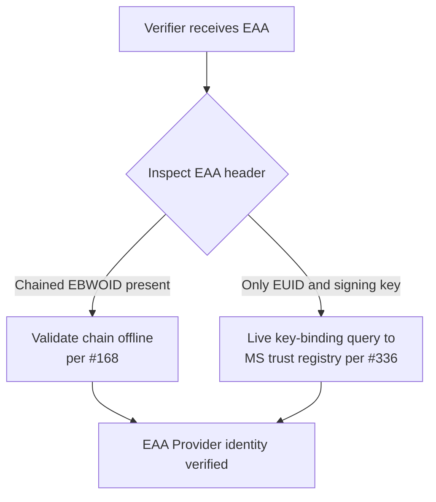

# Complementary hybrid trust model for EAA Provider identity verification

**Authors:**

- Werner Folkendt, Robert Bosch GmbH, Germany
- Niels Klomp, Sphereon, The Netherlands
- Lal Chandran, iGrant.io, Sweden
- Eelco Klaver, Credenco, The Netherlands
- George J Padayatti, iGrant.io, Sweden
- Florin Coptil, Robert Bosch GmbH, Germany

**Obsoletes:** N/A

**Related ADRs:** This ADR builds upon and reconciles [EAA Provider Identity Verification via Attestation Chaining](EAA-Chaining.md) ([#168](https://github.com/webuild-consortium/wp4-architecture/pull/168)) and [Verify EAA issuer key binding via an AuthZEN API call](eaa-key-binding-authzen.md) ([#336](https://github.com/webuild-consortium/wp4-architecture/pull/336)).

## Context

The European Business Wallet (EBW) ecosystem will consist of millions of legal entities acting as Electronic Attestation of Attributes (EAA) Providers. A Verifier that receives an EAA must be able to confirm that the key which signed it is bound to the legal person identified by the issuer's EBWOID, without every EAA Provider being listed in a national Trusted List. Architectural discussions in the WP4 Architecture Group have yielded two distinct models for this:

1. **The Chaining Model** ([#168](https://github.com/webuild-consortium/wp4-architecture/pull/168), [EAA Provider Identity Verification via Attestation Chaining](EAA-Chaining.md)). A decentralised approach that embeds a full, signed credential (the EBWOID and, where used, a delegated Issuing Attestation) into the EAA header. It provides a self-contained, offline-verifiable proof of the issuer's identity, which also makes it suitable for archival verification. Its primary trade-offs are a larger EAA payload and, for offline verification, a dependency on a reasonably recent cached copy of the Trusted List to validate the QTSP root.

2. **The Central Registry API Model** ([#336](https://github.com/webuild-consortium/wp4-architecture/pull/336), [Verify EAA issuer key binding via an AuthZEN API call](eaa-key-binding-authzen.md)). An approach that keeps the EAA lightweight, carrying only the issuer's identifier (EUID) and signing key in the header, and relies on the Verifier making a live query to a Member State trust registry endpoint to confirm the key binding. It minimises payload and answers key rotation and revocation from the current record, but depends on a trust registry endpoint directory and on historical (point-in-time) query capabilities that do not yet exist across Member States.

Neither model alone serves the entire spectrum of WE BUILD use cases. The Chaining Model may be inefficient for high-volume transactional checks where payload size matters. The Central Registry API Model breaks pure offline verification, introduces single points of failure at the registry endpoints, and cannot be made available within the WE BUILD MVP+ timeline. Forcing the ecosystem to choose one would create unnecessary limitations and block important scenarios.

The two models were compared in the focus group on EBWOID, mutual identification and attestation chaining over four meetings, using a decision table of the questions raised against each model. On 21 October 2026 the focus group voted unanimously for the complementary hybrid model recorded in this ADR.

## Decision

The Chaining Model (#168) and the Central Registry API Model (#336) are adopted as **complementary** mechanisms for EAA Provider identity verification, not as mutually exclusive alternatives. Both mechanisms MAY be used within the WE BUILD ecosystem, and the choice between them is made per attestation type.

1. **The EAA Provider selects the mechanism per use case.** The attestation rulebook for each EAA type SHALL state which trust mechanism applies. Where the rulebook selects the Chaining Model, the EAA header MUST carry the chained EBWOID (and delegated Issuing Attestation where used) as specified in #168. Where the rulebook selects the Central Registry API Model, the EAA header MUST carry the issuer's EUID and signing key as specified in #336.

2. **The Verifier supports both mechanisms.** A Verifier (an EBW in the Verifier role, or any other validator of EAAs) SHALL be able to handle both patterns. On receiving an EAA, it inspects the header:
   - If a full chained credential (such as the EBWOID) is present, it performs the offline, self-contained cryptographic validation of the chain as specified in #168.
   - If only the issuer's identifier and signing key are present, it performs the live key-binding query against the Member State trust registry endpoint as specified in #336, including authentication of that endpoint against a Trusted List or List of Trusted Entities, and handles a negative decision or an unreachable endpoint according to its trust policy.

3. **Neither ADR is obsoleted.** #168 and #336 each remain the normative specification of their respective mechanism. This ADR governs how they coexist. The requirement in #168 that every EAA carry the chained EBWOID is to be read as applying to EAAs whose rulebook selects the Chaining Model.

## Consequences

What becomes easier?

- **Use-case designers decide.** The choice of trust mechanism moves from a small architecture group to the business and legal experts designing each attestation. They can pick the model that best fits the security, compliance and operational constraints of their attestation type.
- **WE BUILD's grant objectives are met on both counts.** The consortium can fully "test out and give feedback" on both architectural patterns. It can pilot the short-term viable Chaining Model for the MVP+ iteration, while helping to "identify the regulatory, semantic, and technical gaps" that currently block the Central Registry API Model, such as the missing point-in-time query and the trust registry endpoint directory. This provides real-world feedback to the European Commission on both.
- **Short-term availability for WE BUILD.** Validating an X.509-based chain is already a prerequisite for any wallet that verifies the EBWOID itself. If Wallet Providers support attestation chaining, a compliant solution for the MVP+ pilots can be made available quickly.
- **Future-proofing and extensibility.** The chaining mechanism is inherently extensible. To integrate with an EBSI-based system, for example, a new EBWOID variant could be defined that chains a `did:ebsi` identifier. The same pattern allows other decentralised trust infrastructures to be integrated in parallel, without a forklift upgrade of the entire ecosystem.

What becomes more difficult?

- **Implementation effort for Wallet Providers.** Wallet Providers need to implement the verification logic for both models, and the header inspection that selects between them.
- **Rulebooks must be explicit.** Every attestation rulebook needs to state which mechanism applies. An EAA whose rulebook is silent on this cannot be verified consistently across Verifiers.

How do we address the risks introduced by this change?

- The additional effort for Wallet Providers is smaller than it appears. Chain validation per #168 is a mandatory prerequisite for any wallet that verifies the EBWOID, so that work is largely a sunk cost. The incremental work is the client-side logic for the #336 query, which #336 already specifies in terms of an existing OpenID AuthZEN profile.
- The conformance specifications for the Verifier role cover both patterns, so that header inspection and both resulting branches are tested rather than assumed.
- The Chaining Model is piloted in the MVP+ iteration, and the gaps found in the Central Registry API Model are fed back to the European Commission and recorded against #336.

## Advice

Once merged, this is our consortium’s decision. This does not mean all participants agree it is the best possible decision. In the decision making process, we have heard the following advice.

- yyyy-mm-dd, Name, Affiliation, Country: OK or summary of advice
