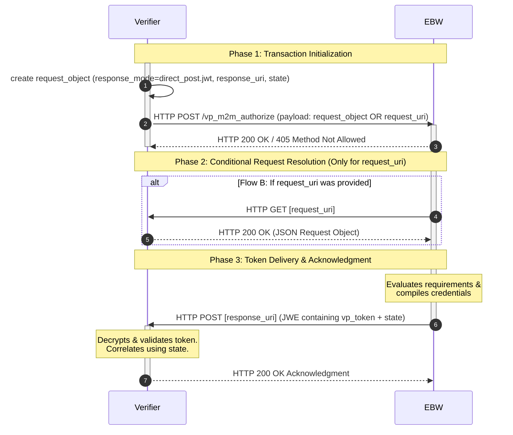

# WE BUILD - Conformance Specification:  Credential Presentation

Version 1.3
Date: 21 October 2026

**Revision history**

* Version 1.3 (21 October 2026): Introduction of the business wallet invocation mechanism; issue #249. The business wallet is a server-based application in the cloud. It requires a different invocation method compared to the personal wallet (EUDI wallet).<br/>The Business Wallet can also be used in an M2M scenario. Proposal for an M2M profile in Annex A.<br/>
Fix: `redirect_uri` in response only necessary in same-device scenario and not in cross-device scenario. (6.1.7 and 6.2.7)
* Version 1.2 (23 September 2026): Restricted the Verifier's `client_id` to the `x509_hash` Client Identifier Scheme, added `haip-vp://` and `eu-eaap://` as additional Wallet invocation schemes, and added the mandatory `verifier_info` parameter (RP Registrar-provided data and, where available, the WRPRC) to the Presentation Request Object, aligning with the finalised OpenID4VC HAIP 1.0 and ETSI TS 119 472-2, resolving issue [#341](https://github.com/webuild-consortium/wp4-architecture/issues/341). Also corrected and restructured Section 8.3 (Presentation Response Endpoint) to match OpenID4VP 1.0's actual `direct_post.jwt` semantics (encrypted `response` parameter, form-urlencoded transport, defined error codes, and the `redirect_uri` acknowledgement), and aligned Sections 6.1.6/6.1.7/6.2.6/6.2.7 accordingly.
* Version 1.1 (30 April 2026): Approved.

**Authors / Contributors**: WP4 Architecture

* Lal Chandran, iGrant.io, Sweden
* Sander Dijkhuis, Cleverbase, Netherlands
* George J Padayatti, iGrant.io, Sweden
* Nikolaos Triantafyllou, University of Aegean, Greece
* Malin Norlander, Bolagsverket, Sweden
* Martin Micuch, IDUnion, Germany
* Peter Kooi, Belastingdienst, Netherlands

## Table Of Contents

- [WE BUILD - Conformance Specification:  Credential Presentation](#we-build---conformance-specification--credential-presentation)
- [1. Introduction](#1-introduction)
- [2. Scope](#2-scope)
- [3. Normative Language](#3-normative-language)
- [4. Roles and Components](#4-roles-and-components)
- [5. Protocol Overview](#5-protocol-overview)
- [6. High-level Flows](#6-high-level-flows)
  - [6.1 Same-device Presentation Flow](#61-same-device-presentation-flow)
    - [6.1.1 Presentation Request Creation](#611-presentation-request-creation)
    - [6.1.2 WU Invocation](#612-wu-invocation)
    - [6.1.3 WU Validation](#613-wu-validation)
    - [6.1.4 Holder Consent](#614-holder-consent)
    - [6.1.5 Presentation Generation](#615-presentation-generation)
    - [6.1.6 Presentation Submission](#616-presentation-submission)
    - [6.1.7 Result Handling](#617-result-handling)
  - [6.2 Cross-device Presentation Flow](#62-cross-device-presentation-flow)
    - [6.2.1 Presentation Request Creation and Display](#621-presentation-request-creation-and-display)
    - [6.2.2 Wallet Unit Invocation via QR](#622-wallet-unit-invocation-via-qr)
    - [6.2.3 Wallet Validation](#623-wallet-validation)
    - [6.2.4 Holder Consent](#624-holder-consent)
    - [6.2.5 Presentation Generation](#625-presentation-generation)
    - [6.2.6 Presentation Submission](#626-presentation-submission)
    - [6.2.7 Result Handling](#627-result-handling)
  - [6.3 M2M Presentation Flow](#63-m2m-presentation-flow)
    - [6.3.1 Presentation Request Creation and Display](#631-presentation-request-creation-and-display)
    - [6.3.2 Wallet Unit Invocation via HTTP GET](#632-wallet-unit-invocation-via-http-get)
    - [6.3.3 Wallet Validation](#633-wallet-validation)
    - [6.3.4 Holder Consent](#634-holder-consent)
    - [6.3.5 Presentation Generation](#635-presentation-generation)
    - [6.3.6 Presentation Submission](#636-presentation-submission)
    - [6.3.7 Result Handling](#637-result-handling)
- [7. Normative Requirements](#7-normative-requirements)
  - [7.1 Wallet Unit Requirements](#71-wallet-unit-requirements)
  - [7.2 Verifier Requirements](#72-verifier-requirements)
- [8. Interface Definitions](#8-interface-definitions)
  - [8.1 Wallet Invocation Interface](#81-wallet-invocation-interface)
  - [8.2 Presentation Request Object Interface](#82-presentation-request-object-interface)
  - [8.3 Presentation Response Endpoint](#83-presentation-response-endpoint)
  - [8.4 Verifier Metadata Interface](#84-verifier-metadata-interface)
- [9. Conformance](#9-conformance)
- [References](#references)
- [Annex A: Synchronous Machine-to-Machine (M2M) OpenID4VP Profile](#annex-a-synchronous-machine-to-machine-m2m-openid4vp-profile)
  - [A.1 Functional & Architectural Overview](#a1-functional--architectural-overview)
  - [A.2 Process Walkthrough](#a2-process-walkthrough)
- [Annex B: Improvement Proposal: Preserving Standard OAuth for Issuance and Expanding Endpoints for Presentation](#annex-b-improvement-proposal-preserving-standard-oauth-for-issuance-and-expanding-endpoints-for-presentation)
  - [B.1 Introduction & Context](#b1-introduction--context)
  - [B.2 The Core Conflict: Endpoint Overloading](#b2-the-core-conflict-endpoint-overloading)
  - [B.3 Proposed Architecture: Dual Presentation Endpoints](#b3-proposed-architecture-dual-presentation-endpoints)
    - [B.3.1 The Issuance Side: Preserving the OAuth Standard](#b31-the-issuance-side-preserving-the-oauth-standard)
    - [B.3.2 The Presentation Side: Interactive Profile](#b32-the-presentation-side-interactive-profile)
    - [B.3.3 The Presentation Side: Machine-to-Machine Profile)](#b33-the-presentation-side-machine-to-machine-profile)
  - [B.4 Strategic Benefits for the LSP](#b4-strategic-benefits-for-the-lsp)

# 1. Introduction

This document defines the **WE BUILD Conformance Specification for Credential Presentation**, describing how Wallet Units (WU) and Verifiers interoperate using OpenID for Verifiable Presentations (OpenID4VP) 1.0 [1] in alignment with the OpenID4VC High Assurance Interoperability Profile (HAIP) 1.0 [2] and ETSI TS 119 472-2 [3], based on the decision recorded in WE BUILD [ADR Base Protocols](https://github.com/webuild-consortium/architecture/blob/main/adr/base-protocols.md).

It specifies a high‑assurance presentation profile for use within the WE BUILD ecosystem, covering:

* Presentation request and response flows
* Interfaces between Wallets and Verifiers
* Security, privacy and interoperability requirements
* Support for SD‑JWT‑VC credentials [4]
* Same‑device and cross‑device invocation patterns
* Support for both interactive and machine-to-machine (M2M) use

This document complements the WE BUILD Conformance Specification: Credential Issuance v1.0. The document is used to build the WE BUILD Interoperability Test Bed Plus (ITB+) [5].


# 2. Scope

This specification defines the conformance profile for high‑assurance credential presentation:

* Requirements for:
    * WUs that respond to presentation requests
    * Verifiers that initiate presentation requests
* Mandatory features:
    * OpenID4VP 1.0
    * HAIP 1.0 Section 5 requirements
    * JWT‑based Presentation Proof
    * SD‑JWT‑VC selective disclosure
    * Same‑device and cross‑device invocation
    * `openid4vp://` and `eu-eaap://` Wallet invocation (`haip-vp://` OPTIONAL) - EUDI wallet
    * `https://` Wallet invocation - EB wallet (EBW)
    * `x509_hash` Client Identifier Scheme for the Verifier's `client_id`
    * `verifier_info` parameter carrying RP Registrar-provided data and, where available, the WRPRC
    * Interactive and machine-to-machine (M2M)
 

**EUDI Wallet vs. server-based Business Wallet (EBW)**

*Invocation Differences*

The OpenID4VP specification indicates that both types of wallets are invoked via the front-channel (the end-user's browser). The distinction lies in how the verification request is technically handled:
*   EUDI Wallet (Deep-link): The browser activates a specific URI or deep-link (e.g., `eu-eaap://`). This triggers an immediate app-switch on the device, opening the local wallet application.
*   Server-based Business Wallet (API redirection): The browser remains within the web environment and forwards the presentation request (via HTTP redirection) to the cloud environment where the business wallet resides.

*M2M Interaction : Business Wallet only*

Requesting a verifiable presentation from the EUDI wallet is only possible if the holder is actively involved in the process. The holder interacts with an online service provided by the Verifier and is asked to use their EUDI wallet to make data available.<br/>
A fundamental principle of the Business Wallet is that it must be accessible at any time of day for providing verifiable presentations. This requires the Business Wallet to be capable of providing such verifiable presentations in an automated manner.<br/>
Therefore, in addition to interaction via the 'front-channel,' this conformity specification also defines the profile for requesting a verifiable presentation in an M2M context. This profile remains closely aligned with the architecture of OpenID4VP and the the building blocks and requirements defined within this document, eliminating the need to establish a separate infrastructure for M2M traffic.

# 3. Normative Language

The terms MUST, MUST NOT, SHOULD, SHOULD NOT, REQUIRED, RECOMMENDED, MAY and OPTIONAL are to be interpreted as described in RFC 2119.


# 4. Roles and Components

The role names defined in this specification (Wallet Unit, Holder, Verifier) are **OpenID4VP protocol roles**, not organisational or product roles. A single software product may implement more than one role at different times, and any given role may be fulfilled by software that also performs other functions (for example, a Business Wallet implementing both Holder and Verifier roles in different interactions). The requirements in this specification attach to the role, not to the product or organisation that implements it.

This specification uses the following roles:

* **Wallet Unit (WU):** A software component on the Holder's device acting on behalf of the Holder to obtain, store and present Verifiable Credentials.

> **NOTE_CSCP_OAUTH_CLIENT** In OpenID4VP terminology, the OAuth Client role is played by the Verifier (Relying Party), not by the Wallet Unit. References to `client_id` in this specification refer to the Verifier.
* **Holder:** The subject or representative of the subject who controls the Wallet Unit.
* **Verifier:** Entity requesting verifiable presentations, validating responses and making authorisation decisions.

# 5. Protocol Overview

The WE BUILD presentation profile is based on OpenID4VP with the following mandatory features defined by HAIP 1.0 [2] and ETSI TS 119 472-2 [3]:

* JWT-Secured Authorisation Request (JAR): All authorisation requests MUST be signed.
* Digital Credentials Query Language (DCQL): MUST be used for querying credentials.
* Client Identifier Scheme: The Verifier's `client_id` MUST use the `x509_hash` Client Identifier Prefix. Other prefixes (`x509_san_dns`, `verifier_attestation`, `did:web`, `did:jwk`) MUST NOT be used. (See **NOTE_CS02_02**)
* Wallet Invocation Schemes:
  *  EUDI Wallet : `openid4vp://` and `eu-eaap://` MUST be supported for non-API mediated invocation; `haip-vp://` MAY additionally be supported. (See **NOTE_CS02_03**)
  *  EBW : `https://` (server-based solution)
* Verifier Info: The Request Object MUST contain the `verifier_info` parameter, carrying RP Registrar-provided data and, where the Verifier holds one, its WRPRC (Wallet-Relying Party Registration Certificate). (See **NOTE_CS02_04**)
* Crypto Suites: Strict adherence to P-256 (secp256r1) with ES256 for signing.
* Holder Binding: Mandatory Key Binding JWT (KB-JWT) for SD-JWT VCs. (See **NOTE_CS02_01**)

High‑level steps:

1. Verifier creates Presentation Request, including `verifier_info`
2. Wallet is invoked via `openid4vp://`, `eu-eaap://`, or `haip-vp://` (same or cross device) or `https://` depending on the wallet-type.
3. Wallet validates Presentation Request
4. Holder consents
5. Wallet generates Presentation Proof + Disclosures
6. Wallet submits Presentation Response
7. Verifier validates and produces outcome

***NOTE_CS02_01: ISO18013-5 and  ISO18013-7 will be supported in subsequent versions based on use case requirements.***

***NOTE_CS02_02: The `x509_hash` Client Identifier Prefix identifies the Verifier by the base64url-encoded SHA-256 hash of its DER-encoded X.509 (access) certificate, as defined in OpenID4VP 1.0 [1] Section 5.9.3 and mandated by HAIP 1.0 [2] Section 5 ("the Verifier MUST use, and the Wallet MUST accept, the Client Identifier Prefix `x509_hash`").***

***NOTE_CS02_03: `eu-eaap://` is the custom URL scheme mandated for non-API mediated Wallet invocation by ETSI TS 119 472-2 [3], clause 6.4.1 (requirement OIDFVP-HAIP-REDIRECTS-03). `haip-vp://` is the OPTIONAL scheme defined by HAIP 1.0 [2] Section 5.1. WUs and Verifiers MUST support `openid4vp://` and `eu-eaap://`; `haip-vp://` support is OPTIONAL.***

***NOTE_CS02_04: `verifier_info` is a JSON array in the Request Object; one element (`format`: `registrar_dataset`) carries the RP Registrar-provided data, and, where the Verifier holds a WRPRC, a further element (`format`: `registration_cert`) carries the base64url-encoded WRPRC, per ETSI TS 119 472-2 [3] clause 6.3.2.2 (requirements OIDFVP-HAIP-COMMON-REQ-RO-01 to -16). See Section 8.2 for the structure.***


# 6. High-level Flows

This chapter defines the presentation flows required by WE BUILD.<br/>
Sections 6.1 and 6.2 relate to interactive use, section 6.3 to M2M use.

>[!NOTE]
In a fully server-based setup of the Business Wallet, it meets the definition of the "same-device" scenario.

## 6.1 Same-device Presentation Flow

### 6.1.1 Presentation Request Creation

The Verifier prepares a signed Presentation Request Object containing:

* Requested credential types
* Disclosure constraints
* Proof requirements (nonce, audience)
* Expiry (exp)
* Verifier identifier (client_id), using the `x509_hash` Client Identifier Scheme (**NOTE_CS02_02**)
* `verifier_info`, containing RP Registrar-provided data and, where available, the WRPRC (**NOTE_CS02_04**)

The request MUST be integrity‑protected (JAR‑style or equivalent).

### 6.1.2 WU Invocation

**EUDI wallet**

1. The Verifier redirects the user-agent to the WU using one of the supported invocation schemes (**NOTE_CS02_03**):

```
openid4vp://?request_uri=<URL>
eu-eaap://?request_uri=<URL>
haip-vp://?request_uri=<URL>   # OPTIONAL
```

2. Wallet retrieves or validates the signed Presentation Request Object.

**EBW**

1. The Verifier retrieves the `vp_authorization_endpoint` by using the lookup service at EDD ([12])

2. The Verifier sends the Presentation Request to the business wallet's `vp_authorization_endpoint` over the front-channel (redirects the user-agent).

3. Wallet retrieves or validates the signed Presentation Request Object.

>[!NOTE]
>For `vp_authorization_endpoint` see Annex B.

### 6.1.3 WU Validation

The WU MUST validate:

* Signature of Presentation Request
* Nonce freshness
* Audience matches Wallet
* Expiry validity
* Credential types and disclosure constraints
* Request integrity
* `client_id` uses the `x509_hash` Client Identifier Scheme (**NOTE_CS02_02**)
* `verifier_info` is present and contains RP Registrar-provided data; where a WRPRC is included, its validity

Unsigned or invalid requests, requests using a `client_id` scheme other than `x509_hash`, or requests missing `verifier_info` MUST be rejected.


### 6.1.4 Holder Consent

The WU MUST display:

* Verifier identity
* Requested credential types
* Requested attributes or claims
* Any selective disclosure details

Holder MUST explicitly consent.

### 6.1.5 Presentation Generation

Upon consent, the Wallet MUST generate:

* JWT‑based Presentation Proof
* Selective disclosures for SD‑JWT‑VC
* Binding between:
    * Presentation Proof and Wallet‑held key
    * Nonce
    * Audience


### 6.1.6 Presentation Submission

The Wallet MUST POST the Presentation Response to the Verifier’s Presentation Response Endpoint as defined in Section 8.3, encrypted per Response Mode `direct_post.jwt`, including:

* `vp_token` containing the JWT‑encoded Presentation
* `state`, echoing the Presentation Request's `state` parameter, where present

If the Wallet cannot produce a Presentation, it MUST instead submit a Presentation Error Submission as defined in Section 8.3.


### 6.1.7 Result Handling

The Verifier's Response Endpoint MUST acknowledge the submission as defined in Section 8.3 (HTTP `200 OK` with a `redirect_uri`). Verification of the Presentation (Section 7.2 item 5) and communication of its outcome to the Holder MUST occur via the Verifier's own user interface, reached either directly (cross-device, or session-fixation protection) or via the `redirect_uri` (same-device).

Wallet MUST correctly display any outcome communicated to it to the Holder.


## 6.2 Cross-device Presentation Flow


### 6.2.1 Presentation Request Creation and Display

Verifier constructs the Presentation Request Object (as in 6.1.1) and encodes it in a QR‑based `openid4vp://`, `eu-eaap://`, or `haip-vp://` URL (**NOTE_CS02_03**).


### 6.2.2 Wallet Unit Invocation via QR

Holder scans the QR code. WU retrieves the Presentation Request Object (embedded or via `request_uri`).

### 6.2.3 Wallet Validation

The same validation rules as 6.1.3 apply.

### 6.2.4 Holder Consent

Same as 6.1.4.


### 6.2.5 Presentation Generation

Same as 6.1.5.

### 6.2.6 Presentation Submission

WU delivers the Presentation Response as in 6.1.6, directly to the Verifier’s Presentation Response Endpoint (back channel).

### 6.2.7 Result Handling

Verifier's Response Endpoint acknowledges the submission and the outcome is communicated to the Holder as in 6.1.7; in a cross-device flow, it is not necessary to return a `redirect_uri` in the response to the WU.


## 6.3 M2M Presentation Flow

### 6.3.1 Presentation Request Creation and Display

Verifier constructs the Presentation Request Object (as in 6.1.1).


### 6.3.2 Wallet Unit Invocation via HTTP POST

**EBW**

1. The Verifier retrieves the `vp_m2m_authorization_endpoint` by using the lookup service at EDD ([12])
   If `vp_m2m_authorization_endpoint` is not present, the WU in question does not support M2M.

2. The Verifier sends the Presentation Request to the WU's `vp_m2m_authorization_endpoint` over the back-channel (HTTP POST).

3. The WU receives the request and determines whether it will be accepted or rejected.<br/>
If the WU rejects the request, it MUST respond with an error (HTTP status code 405). In such a scenario, the Verifier MAY proceed to 6.1.2, provided that the mode allows for this.

>[!NOTE]
>Acceptance of the request does not imply that the WU will automatically process it immediately. The Verifier must be aware of this when designing the solution.

>[!NOTE]
>For `vp_m2m_authorization_endpoint` see Annex B.


### 6.3.3 Wallet Validation

The same validation rules as 6.1.3 apply.

### 6.3.4 Holder Consent

The WU must determine whether it is permitted to share the requested attestations with the identified Verifier. 
The method for determining this is left to the WU (or its owner).

### 6.3.5 Presentation Generation

Same as 6.1.5.

### 6.3.6 Presentation Submission

WU delivers the Presentation Response as in 6.1.6, directly to the Verifier’s Presentation Response Endpoint (back channel).

### 6.3.7 Result Handling

Verifier's Response Endpoint acknowledges the submission and in response, the WU sends a reply to the initial Presentation Request.
The Verifier does not include a `redirect_uri` in the response.

# 7. Normative Requirements

The requirements in 7.1 and 7.2 attach to the OpenID4VP **roles** of Wallet Unit and Verifier respectively, as defined in chapter 4, not to the products or organisations implementing them. A relying party deploying a multi-role software product (for example a Business Wallet) to implement the Verifier role is a normal and supported pattern; the obligations in 7.2 apply to the Verifier role inside that product.

## 7.1 Wallet Unit Requirements

Wallets MUST:

1. Support HAIP‑compliant OpenID4VP.
2. Support the same‑device and cross‑device flows.
3. Support invocation via
   *. EUDI wallet : `openid4vp://` and `eu-eaap://` custom URL schemes; `haip-vp://` support is OPTIONAL.
   *. EBW : `https://` (server-based solution)
4. Validate signed Presentation Requests.
5. Validate that the Verifier's `client_id` uses the `x509_hash` Client Identifier Scheme.
6. Validate the `verifier_info` parameter, including the RP Registrar-provided data and, where present, the WRPRC.
7. Implement SD‑JWT‑VC selective disclosure.
8. Provide transparent Holder consent.
9. Generate JWT‑based Presentation Proof.
10. Bind Presentation Proof to Verifier’s nonce and audience.
11. Submit Presentation Responses to the Presentation Response Endpoint.
12. Disclose the `vp_authorization_endpoint` to which the presentation request can be sent, within EDD. (see Annex B)
13. Include the `state` parameter in the response to the initiating M2M Presentation request. 

Wallets MUST NOT:

* Accept unsigned or invalid Presentation Requests
* Accept requests whose `client_id` does not use the `x509_hash` Client Identifier Scheme
* Accept requests missing the `verifier_info` parameter
* Auto‑consent (interactive scenarios only)
* Add unsolicited claims

Business Wallets MAY:

* Support the M2M Presentation flow
* Disclose the `vp_m2m_authorization_endpoint` to which the M2M presentation request can be sent, within EDD. (see Annex B)<br/>
  If the business wallet supports the M2M Presentation flow, the `vp_m2m_authorization_endpoint` MUST be disclosed within EDD.
  
## 7.2 Verifier Requirements

Verifier obligations are listed below in two groups: per-transaction protocol behaviours, and deployment-time obligations. All items are normative MUSTs. The wallet's reciprocal duty for the same protocol step is referenced in parentheses.

**Verifiers MUST ensure, on every transaction, that:**

1. The Presentation Request Object is sealed (signed) by the Verifier. (Wallet reciprocal: 7.1.4)
2. Nonces and audience restrictions are generated and included. (Wallet reciprocal: 7.1.10)
3. The `client_id` uses the `x509_hash` Client Identifier Scheme. (Wallet reciprocal: 7.1.5)
4. `verifier_info` is included, carrying RP Registrar-provided data and, where the Verifier holds one, its WRPRC. (Wallet reciprocal: 7.1.6)
5. All Presentation Responses are validated, including:
    * Signature of Presentation Proof
    * Credential authenticity
    * SD‑JWT‑VC disclosure integrity
    * Holder binding
    * Nonce and audience binding
    * Satisfaction of request constraints

   (Wallet reciprocal: 7.1.7 to 7.1.10)

**Verifiers MUST, at deployment:**

6. Support
   * EUDI wallet : same‑device and cross‑device invocation, via `openid4vp://` and `eu-eaap://` (`haip-vp://` OPTIONAL). (Wallet reciprocal: 7.1.2, 7.1.3)
   * EBW : same‑device, via `https://`. (Wallet reciprocal: 7.1.2, 7.1.3)
8. Publish Verifier Metadata.
9. Provide a Presentation Response Endpoint. (Wallet reciprocal: 7.1.11)

Verifiers MUST NOT:

* Request unnecessary personal information
* Disable nonce or audience validation
* Use a `client_id` scheme other than `x509_hash`
* Omit `verifier_info` from the Presentation Request Object
* return `redirect_uri` in the response to the `verifiable_presentation` in cross_device mode.

Verifiers MAY:

* Support the M2M Presentation flow

# 8. Interface Definitions

Interfaces in this chapter follow the structure from the Issuance Conformance Specification.

## 8.1 Wallet Invocation Interface

**EUDI Wallet**

Direction: Verifier → Wallet \
Transport: `openid4vp://` or `eu-eaap://` scheme (WUs and Verifiers MUST support both); `haip-vp://` scheme (OPTIONAL) \
Usage: Same-device or cross-device scanning

Example:

```
openid4vp://?request_uri=https://verifier.example.org/request/123
eu-eaap://?request_uri=https://verifier.example.org/request/123
haip-vp://?request_uri=https://verifier.example.org/request/123
```

Wallet MUST retrieve or validate the Presentation Request Object.


**EBW (Interactive)**

*Interactive mode*
Direction: Verifier → Wallet \
Transport: `https://` \
Usage: Same-device

Example:

```
HTTP/1.1 302 Found
Location: https://example.business_wallet.com/vp_authorize?request_uri=...
```

**EBW - M2M Interaction**
Direction: Verifier → Wallet \
Method: POST \

Example:

```
POST /vp_m2m_authorize HTTP/1.1
Host: example.business_wallet.com
Accept: application/json

client_id=redirect_uri%3Ahttps%3A%2F%2Febw.verifier.org%2Fcb
&request=eyJrd...
```

**Response** If the method (POST) is not supported

```
HTTP/1.1 405 Method Not Allowed
Content-Type: application/json
Allow: GET, HEAD

{
  "error": "method_not_allowed",
}
```

Wallet MUST retrieve or validate the Presentation Request Object.


## 8.2 Presentation Request Object Interface

The Presentation Request Object MUST include:

* Verifier identifier (`client_id`), using the `x509_hash` Client Identifier Scheme
* `nonce`
* `audience`
* Requested credential types
* Disclosure constraints
* Proof requirements
* Expiry
* `verifier_info`: a JSON array containing:
    * One element with `format`: `registrar_dataset`, whose `data` is a non-empty JSON object carrying the RP Registrar-provided data (identifier, service description, Registrar API URI, intended-use identifier, purpose, and privacy policy URI, and optionally the registered credential/attribute set)
    * Where the Verifier holds a WRPRC, one further element with `format`: `registration_cert`, whose `data` is the base64url‑encoded WRPRC
* Signature (integrity-protected object)

Wallet Units reject incomplete or invalid request objects, including requests with an unsupported `client_id` scheme or a missing `verifier_info` parameter.

**Example**

```json
{
  "client_id": "x509_hash:2jgUeqU3JDzTHXPfZbXgKN99IJJ9AH6f2ggeq1cQ0-o",
  "nonce": "n-0S6_WzA2Mj",
  "aud": "https://wallet.example.org",
  "verifier_info": [
    {
      "format": "registrar_dataset",
      "data": {
        "identifier": "urn:webuild:rp:example-001",
        "srvDescription": [{ "lang": "en", "value": "Example Verifier Service" }],
        "registryURI": "https://registrar.example.org/api",
        "intendedUseIdentifier": "urn:webuild:intended-use:001",
        "purpose": [{ "lang": "en", "value": "Age verification" }],
        "policyURI": "https://verifier.example.org/privacy"
      }
    },
    {
      "format": "registration_cert",
      "data": "<base64url-encoded WRPRC>"
    }
  ]
}
```


## 8.3 Presentation Response Endpoint

Direction: Wallet → Verifier's `response_uri` \
Method: POST \
Response Mode: `direct_post.jwt` (encrypted Authorization Response; MUST, per HAIP requirement OIDFVP-HAIP-COMMON-RESP-01) \
Request Content-Type: `application/x-www-form-urlencoded`

**Successful Presentation Submission**

The Wallet MUST POST a single `response` parameter whose value is a compact-serialized JWE (OpenID4VP 1.0 [1] Section 8.3). The decrypted JWE payload MUST be a JSON object containing:

* `vp_token`: REQUIRED. The JWT‑encoded Presentation(s), keyed by DCQL credential query `id`
* `state`: REQUIRED if a `state` parameter was present in the Presentation Request; its value MUST match

**Decrypted payload example**

```json
{
  "vp_token": { "<credential_query_id>": ["<SD-JWT-VC presentation>"] },
  "state": "<echoed state, if present in the request>"
}
```
```
{ "vp_token": "<JWT-Presentation>", "format": "vc+sd-jwt" }
```

**Success Response Example**

_Same-device_

```
{
  "status": "ok",
  "redirect_uri": "https//ebw.verifier.org/cb",
}
```

_Cross-device_

```
{ "status": "ok" }
```

**Error Example**


```
{ "error": "invalid_presentation", "error_description": "Nonce invalid or expired" }
```

## 8.4 Verifier Metadata Interface

Verifiers MUST publish metadata containing:

* Presentation_endpoint
* Supported vp_formats
* Supported proof mechanisms
* JWK set for Request signing
* Required credential types

Wallet Units retrieves this metadata where available.


# 9. Conformance

An implementation **conforms to this specification as a Wallet Provider** if it:

1. Implements all Wallet requirements in Section 7.1
2. Implements all interfaces and behaviours in Section 8
3. Supports flows defined in Section 6
4. Supports SD‑JWT‑VC as defined for OpenID4VP

An implementation **conforms to this specification as an Issuer** if it:

1. Implements all Verifier requirements in Section 7.2
2. Publishes required Verifier Metadata
3. Implements the Presentation Request and Presentation Response Endpoint interfaces
4. Supports both same‑device and cross‑device flows

# References

[1]	OpenID Foundation (2025). OpenID for Verifiable Presentations 1.0. OpenID Foundation, 9 July. Available at: [https://openid.net/specs/openid-4-verifiable-presentations-1_0.html](https://openid.net/specs/openid-4-verifiable-presentations-1_0.html) (Accessed: 24 November 2025).

[2]	OpenID Foundation (2025) OpenID4VC High Assurance Interoperability Profile 1.0. OpenID Foundation, 29 December. Available at: [https://openid.net/specs/openid4vc-high-assurance-interoperability-profile-1_0.html](https://openid.net/specs/openid4vc-high-assurance-interoperability-profile-1_0.html) (Accessed: 23 September 2026).

[3]	ETSI (2026) ETSI TS 119 472-2 V1.2.1: Electronic Signatures and Trust Infrastructures (ESI); Profiles for Electronic Attestation of Attributes; Part 2: Profiles for EAA/PID Presentations to Relying Party. Available at: [https://www.etsi.org/deliver/etsi_ts/119400_119499/11947202/01.02.01_60/ts_11947202v010201p.pdf](https://www.etsi.org/deliver/etsi_ts/119400_119499/11947202/01.02.01_60/ts_11947202v010201p.pdf) (Accessed: 23 September 2026).

[4]	IETF (2025) SD‑JWT‑based Verifiable Credentials. IETF. Available at: https://www.ietf.org/archive/id/draft-ietf-oauth-sd-jwt-vc-09.html (Accessed: 24 November 2025).

[5]	WE BUILD (2025) Interoperability Test Bed - Reference Specification, 12 November, Available at: [https://github.com/webuild-consortium/wp4-interop-test-bed/blob/main/docs/reference-implementation-interoperability-test-bed.md](https://github.com/webuild-consortium/wp4-interop-test-bed/blob/main/docs/reference-implementation-interoperability-test-bed.md) (Accessed: 24 November 2025).

[6]	WE BUILD (2026) Conformance Specification CS-17: Directory & Discovery (EDD)

# Annex A: Synchronous Machine-to-Machine (M2M) OpenID4VP Profile

## A.1 Functional & Architectural Overview 

This annex defines the M2M profile for OpenID for Verifiable Presentations (OpenID4VP) within the WE BUILD ecosystem. Unlike the standard User-to-Machine (U2M) flow — which relies on asynchronous browser redirects, user agent interactions, and decoupled callback endpoints — this M2M profile is designed for automated, system-to-system transactions between the Verifier and the European Business Wallet (EBW). 

The Verifier initiates the transaction via an HTTP POST request, passing either the Request Object directly within the request body or a reference via a `request_uri`. This initial payload dictates the subsequent execution flow. The EBW immediately responds with an HTTP 200 OK to confirm acceptance, or an HTTP 405 Method Not Allowed if the method is invalid, eliminating any blocking wait state for the Verifier during initialization. 

The required modifications compared to the standard protocol have been strictly limited. This profile is explicitly designed to mirror the standard process flow described in OpenID4VP as closely as possible, keeping it fully aligned with the Conformance Specification of WE BUILD. As a result, the building blocks and standards prescribed within this Conformance Specification can be optimally reused within this M2M flow. Consequently, this M2M profile introduces zero new parameters or protocol extensions.


## A.2 Process Walkthrough



1. **Transaction Initialization (POST /authorize):** The Verifier fires an HTTP POST request to the M2M-specific authorization endpoint of the EBW, transmitting either the complete Request Object or a `request_uri` reference in the body. The request specifies a `response_mode` of `direct_post.jwt`, routing metadata (`response_uri`), and the unique `state` parameter. The EBW immediately evaluates the request and responds directly with an HTTP 200 OK acknowledgment (or HTTP 405 if applicable), allowing the Verifier to continue execution.
2. **Request Fetching (Conditional - GET /request):** This step is only executed if the Verifier provided a `request_uri` instead of the full Request Object in Step 1. The EBW opens a secondary, independent HTTP connection back to the Verifier's specified URI to fetch the actual Request Object.
3. **Request Delivery (Conditional):** If triggered by Step 2, the Verifier serves the Request Object over this secondary connection back to the EBW.
4. **Presentation Delivery (POST /vp_token):** The EBW evaluates the request requirements, retrieves the matching verifiable credentials, and compiles the `vp_token`. Applying the requested `direct_post.jwt` mode, the EBW packages the payload into a JWE envelope and executes an HTTP POST to the Verifier's `response_url`, including the matching `state` parameter in the payload.
5. **Payload Acknowledgment:** The Verifier receives and validates the incoming `vp_token` payload on its callback endpoint. It correlates the payload directly using the `state` parameter, completes the transaction state, and responds to the EBW's POST with a standard HTTP 200 OK acknowledgment.

| Step | Flow A: Direct Request Object | Flow B: Via `request_uri` |
| :--- | :--- | :--- |
| **1. Transaction Initialization** | Verifier sends **POST** with the full `request_object` in the body. EBW responds immediately with `200 OK` (or `405`). | Verifier sends **POST** with the `request_uri` reference in the body. EBW responds immediately with `200 OK` (or `405`). |
| **2. Request Fetching** | *Skipped* (EBW already possesses the data). | EBW opens a back-channel connection and executes a **GET** request to the provided `request_uri`. |
| **3. Request Delivery** | *Skipped* | Verifier serves the JSON-formatted `request_object` over this secondary connection back to the EBW. |
| **4. Presentation Delivery** | EBW compiles the `vp_token` and executes an HTTP **POST** to the Verifier's `response_uri`. | EBW compiles the `vp_token` and executes an HTTP **POST** to the Verifier's `response_uri`. |
| **5. Payload Acknowledgment** | Verifier validates the payload and returns an HTTP `200 OK` acknowledgment to the EBW. | Verifier validates the payload and returns an HTTP `200 OK` acknowledgment to the EBW. |


# Annex B: Improvement Proposal: Preserving Standard OAuth for Issuance and Expanding Endpoints for Presentation

## B.1 Introduction & Context
Due to its nature, the **Business Wallet** fulfills a dual role: it acts as an **Issuer** via OpenID4VCI and as a **Holder** via OpenID4VP. Because both protocols are built on top of the OAuth 2.0 and OIDC infrastructure, a routing conflict emerges in practice when attempting to funnel all traffic streams through identical endpoints. 

To resolve this conflict without disrupting proven OAuth infrastructures, this annex proposes a clean separation of concerns by introducing **two dedicated endpoint extensions for presentation**. This approach keeps the standard OAuth endpoints exclusively for issuance, while providing specific, logically named endpoints for both interactive and M2M presentation flows.

## B.2 The Core Conflict: Endpoint Overloading
When adhering to the interactive `grant_type=authorization_code` flow for credential issuance, the Business Wallet acts as a traditional OAuth Authorization Server. External applications that wish to receive a credential initiate the process by requesting an access token by calling the authorization endpoint of the wallet. 

The conflict arises as soon as that same Business Wallet is required to act as a holder to provide a verifiable presentation. Triggering presentation requests via the exact same authorization endpoint leads to severe routing complexity and potential security risks within off-the-shelf OAuth gateways, as the payload structures (such as the `presentation_definition`) differ fundamentally. To keep the architecture clean and maintainable, a complete separation of paths is required for each specific flow profile.

## B.3 Proposed Architecture: Dual Presentation Endpoints
This architecture decouples the Business Wallet endpoints based on both the active role (Issuer vs. Holder) and the interaction profile (Interactive vs. M2M), introducing two distinct presentation endpoints:

### B.3.1 The Issuance Side: Preserving the OAuth Standard
The credential issuance flow remains 100% compliant with the standard OAuth 2.0 specification.
* **Flow integrity:** Issuers initiate a standard authorization code flow via the default `authorization_endpoint`. 
* **Interoperability:** Authorization Servers and OAuth libraries process these requests out-of-the-box without requiring custom routing or parsing rules.

### B.3.2 The Presentation Side: Interactive Profile
For interactive/frontend presentation flows involving user or browser redirection, a dedicated endpoint named `vp_authorization_endpoint` is utilized.
* **Isolation of Concerns:** This endpoint isolates the complex front-channel OpenID4VP presentation logic (such as browser-based redirection and user consent) away from both the issuance and the M2M pipelines.
* **Conflict Avoidance:** It completely eliminates routing collisions that occur when browser-based issuance and browser-based presentation share the same path.

### B.3.3 The Presentation Side: Machine-to-Machine Profile
For M2M verifiable presentations, a dedicated endpoint named `vp_m2m_authorization_endpoint` is introduced.
* **Standard Alignment:** The internal logic of this endpoint stays as close as possible to the pure OpenID4VP presentation request specifications and respects the guidelines within the WE BUILD conformance specifications.
* **Path Separation:** By giving the M2M flow its own explicit endpoint, back-to-back automated traffic is fully isolated from the standard issuance pipeline, preventing gateway confusion.

## B.4 Strategic Benefits for the LSP
* **Optimal Alignment with WE BUILD:** The `vp_m2m_authorization_endpoint` is tailored to implement the OpenID4VP requirements exactly as envisioned within the WE BUILD conformance specifications, but without the downside of endpoint pollution.
* **Zero Breaking Changes for Issuance:** The standard issuance pipeline remains untouched and strictly compliant with standard OAuth 2.0 gateways.
* **Maximum Security & Auditability:** Explicit endpoints for explicit flows mean that security policies, firewalls, and rate-limiting can be configured highly granularly per endpoint.
