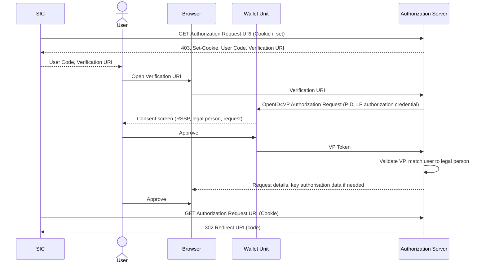
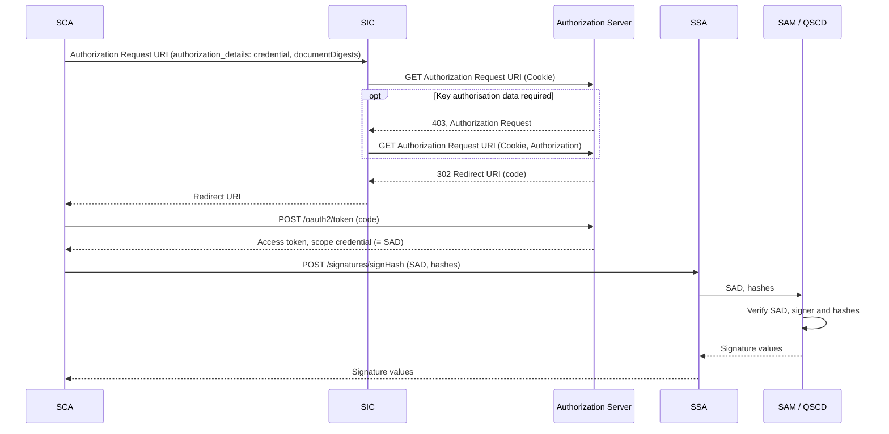
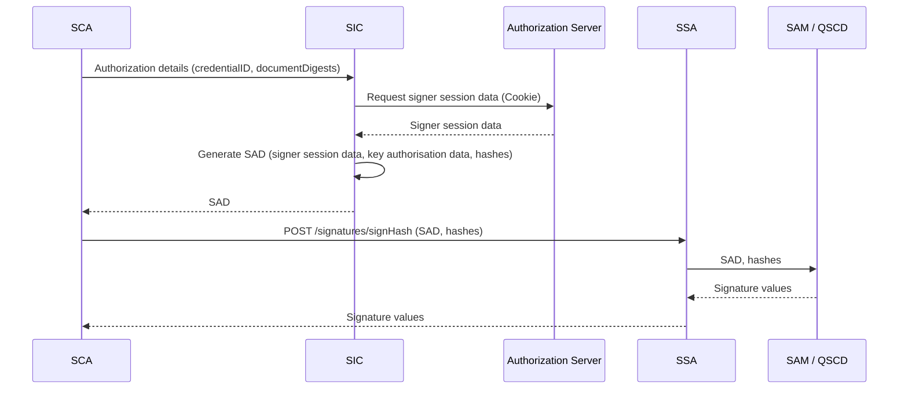

# WE BUILD - Conformance Specification: Remote Qualified Seals via CSC API

Version 0.2 / Draft  
Date: 18 November 2026

**Authors / Contributors**: WP4 Architecture

**Table of Contents**

- [WE BUILD - Conformance Specification: Remote Qualified Seals via CSC API](#we-build---conformance-specification-remote-qualified-seals-via-csc-api)
- [1. Introduction](#1-introduction)
- [2. Scope](#2-scope)
- [3. Normative Language, Terms and Abbreviations](#3-normative-language-terms-and-abbreviations)
- [4. Roles and Components](#4-roles-and-components)
- [5. Protocol Overview](#5-protocol-overview)
  - [5.1 Authentication Sessions](#51-authentication-sessions)
  - [5.2 Legal Person Control](#52-legal-person-control)
  - [5.3 Signature Activation Data](#53-signature-activation-data)
- [6. High-level Flows](#6-high-level-flows)
  - [6.1 Signer Session Establishment](#61-signer-session-establishment)
  - [6.2 Seal Creation with Intermediation](#62-seal-creation-with-intermediation)
  - [6.3 Seal Creation with SAD Generated by the SIC](#63-seal-creation-with-sad-generated-by-the-sic)
  - [6.4 Credential Creation and Deletion](#64-credential-creation-and-deletion)
  - [6.5 Signer Session End](#65-signer-session-end)
- [7. Normative Requirements](#7-normative-requirements)
  - [7.1 Wallet Unit Requirements](#71-wallet-unit-requirements)
  - [7.2 Signer Interaction Component Requirements](#72-signer-interaction-component-requirements)
  - [7.3 Seal Creation Application Requirements](#73-seal-creation-application-requirements)
  - [7.4 Authorization Server Requirements](#74-authorization-server-requirements)
  - [7.5 Remote Signing Service Provider Requirements](#75-remote-signing-service-provider-requirements)
- [8. Interface Definitions](#8-interface-definitions)
  - [8.1 Credential Authorization Request](#81-credential-authorization-request)
  - [8.2 Token Response as SAD](#82-token-response-as-sad)
  - [8.3 Signature Creation](#83-signature-creation)
  - [8.4 Credential Creation and Deletion](#84-credential-creation-and-deletion)
- [9. Conformance](#9-conformance)
- [References](#references)

# 1. Introduction

This specification defines how a legal person creates qualified electronic seals with a key held by a Remote Signing Service Provider (RSSP), using the CSC API v2.2 [1] at Sole Control Assurance Level 2 (SCAL2). The RSSP operates as a qualified trust service for the management of remote qualified seal creation devices under eIDAS [2] and Implementing Regulation (EU) 2025/1567 [7].

Seals are typically created unattended and at scale, for example on every outgoing invoice. For a legal person, ETSI TS 119 431-1 [11] (SIG-A.6-07A) reads the "sole control" requirement of EN 419 241-1 [9] as "control". This specification applies that reading.

The architecture follows the CSC reference note "Remote unattended QESeal creation at SCAL2" [12]. A natural person identified in association with the legal person authenticates once with their Wallet Unit (WU). This opens a long-lived signer session between a Signer Interaction Component (SIC) under the legal person's control and the RSSP's Authorization Server (AS). Within that session, the Seal Creation Application (SCA) obtains Signature Activation Data (SAD) per batch of hashes and calls `signatures/signHash`. The Signature Activation Module (SAM) of the RSSP verifies the SAD before it activates the key.

# 2. Scope

In scope:

- Signer session establishment, with user authentication by a WU over OpenID4VP [4]
- Seal creation with SAD issued by the AS (intermediation, Section 6.2)
- Seal creation with SAD generated by the SIC (Section 6.3)
- Seal credential creation and deletion through the same authorization mechanism (Section 6.4)
- The CSC API v2.2 interfaces used by these flows

Out of scope:

- `auth/mode` `explicit` with `authData` supplied by the SCA: the SCA would then control activation instead of the signer
- PIN or OTP as the only authentication factor, and `authMode: implicit`
- mTLS client certificates as signer authentication
- Keys held in a Wallet Unit (see CS-03 [6])
- Identity proofing of the legal person and certificate issuance by the CA
- AdES formats and profiles (see ETSI EN 319 102-1 [10])
- QTSP qualification procedures

# 3. Normative Language, Terms and Abbreviations

The keywords **MUST**, **MUST NOT**, **REQUIRED**, **SHALL**, **SHOULD**, **SHOULD NOT**, **RECOMMENDED**, **MAY**, and **OPTIONAL** are to be interpreted as described in RFC 2119 [3].

| Term | Meaning |
|---|---|
| AS | Authorization Server: OAuth 2.0 [13] authorization server of the RSSP |
| CSC | Cloud Signature Consortium |
| DTBS/R | Data To Be Signed (Representation): here, the document hashes |
| Key authorisation data | Additional authentication data the legal person links to the seal credential, such as a password (EN 419 221-5 [8] authorisation data) |
| QSCD | Qualified Signature/Seal Creation Device |
| QSealC | Qualified certificate for electronic seals |
| RSSP | Remote Signing Service Provider: QTSP managing the remote QSCD |
| SAD | Signature Activation Data, as defined in EN 419 241-1 [9] |
| SAM | Signature Activation Module (EN 419 241-2 [14]) |
| SAP | Signature Activation Protocol between the SIC or SSA and the SAM |
| SCA | Seal Creation Application: OAuth client that calls the CSC API |
| SCAL2 | Sole Control Assurance Level 2 (EN 419 241-1 [9]) |
| SIC | Signer Interaction Component: user agent under the legal person's control |
| Signer session | Authenticated session between the SIC and the AS |
| SSA | Server Signing Application: the RSSP component exposing the CSC API |
| User | Natural person identified in association with the legal person |
| WU | Wallet Unit |

# 4. Roles and Components

- Legal person: the signer and subject of the QSealC. In OAuth terms, the resource owner.
- Legal representative: a natural person who represents the legal person. Registers the legal person with the RSSP and names the users.
- User: a natural person identified in association with the legal person. This can be a legal representative, or another person they assign, for example under a power of attorney. The user authenticates with their WU, approves authorization requests and sets the key authorisation data.
- Wallet Unit (WU): the user's EUDI Wallet. Presents the user's PID, and an authorization credential for the legal person where one exists, to the AS.
- Signer Interaction Component (SIC): the user agent. A component of a system operated by the legal person; headless for unattended sealing. Holds the signer session and, for Section 6.3, generates SAD.
- Seal Creation Application (SCA): the OAuth client. Prepares the hashes, requests authorization through the SIC, calls the CSC API and builds the seal. The SCA and SIC MAY run in the same system; their roles stay separate in this specification.
- Authorization Server (AS): authenticates the user through the WU, matches the user to the legal person, maintains the signer session, and issues access tokens and SAD. Runs inside the RSSP's protected environment or that of a delegate under contract.
- Remote Signing Service Provider (RSSP): a QTSP managing the remote QSCD. Consists of:
  - SSA: exposes the CSC API v2.2 [1] as resource server.
  - SAM: verifies the SAD and activates the key for the hashes bound to it.
  - QSCD: holds the seal key and creates the signature value.

# 5. Protocol Overview

## 5.1 Authentication Sessions

| Session | Parties | Authenticates | SCAL2 relevance |
|---|---|---|---|
| Client session | SCA and AS/SSA | The SCA as OAuth client | None |
| Signer session | SIC and AS | The legal person's system, based on the user's WU authentication | Basis for SAD issuance |
| Signature session | SIC or SSA and SAM | The signer, by SAD | Control point for key activation |

The signer session MAY be long-lived. Its lifetime and re-authentication rules are agreed between the legal person and the RSSP.

## 5.2 Legal Person Control

| EN 419 241-1 [9] | How this specification meets it |
|---|---|
| SRA_SAP.2.2 | The SIC is under the legal person's control |
| SRA_SAP.2.3 | The user authenticates with a WU at LoA high; the legal person MAY add key authorisation data from the SIC environment |
| SRA_SAP.2.4 | No valid SAD exists without the AS and a valid signer session |
| SRA_SAP.2.6 | The AS requires SIC interaction for every SAD |
| SRA_SAP.2.7 (control, per TS 119 431-1 [11] SIG-A.6-07A) | The user holds the WU; the legal person holds the key authorisation data |

## 5.3 Signature Activation Data

The SAD MUST bind:

- the hashes to be sealed (`documentDigests`)
- the authenticated signer (user identity from the signer session, and key authorisation data where configured)
- the seal credential (`credentialID`)

The SAD MUST be single-use and short-lived. Its internal format is defined by the RSSP and its SAM. This specification does not define it.

# 6. High-level Flows

## 6.1 Signer Session Establishment

The SIC requests authorization at the AS. Without a valid signer session, the AS starts user interaction with the OAuth device authorization grant [15].



1. The AS answers a request without a sufficient signer session with HTTP 403, `Set-Cookie`, `WWW-Authenticate` and a body containing the User Code and Verification URI.
2. The user opens the Verification URI. The AS acts as OpenID4VP Verifier per CS-02 [5], same-device or cross-device.
3. The WU presents the PID and, where available, a credential showing the user's authorization for the legal person.
4. The AS checks that the user is registered for the legal person. If not, it returns `access_denied`.
5. The user approves the request. The SIC retries with its cookie and receives the redirect.

> **NOTE_QSEAL_01** The interface between SIC and AS (cookies, 403/302 negotiation) is RSSP-specific. The RSSP documents it for the legal person. This matches Sections 3.1 and 4.1.1 of RFC 6749 [13]: the AS may rely on session cookies and may establish approval by other means.

## 6.2 Seal Creation with Intermediation

The AS issues the SAD as the token response, using the CSC `oauth2` credential mode (CSC API v2.2 [1] Section 8.2).



1. The SCA builds an authorization request with `authorization_details` (RFC 9396 [16]) of type `https://cloudsignatureconsortium.org/2025/credential` (Section 8.1) and hands the URI to the SIC.
2. The SIC presents the URI with its signer session cookie. If the credential requires key authorisation data, the SIC supplies it from its environment. If the signer session is missing, Section 6.1 applies first.
3. The SCA exchanges the code for an access token with `credential` scope. This token is the SAD.
4. The SCA calls `signatures/signHash` with the same hashes. The SAM verifies the SAD and activates the key for exactly those hashes.

## 6.3 Seal Creation with SAD Generated by the SIC

The SIC generates the SAD itself, as SAP client. The key authorisation data then never reach the AS at use.



The endpoint for signer session data and the SAD format are RSSP-specific. This variant moves security requirements from the AS to the SIC. The RSSP and the legal person agree on it per deployment.

## 6.4 Credential Creation and Deletion

Credential creation and deletion use the authorization of Section 6.2, with `authorization_details` of type `credential-creation` or `credential-deletion` (Section 8.4) instead of `credential`.

1. The SCA, or a management application of the legal person, requests `credential-creation` authorization through the SIC, with `acr_values` for LoA high.
2. The user authenticates with the WU (Section 6.1) and approves.
3. The user sets the key authorisation data. The channel ends in the SAM, so the RSSP cannot learn the value.
4. The client calls `credentials/create` (CSC API v2.2 [1] Section 11.4). The RSSP generates the key in the QSCD and has the QSealC issued.
5. For deletion, the client calls `credentials/delete` (Section 11.5) with a `credential-deletion` token. The RSSP revokes the QSealC and destroys the key.

## 6.5 Signer Session End

The AS MUST end the signer session when:

- the agreed lifetime expires
- the user loses authority for the legal person, or the legal representative who named the user loses authority
- the legal person reports compromise of the SIC, the session cookie or the key authorisation data
- the legal person requests it

After the session ends, Section 6.1 applies again.

# 7. Normative Requirements

## 7.1 Wallet Unit Requirements

Wallet Units MUST:

1. Conform to CS-02 [5] as a Wallet Unit when responding to the AS.
2. Present the PID, and an authorization credential for the legal person where requested and available.
3. Show the RSSP, the legal person and the requested authorization on the consent screen.

## 7.2 Signer Interaction Component Requirements

The SIC MUST:

1. Run in an environment under the legal person's control.
2. Hold the signer session cookie and key authorisation data so that the SCA cannot read them.
3. Pass the User Code and Verification URI to the user when the AS asks for user interaction.
4. For Section 6.3: generate a SAD that meets Section 5.3, per the RSSP's SAP specification.

## 7.3 Seal Creation Application Requirements

The SCA MUST:

1. Request signature activation with `authorization_details` of type `https://cloudsignatureconsortium.org/2025/credential`, including `credentialID`, `numSignatures`, `hashAlgorithmOID` and `documentDigests`.
2. Request authorization through the SIC and never collect signer authentication data or key authorisation data itself.
3. Call `signatures/signHash` with the same hashes as in `documentDigests`.
4. Use each SAD for one `signatures/signHash` call only.

The SCA MUST NOT call `credentials/authorize` with `authData`.

## 7.4 Authorization Server Requirements

The AS MUST:

1. Act as OpenID4VP Verifier per CS-02 [5] Section 7.2 when authenticating the user.
2. Validate the VP, including credential status, and accept PIDs from eIDAS-compliant PID Providers.
3. Issue SAD or signer session data only to a SIC with a valid signer session for a user registered for the legal person and credential.
4. Bind the SAD to the approved `documentDigests`, the user identity and the `credentialID`, and protect it for the SAM.
5. Issue SAD that is single-use and short-lived.
6. End signer sessions per Section 6.5.
7. Publish the credential types it accepts as proof of the user's authorization for a legal person.

The AS MUST NOT authenticate the signer session with mTLS client certificates alone.

## 7.5 Remote Signing Service Provider Requirements

The RSSP MUST:

1. Expose CSC API v2.2 [1] `info`, `credentials/list`, `credentials/info`, `credentials/create`, `credentials/delete` and `signatures/signHash`.
2. Report `auth/mode` `oauth2code` and `SCAL` `2` in `credentials/info` for seal credentials.
3. Accept a `credential` scope access token as SAD at `signatures/signHash`, in the `Authorization` header or the `SAD` parameter.
4. Pass SAD and hashes to the SAM. The SAM MUST verify the SAD, the signer and that the hashes equal the bound digests before it activates the key.
5. Block the credential after a configured number of consecutive SAD verification failures.
6. Register the users of each legal person, as named by a legal representative, and keep this register current.
7. Document the SIC to AS interface and, if offered, the SAD format for Section 6.3.

# 8. Interface Definitions

`info`, `credentials/list`, `credentials/info` and service authorization follow CSC API v2.2 [1] unchanged.

## 8.1 Credential Authorization Request

*Direction:* SCA → SIC → AS  
*Method:* GET `/oauth2/authorize` (CSC API v2.2 [1] Section 8.2.2)

Example `authorization_details` (illustrative only):

```json
[
  {
    "type": "https://cloudsignatureconsortium.org/2025/credential",
    "credentialID": "seal-credential-001",
    "numSignatures": 2,
    "hashAlgorithmOID": "2.16.840.1.101.3.4.2.1",
    "documentDigests": [
      { "hash": "sTOgwOm+474gFj0q0x1iSNspKqbcse4IeiqlDg/HWuI=", "label": "Invoice 2026-0001" },
      { "hash": "HZQzZmMAIWekfGH0/ZKW1nsdt0xg3H6bZYztgsMTLw0=", "label": "Invoice 2026-0002" }
    ]
  }
]
```

## 8.2 Token Response as SAD

*Direction:* SCA → AS  
*Method:* POST `/oauth2/token`, `grant_type=authorization_code`

The response contains an access token with `credential` scope and the approved `authorization_details`. The token content is RSSP-specific.

```json
{
  "access_token": "<credential-scope token>",
  "token_type": "Bearer",
  "expires_in": 300,
  "authorization_details": [ "<as requested>" ]
}
```

## 8.3 Signature Creation

*Direction:* SCA → SSA  
*Method:* POST `/signatures/signHash` (CSC API v2.2 [1] Section 11.13)

```text
POST /csc/v2/signatures/signHash HTTP/1.1
Host: rssp.example.com
Authorization: Bearer <credential-scope token>
Content-Type: application/json

{
  "credentialID": "seal-credential-001",
  "hashes": ["sTOgwOm+474gFj0q0x1iSNspKqbcse4IeiqlDg/HWuI=", "HZQzZmMAIWekfGH0/ZKW1nsdt0xg3H6bZYztgsMTLw0="],
  "hashAlgorithmOID": "2.16.840.1.101.3.4.2.1",
  "signAlgo": "1.2.840.10045.4.3.2"
}
```

For Section 6.3, the SCA passes the SIC-generated SAD in the `SAD` parameter and a `service` scope token in the `Authorization` header.

## 8.4 Credential Creation and Deletion

*Direction:* SCA → SIC → AS, then SCA → SSA  
*Methods:* GET `/oauth2/authorize`, POST `/credentials/create` (Section 11.4), POST `/credentials/delete` (Section 11.5)

Example `authorization_details` for creation (illustrative only):

```json
[
  {
    "type": "https://cloudsignatureconsortium.org/2025/credential-creation",
    "credentialCreationRequest": { "subject": "<legal person subject>" }
  }
]
```

Deletion uses type `https://cloudsignatureconsortium.org/2025/credential-deletion` with the `credentialID`.

# 9. Conformance

An implementation conforms as:

- Wallet Unit: if it meets Section 7.1.
- SIC: if it meets Section 7.2 and supports Section 6.1 and at least one of Sections 6.2 and 6.3.
- SCA: if it meets Section 7.3 and supports Sections 6.2 and 6.3.
- Authorization Server: if it meets Section 7.4 and supports Sections 6.1, 6.2 and 6.4.
- RSSP: if it meets Section 7.5 and supports Sections 6.2 and 6.4. Support for Section 6.3 is OPTIONAL.

Additional WE BUILD profiles MAY add requirements. They MUST NOT weaken this specification.

# References

[1] Cloud Signature Consortium (2025). CSC API for Remote Signature Creation, version 2.2. Available at: https://cloudsignatureconsortium.org/wp-content/uploads/2025/11/csc-api.pdf (Accessed: 18 November 2026).

[2] European Parliament and Council (2024). Regulation (EU) 2024/1183 (eIDAS2), amending Regulation (EU) No 910/2014. Official Journal of the European Union.

[3] IETF (1997). Key words for use in RFCs to Indicate Requirement Levels, RFC 2119. Available at: https://datatracker.ietf.org/doc/html/rfc2119.

[4] OpenID Foundation (2025). OpenID for Verifiable Presentations 1.0. Available at: https://openid.net/specs/openid-4-verifiable-presentations-1_0.html.

[5] WE BUILD (2025). Conformance Specification: Credential Presentation, version 1.0. Available at: https://github.com/webuild-consortium/wp4-architecture/blob/main/conformance-specs/cs-02-credential-presentation.md.

[6] WE BUILD (2026). Conformance Specification: Remote Qualified Signing with Wallet Units. Available at: https://github.com/webuild-consortium/wp4-architecture/blob/main/conformance-specs/cs-03-remote-signing-with-wallet-units.md.

[7] European Commission (2025). Commission Implementing Regulation (EU) 2025/1567 as regards the management of remote qualified electronic signature creation devices and of remote qualified electronic seal creation devices as qualified trust services. Official Journal of the European Union, L series, 30 July 2025.

[8] CEN EN 419 221-5. Protection Profiles for TSP Cryptographic Modules, Part 5: Cryptographic Module for Trust Services.

[9] CEN EN 419 241-1:2018. Trustworthy Systems Supporting Server Signing, Part 1: General System Security Requirements.

[10] ETSI EN 319 102-1. Electronic Signatures and Trust Infrastructures (ESI); Procedures for Creation and Validation of AdES Digital Signatures; Part 1: Creation and Validation.

[11] ETSI TS 119 431-1 V1.3.1. Electronic Signatures and Trust Infrastructures (ESI); Policy and security requirements for trust service providers; Part 1: TSP service components operating a remote QSCD / SCDev.

[12] S. Dijkhuis (2026). Remote unattended QESeal creation at SCAL2, request for comments within the Cloud Signature Consortium. Available at: https://github.com/Cloud-Signature-Consortium/csc-api/pull/290.

[13] IETF (2012). The OAuth 2.0 Authorization Framework, RFC 6749. Available at: https://datatracker.ietf.org/doc/html/rfc6749.

[14] CEN EN 419 241-2:2019. Trustworthy Systems Supporting Server Signing, Part 2: Protection Profile for QSCD for Server Signing.

[15] IETF (2019). OAuth 2.0 Device Authorization Grant, RFC 8628. Available at: https://datatracker.ietf.org/doc/html/rfc8628.

[16] IETF (2023). OAuth 2.0 Rich Authorization Requests, RFC 9396. Available at: https://datatracker.ietf.org/doc/html/rfc9396.
