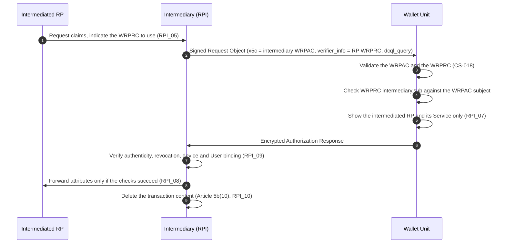

# WE BUILD - Pre-flight Conformance Specification CS-013: Relying Party Intermediaries

Version 0.3 / Pre-flight Draft
Date: 16 October 2026

**Revision history**

* Version 0.3 (16 October 2026): Reduced to the intermediary delta on top of CS-018 (Baseline Trust Validation). Common WRPAC and WRPRC validation moved to CS-018. Aligned `verifier_info` with OpenID4VP 1.0 and ETSI TS 119 472-2, replaced `presentation_definition` with `dcql_query`, added the RPI_08 and RPI_09 obligations, aligned the WRPRC `intermediary` member with ETSI TS 119 475 V1.2.1 (WE BUILD uses `intermediary.sub`, not `act.sub`), and moved the registration procedure to CS-006.
* Version 0.2 (23 September 2026): Review comments applied.
* Version 0.1 (15 September 2026): First draft.

**Authors / Contributors**: WP4 Architecture / Trust Infrastructure Group

* Sarah Amandusson, Digg
* Lal Chandran, iGrant.io
* Nikos Triantafyllou, University of the Aegean
* George J Padayatti, iGrant.io
* Leif Johansson, SIROS
* Martin Micuch, IDUnion
* Michal Stava, Aricoma
* Filip Hladký, Bankid CZ
* Stefan Kauhaus, Visa
* Angel Palomares
* Teemu Varpanen, ReceiptHero
* Miriam Weber, Procivis

Table Of Contents

- [1. Introduction](#1-introduction)
- [2. Scope](#2-scope)
- [3. Normative Language](#3-normative-language)
- [4. Roles and Components](#4-roles-and-components)
- [5. Protocol Overview](#5-protocol-overview)
  - [5.1 What Changes from the Direct Case](#51-what-changes-from-the-direct-case)
- [6. High-level Flows](#6-high-level-flows)
  - [6.1 Registration Relationships](#61-registration-relationships)
  - [6.2 Intermediated Presentation](#62-intermediated-presentation)
- [7. Normative Requirements](#7-normative-requirements)
  - [7.1 Relying Party Intermediary Requirements](#71-relying-party-intermediary-requirements)
  - [7.2 Wallet Unit Requirements](#72-wallet-unit-requirements)
  - [7.3 Intermediated Relying Party Requirements](#73-intermediated-relying-party-requirements)
  - [7.4 Registrar and Certificate Provider Requirements](#74-registrar-and-certificate-provider-requirements)
  - [7.5 Unhappy Paths](#75-unhappy-paths)
- [8. Interface Definitions](#8-interface-definitions)
  - [8.1 Authorization Request](#81-authorization-request)
  - [8.2 Intermediary Member of the WRPRC](#82-intermediary-member-of-the-wrprc)
  - [8.3 Association in the WRPAC](#83-association-in-the-wrpac)
- [9. Open Topics for Testing Feedback](#9-open-topics-for-testing-feedback)
- [10. Conformance](#10-conformance)
- [References](#references)

# 1. Introduction

This document is a **pre-flight conformance specification** as defined in [5]. It is intended to enable early testing of presentations that a Relying Party makes through a Relying Party Intermediary (RPI). The goal is to gather implementation experience and testing feedback that will inform a future full conformance specification.

An intermediary sits between a Relying Party and the Wallet Unit and does the technical work of presentation requests for the Relying Party. To take part in the EUDI Wallet ecosystem, a Relying Party must implement OpenID4VP, sign requests, hold and renew the certificates that authenticate it to Wallet Units, validate the returned credentials (signature, revocation status, trust chain to the issuer trusted lists), and stay conformant as the specifications change. An intermediary implements this once and offers it as a service, so that a Relying Party can request and receive verified attributes through a simpler interface instead of operating a full verifier itself.

Under Article 5b(10) of Regulation (EU) No 910/2014 as amended [11], an intermediary acting on behalf of a Relying Party is deemed to be a Relying Party and does not store data about the content of the transaction.

This specification defines **only what is different** when a Relying Party uses an intermediary. The validation of access certificates (WRPAC) and registration certificates (WRPRC) that applies to every presentation is defined in **CS-018 (Baseline Trust Validation)** [1]. The presentation protocol is defined in **CS-002 (Credential Presentation)** [2] and **CS-007 (Digital Credentials API)** [3]. The issuance of WRPACs and WRPRCs is defined in **CS-006** [4]. The informative base of this specification is the WP4 Trust Group technical report on intermediaries [6], the intermediary use case [7] and Appendix C of the Blueprint [8].

# 2. Scope

This specification defines the conformance expectations for intermediated presentations in the WE BUILD ecosystem.

* **In scope:**
  * The registration relationships between an intermediary, an intermediated Relying Party and the Registrar, to the extent that the Wallet Unit depends on them
  * The content of an intermediated presentation request: the intermediary's WRPAC and the intermediated Relying Party's WRPRC
  * The checks that the Wallet Unit performs in addition to, or instead of, those of CS-018 [1]
  * What the Wallet Unit shows to the User in an intermediated presentation
  * The verification, forwarding and deletion obligations of the intermediary (ARF RPI_08 to RPI_10)

* **Out of scope:**
  * WRPAC and WRPRC validation for the direct case, covered by CS-018 [1]
  * The procedure to register and to obtain WRPACs and WRPRCs, covered by CS-006 [4]
  * The interface between an intermediated Relying Party and its intermediary (implementation-specific)
  * Intermediated proximity presentations (see §9)
  * Wallet-to-wallet discovery, covered by CS-017

# 3. Normative Language

The keywords **MUST**, **MUST NOT**, **REQUIRED**, **SHALL**, **SHALL NOT**, **SHOULD**, **SHOULD NOT**, **RECOMMENDED**, **MAY**, and **OPTIONAL** are to be interpreted as described in [RFC 2119](https://datatracker.ietf.org/doc/html/rfc2119).

> **Note:** As a pre-flight specification, the normative requirements herein are preliminary and subject to revision based on testing feedback.

# 4. Roles and Components

| Role | Description |
|------|-------------|
| **Relying Party Intermediary (RPI)** | A Relying Party that is registered as an intermediary. It sends presentation requests to Wallet Units on behalf of one or more intermediated Relying Parties, verifies the presented attributes, forwards them, and deletes them. |
| **Intermediated Relying Party (RP)** | The Relying Party that relies on the presented attributes to deliver its service. It is identified to the User by its WRPRC. |
| **Wallet Unit (WU)** | Validates the request, shows the intermediated Relying Party to the User, and presents the attributes. |
| **Registrar** | Registers Relying Parties and intermediaries and records the relationship between them. In the European Union this is the Member State Registrar; in WE BUILD it is the registrar defined for the pilot. |
| **Access Certificate Authority** | Issues WRPACs, including the WRPAC of the intermediary. |
| **Provider of registration certificates** | Issues the WRPRC of the intermediated Relying Party, including the `intermediary` member. |

# 5. Protocol Overview

An intermediated presentation splits the identity of the requester in two:

1. **The intermediary authenticates the channel.** The intermediary signs the request with the key of its own WRPAC, and the `client_id` is the `x509_hash` of that WRPAC. The intermediated Relying Party does not present a WRPAC.
2. **The intermediated Relying Party is identified by its WRPRC.** The request carries the WRPRC of the intermediated Relying Party by value. The WRPRC names the Relying Party, lists what it is registered to request, and names the intermediary in its `intermediary` member ([16] Table 10).
3. **The Wallet Unit binds the two.** The Wallet Unit checks that the intermediary named in the WRPRC is the subject of the WRPAC that signed the request. It shows the intermediated Relying Party to the User, and not the intermediary ([12] RPI_07).

## 5.1 What Changes from the Direct Case

| Item | Direct case (CS-018 [1]) | Intermediated case (this specification) |
|------|--------------------------|------------------------------------------|
| WRPAC subject | The Relying Party | The intermediary |
| WRPRC subject (`sub`) | The Relying Party | The intermediated Relying Party |
| WRPRC `intermediary` member | Absent | Present, identifies the intermediary |
| Binding check | WRPRC `sub` equals the WRPAC subject identifier (CS-018 WU-TV-12) | WRPRC `intermediary.sub` equals the WRPAC subject identifier (WU-INT-02) |
| Name shown to the User | Trade names from the WRPAC (CS-018 WU-TV-07) | Name and Service from the WRPRC; the intermediary is not shown (WU-INT-04) |
| Overasking check | Against the WRPRC (CS-018 WU-TV-13) | Unchanged, against the WRPRC of the intermediated Relying Party |
| WRPAC and WRPRC path, revocation and status checks | CS-018 WU-TV-01 to WU-TV-11 | Unchanged |

# 6. High-level Flows

## 6.1 Registration Relationships

Participating actors: Intermediary, Intermediated Relying Party, Registrar, Access Certificate Authority, Provider of registration certificates.

1. The intermediary registers as a Relying Party and indicates that it acts as an intermediary ([12] RPI_01).
2. The intermediated Relying Party is registered, and the registration records that it uses the intermediary. The Registrar obtains evidence of the relationship ([12] RPI_03, RPI_04). The way the Relying Party authorises the intermediary (for example a contract or a power of attorney) is not defined by this specification.
3. The Access Certificate Authority issues the WRPAC of the intermediary ([12] Reg_10, Reg_34a).
4. The Provider of registration certificates issues a WRPRC to the intermediated Relying Party that names the intermediary in its `intermediary` member. A separate WRPRC is issued for each intermediary that the Relying Party uses ([16] clause 5.2.4).

The procedures for steps 3 and 4 are defined in CS-006 [4].

**Outcome**: the Wallet Unit can verify from signed data alone that the intermediary is authorised to request on behalf of the intermediated Relying Party.

## 6.2 Intermediated Presentation

Participating actors: Intermediated Relying Party, Intermediary, Wallet Unit.



1. The intermediated Relying Party asks the intermediary for attributes and indicates which WRPRC to use.
2. The intermediary sends a signed Request Object as defined in CS-002 [2] or CS-007 [3], with its own WRPAC in `x5c` and the WRPRC of the intermediated Relying Party in `verifier_info`.
3. The Wallet Unit validates the WRPAC and the WRPRC as defined in CS-018 [1], except for the binding check, which is replaced by WU-INT-02.
4. The Wallet Unit shows the intermediated Relying Party and its Service, and any warning, before it asks the User to approve.
5. The Wallet Unit returns the encrypted response to the intermediary.
6. The intermediary verifies the presentation and forwards the attributes to the intermediated Relying Party that made the request, only if all checks succeed.
7. The intermediary deletes the content of the transaction.

**Outcome**: the User sees and approves the Relying Party that receives the data; the intermediary handles the protocol but keeps nothing.

# 7. Normative Requirements

## 7.1 Relying Party Intermediary Requirements

| ID | Requirement | Reference |
|----|-------------|-----------|
| RPI-INT-01 | The intermediary MUST be registered as a Relying Party and MUST indicate in its registration that it acts as an intermediary. | [12] RPI_01 |
| RPI-INT-02 | The intermediary MUST ensure that each intermediated Relying Party for which it sends requests is registered, and that the WRPRC of that Relying Party names the intermediary. | [12] RPI_03, RPRC_04 |
| RPI-INT-03 | The intermediary MUST sign each Request Object with the key of its own WRPAC, MUST include that WRPAC chain in the `x5c` header, and MUST set the `client_id` to the `x509_hash` of that WRPAC. | [2], [12] RPI_06, [15] OIDFVP-HAIP-COMMON-REQ-RO-23 |
| RPI-INT-04 | The intermediary MUST include, by value, exactly one WRPRC of the intermediated Relying Party in each request: as an element of the `verifier_info` array with `format` `registration_cert` (OpenID4VP), or in `euWrprc` (mdoc). | [12] RPRC_19, RPI_05, RPI_06, [14] clause 5.1, [15] OIDFVP-HAIP-COMMON-REQ-RO-13 to -16 |
| RPI-INT-05 | The intermediary MUST request, in the `dcql_query`, only credentials and claims that are listed in the `credentials` of the WRPRC it includes. | [2], [12] RPRC_21 |
| RPI-INT-06 | Where agreed with the intermediated Relying Party, the intermediary MUST verify the authenticity, revocation status, device binding and User binding of each presented attestation, and the combined presentation where applicable. Authenticity and revocation status MUST be verified as defined in CS-018 [1] §7.4 and §7.6. | [12] RPI_09, [1] |
| RPI-INT-07 | The intermediary MUST forward the presented attributes only to the intermediated Relying Party that made the request, and only after the verifications of RPI-INT-06 have succeeded. Where a verification fails, the intermediary MUST NOT forward any attribute. | [12] RPI_08 |
| RPI-INT-08 | The intermediary MUST NOT store data about the content of the transaction, and MUST delete the presented attributes immediately after it has forwarded them or after a verification has failed. Records kept for audit MUST NOT contain the presented attributes or other personal data from the presentation. | [11] Article 5b(10), [12] RPI_10 |

## 7.2 Wallet Unit Requirements

| ID | Requirement | Reference |
|----|-------------|-----------|
| WU-INT-01 | The Wallet Unit MUST validate the intermediary's WRPAC and the intermediated Relying Party's WRPRC as defined in CS-018 [1] WU-TV-01 to WU-TV-11 and WU-TV-14, and MUST perform the overasking check of CS-018 WU-TV-13 against the `credentials` of the intermediated Relying Party's WRPRC. CS-018 WU-TV-07 and WU-TV-12 do not apply when the WRPRC contains an `intermediary` member; WU-INT-02 to WU-INT-04 apply instead. | [1], [9] Annex II WRP-VALIDATION-01 to -03, WRP-OVERASKING-01 to -03 |
| WU-INT-02 | Where the WRPRC contains an `intermediary` member, the Wallet Unit MUST check that `intermediary.sub` is equal to the `organizationIdentifier` (legal person) or `serialNumber` (natural person) of the WRPAC subject. Where `intermediary.sname` is present, the Wallet Unit SHOULD check that it is equal to the `commonName` of the WRPAC subject. | [12] RPRC_17a, [13] clause 6.6.5, [16] clause 5.2.4 Table 10 |
| WU-INT-03 | Where the WRPAC contains an association to an intermediated Relying Party (§8.3), the Wallet Unit MUST check that the associated Relying Party identifier is equal to the WRPRC `sub`, and that the associated Service identifier is equal to the Service identifier of the WRPRC. | [12] Reg_34a, [10] Annex I point 16 |
| WU-INT-04 | The Wallet Unit MUST show the User the name of the intermediated Relying Party and of its Service from the WRPRC, and MUST NOT show the trade name of the intermediary or of the intermediary's Service. | [12] RPI_07, RPA_06 |

## 7.3 Intermediated Relying Party Requirements

| ID | Requirement | Reference |
|----|-------------|-----------|
| RP-INT-01 | The intermediated Relying Party SHOULD indicate to the intermediary which single WRPRC the intermediary includes in its requests. | [12] RPI_05 |
| RP-INT-02 | The intermediated Relying Party MUST hold a WRPRC that names the intermediary for each intermediary it uses. | [16] clause 5.2.4 |
| RP-INT-03 | The intermediated Relying Party does not present its own WRPAC in an intermediated presentation. | [13] clause 6.6.5, [16] clause 4.5 |

## 7.4 Registrar and Certificate Provider Requirements

| ID | Requirement | Reference |
|----|-------------|-----------|
| REG-INT-01 | The Registrar MUST record the relationship between an intermediary and an intermediated Relying Party after it has obtained evidence of that relationship. | [12] RPI_04 |
| REG-INT-02 | The Provider of registration certificates MUST include in the WRPRC of an intermediated Relying Party an `intermediary` member whose `sub` is the identifier and whose `sname` is the `commonName` of the intermediary as given in the intermediary's WRPAC, and MUST issue a separate WRPRC for each intermediary. | [12] RPRC_04, [16] clause 5.2.4 Table 10 |
| REG-INT-03 | The Access Certificate Authority SHOULD include in the WRPAC of an intermediary the association to the intermediated Relying Party (Relying Party identifier and Service identifier), once an encoding is agreed (§8.3). | [12] Reg_34a, [10] Annex I point 16, Annex IV point 3(k) |

## 7.5 Unhappy Paths

These rows add to CS-018 [1] §7.7. **Warn** has the meaning given there. The results of CS-018 apply unchanged to the intermediated case, in particular UP-TV-08 (WRPRC absent or invalid) and UP-TV-10 (overasking).

| ID | Condition | Wallet Unit | Intermediary | Reference |
|----|-----------|-------------|--------------|-----------|
| UP-INT-01 | `intermediary.sub` does not match the WRPAC subject (WU-INT-02) | Warn, and treat the WRPRC as absent | not applicable | [12] RPRC_17a |
| UP-INT-02 | WRPAC association does not match the WRPRC (WU-INT-03) | Warn | not applicable | [12] Reg_34a |
| UP-INT-03 | WRPRC `sub` differs from the WRPAC subject and the WRPRC has no `intermediary` member | Warn, and treat the WRPRC as absent (CS-018 UP-TV-09) | not applicable | [1] |
| UP-INT-04 | WRPRC is absent or treated as absent in a request from an intermediary | Warn that the Relying Party could not be identified | not applicable | [12] RPRC_17, RPI_07 |
| UP-INT-05 | A verification of RPI-INT-06 fails | not applicable | Forward nothing, delete the content | [12] RPI_08, RPI_10 |

# 8. Interface Definitions

## 8.1 Authorization Request

The Request Object of an intermediated presentation is the Request Object of CS-002 [2]. Only the values differ: the `x5c` header and the `client_id` refer to the WRPAC of the intermediary, and `verifier_info` carries the WRPRC of the intermediated Relying Party.

Example Request Object payload (illustrative only):

```json
{
  "client_id": "x509_hash:Uvo3HtuIxuhC92rShpgqcT3YXwrqRxWEviRiA0OZszk",
  "response_type": "vp_token",
  "response_mode": "direct_post.jwt",
  "response_uri": "https://intermediary.example.com/response",
  "nonce": "n-0S6_WzA2Mj",
  "verifier_info": [
    {
      "format": "registration_cert",
      "data": "eyJ0eXAiOiJyYy13cnArand0IiwiYWxnIjoiRVMyNTYiLCJ4NWMiOlsi..."
    }
  ],
  "dcql_query": {
    "credentials": [
      {
        "id": "pid",
        "format": "dc+sd-jwt",
        "meta": {
          "vct_values": [
            "urn:eudi:pid:1"
          ]
        },
        "claims": [
          {
            "path": [
              "family_name"
            ]
          },
          {
            "path": [
              "given_name"
            ]
          }
        ]
      }
    ]
  }
}
```

For mdoc requests, the WRPRC is carried in `euWrprc` in the `requestInfo` of each document request ([15], as amended by [9] Annex II).

## 8.2 Intermediary Member of the WRPRC

The WRPRC of an intermediated Relying Party contains, in addition to the members checked by CS-018 [1] §8.5 (illustrative only):

```json
{
  "sub": "LEIXG-724500VKKSH9QOLTFR81",
  "name": "Example Bank",
  "intermediary": {
    "sub": "LEIXG-5493001KJTIIGC8Y1R12",
    "sname": "Example Intermediary Services"
  }
}
```

* `sub`: the identifier of the intermediated Relying Party. It is not equal to the WRPAC subject identifier.
* `intermediary.sub`: the identifier of the intermediary, as in the `organizationIdentifier` (or `serialNumber`) of its WRPAC (WU-INT-02).
* `intermediary.sname`: the `commonName` of the intermediary's WRPAC.

## 8.3 Association in the WRPAC

CIR (EU) 2025/848 as amended [10] Annex I point 16 and Annex IV point 3(k) require the WRPAC of an intermediary to contain the association to the Relying Party that relies on the intermediary. ARF Reg_34a [12] defines the association as the Relying Party identifier and the Service identifier. ETSI TS 119 411-8 [17] and ETSI TS 119 475 [16] do not define a certificate extension or an object identifier for it. The encoding is an open topic (§9). Until it is agreed, WU-INT-03 applies only where a WRPAC contains an association, and REG-INT-03 is a recommendation.

# 9. Open Topics for Testing Feedback

In line with the pre-flight process [5], the following topics are deliberately left open. Implementers are asked to gather experience on them during testing so the full CS can resolve them:

1. **Encoding of the association in the WRPAC.** No extension or object identifier is defined for Reg_34a (§8.3). Report which encoding Access Certificate Authorities can support, and whether a WRPAC per intermediated Relying Party is practical for intermediaries with many clients.
2. **`intermediary.sub` and `act.sub`.** ETSI TS 119 475 [16] Table 10 defines `intermediary.sub`, but GEN-5.2.4-09 requires a field `act.sub`, and the Annex C example uses `intermediary.name` instead of `intermediary.sname`. WE BUILD uses `intermediary.sub` and `intermediary.sname` as defined in Table 10. A Wallet Unit is not required to process `act.sub`. This conflict is to be reported to ETSI ESI.
3. **Service identifier of the intermediary.** ARF RPRC_04 [12] defines the association in the WRPRC as the intermediary identifier and the intermediary's Service identifier. ETSI TS 119 475 [16] carries the identifier and the `commonName`. Report whether a Service identifier is needed for the binding.
4. **Registry instead of the WRPRC.** ETSI TS 119 475 [16] clause 5.2 says that, where no WRPRC is available, the Wallet Unit retrieves the registration data from the national register. ARF RPRC_19 [12] requires the WRPRC by value. This specification does not use the register (UP-INT-04).
5. **Scope of RPI_09.** RPI_09 applies "if agreed with the Relying Party". Report which verifications intermediated Relying Parties delegate in practice, and whether the intermediated Relying Party needs evidence that they were done.
6. **Intermediated proximity presentations.** ISO/IEC 18013-5 flows with an intermediary are not covered.
7. **WE BUILD Registrar.** WE BUILD has no Member State Registrars. Report how the pilot registrar records intermediary relationships (REG-INT-01).

# 10. Conformance

An **intermediary** conforms to this specification if it satisfies the requirements in §7.1, applies the results for the intermediary in §7.5, and produces the interfaces in §8.1.

A **Wallet Unit** conforms to this specification if it conforms to CS-018 [1] as a Wallet Unit, satisfies the requirements in §7.2, applies the results for the Wallet Unit in §7.5, and processes the interfaces in §8.

An **intermediated Relying Party** conforms to this specification if it satisfies the requirements in §7.3.

ITB+ test cases for this specification are expected to cover at least:

1. **Intermediary**: a signed request with the intermediary's WRPAC, `x509_hash`, one `registration_cert` in `verifier_info`, and a `dcql_query` within the WRPRC (RPI-INT-03 to RPI-INT-05); no forwarding after a failed verification (RPI-INT-07).
2. **Wallet Unit**: acceptance of a valid intermediary WRPAC with a matching WRPRC; the warnings of UP-INT-01, UP-INT-03 and UP-INT-04; and the display rule of WU-INT-04.

Conformance testing for this pre-flight specification will be defined as part of the feedback process described in [5]. Implementers are encouraged to report their testing experience, in particular on the topics in §9, to inform the development of a full conformance specification.

# References

| # | Reference |
|---|-----------|
| [1] | WE BUILD (2026) Pre-flight Conformance Specification CS-018: Baseline Trust Validation. Available at: [cs-18-baseline-trust-validation.md](cs-18-baseline-trust-validation.md) |
| [2] | WE BUILD (2026) Conformance Specification CS-002: Credential Presentation. Available at: [cs-02-credential-presentation.md](cs-02-credential-presentation.md) |
| [3] | WE BUILD (2026) Conformance Specification CS-007: Credential Presentation and Issuance via the Digital Credentials API. Available at: [cs-07-credential-presentation-dc-api.md](cs-07-credential-presentation-dc-api.md) |
| [4] | WE BUILD (2026) Conformance Specification CS-006: Issuance of Relying Party Access and Registration Certificates (draft, pull request #287). Available at: https://github.com/webuild-consortium/wp4-architecture/blob/182842d04584cf7523c126fa7bd16dae0931a169/conformance-specs/cs-06-issuance-of-relying-party-access-and-registration-certificates.md (Accessed: 16 October 2026). Pull request #287 at commit 182842d. |
| [5] | WE BUILD (2026) ADR: Pre-flight CS. Available at: [pre-flight CS ADR](../adr/pre-flight-CS.md) |
| [6] | WE BUILD WP4 Trust Group (2026) Technical Report: Relying Party Intermediaries in OpenID4VP Remote Presentation Flows. Available at: https://github.com/webuild-consortium/wp4-trust-group/blob/040e97f363db1645e1379444b08d440bc2cf5db1/task2-trust-framework/rp-intermediary-openid4vp-technical-report.md (Accessed: 16 October 2026). |
| [7] | WE BUILD WP4 Trust Group (2026) Use case: Relying Party Intermediary. Available at: https://github.com/webuild-consortium/wp4-trust-group/blob/040e97f363db1645e1379444b08d440bc2cf5db1/task1-use-cases/subtask1-2-trust-registry/relying-party-intermediary-use-case.md (Accessed: 16 October 2026). |
| [8] | WE BUILD (2026) D4.1 Blueprint, Appendix C: Trust Ecosystem. Available at: [../blueprint/appendix-trust-ecosystem.md](../blueprint/appendix-trust-ecosystem.md) |
| [9] | European Commission (2024) Commission Implementing Regulation (EU) 2024/2982 of 28 November 2024 as regards protocols and interfaces to be supported by the European Digital Identity Framework, as amended by Commission Implementing Regulation (EU) 2026/1731 of 15 July 2026. Available at: http://data.europa.eu/eli/reg_impl/2024/2982/oj and http://data.europa.eu/eli/reg_impl/2026/1731/oj (Accessed: 16 October 2026). Annex XII of CIR (EU) 2026/1731 replaces Annex II of CIR (EU) 2024/2982 and inserts clause 4.4 (Wallet-relying party validation and overasking checks, WRP-VALIDATION-01 to -03 and WRP-OVERASKING-01 to -03) into ETSI TS 119 472-2. |
| [10] | European Commission (2025) Commission Implementing Regulation (EU) 2025/848 of 6 May 2025 as regards the registration of wallet-relying parties, as amended by Commission Implementing Regulation (EU) 2026/1730 of 15 July 2026. Available at: http://data.europa.eu/eli/reg_impl/2025/848/oj and http://data.europa.eu/eli/reg_impl/2026/1730/oj (Accessed: 16 October 2026). |
| [11] | European Union (2024) Regulation (EU) No 910/2014 as amended by Regulation (EU) 2024/1183 (European Digital Identity Framework), Article 5b. Available at: https://eur-lex.europa.eu/eli/reg/2024/1183/oj (Accessed: 16 October 2026). |
| [12] | European Commission (2026) EUDI Wallet Architecture and Reference Framework v3.0.0, Annex 2: High-Level Requirements (Topics 6, 27, 44, 52). Available at: https://eu-digital-identity-wallet.github.io/eudi-doc-architecture-and-reference-framework/3.0.0/annexes/annex-2/annex-2.02-high-level-requirements-by-topic/ (Accessed: 16 October 2026). Requirements are cited by their legacy identifiers. |
| [13] | European Commission (2026) EUDI Wallet Architecture and Reference Framework v3.0.0, Chapter 6, section 6.6.5: Presentation to an intermediary. Available at: https://eu-digital-identity-wallet.github.io/eudi-doc-architecture-and-reference-framework/3.0.0/main/06-trust-model/#665-pid-or-attestation-presentation-to-an-intermediary (Accessed: 16 October 2026). |
| [14] | OpenID Foundation (2025) OpenID for Verifiable Presentations 1.0, 9 July. Available at: https://openid.net/specs/openid-4-verifiable-presentations-1_0-final.html (Accessed: 16 October 2026). |
| [15] | ETSI (2026) ETSI TS 119 472-2 V1.2.1: Electronic Signatures and Trust Infrastructures (ESI); Profiles for Electronic Attestation of Attributes; Part 2: Profiles for EAA/PID Presentations to Relying Party. Available at: https://www.etsi.org/deliver/etsi_ts/119400_119499/11947202/01.02.01_60/ts_11947202v010201p.pdf (Accessed: 16 October 2026). As amended by [9] Annex II. |
| [16] | ETSI (2026) ETSI TS 119 475 V1.2.1: Electronic Signatures and Trust Infrastructures (ESI); Relying party attributes supporting EUDI Wallet user's authorization decisions. Available at: https://www.etsi.org/deliver/etsi_ts/119400_119499/119475/01.02.01_60/ts_119475v010201p.pdf (Accessed: 16 October 2026). |
| [17] | ETSI (2025) ETSI TS 119 411-8 V1.1.1: Electronic Signatures and Trust Infrastructures (ESI); Policy and security requirements for Trust Service Providers issuing certificates; Part 8: Access Certificate Policy for EUDI Wallet Relying Parties. Available at: https://www.etsi.org/deliver/etsi_ts/119400_119499/11941108/01.01.01_60/ts_11941108v010101p.pdf (Accessed: 16 October 2026). |
