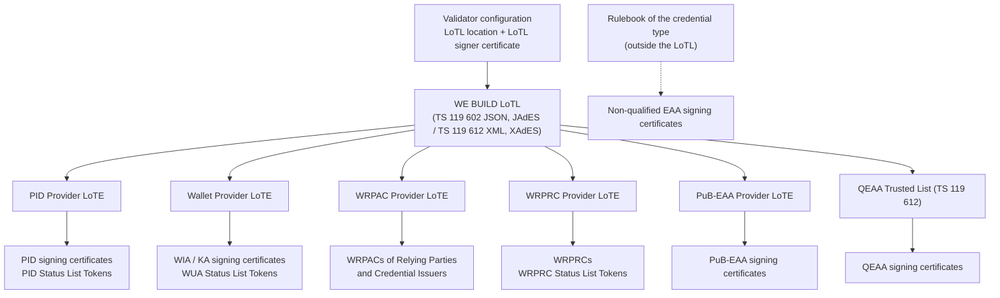
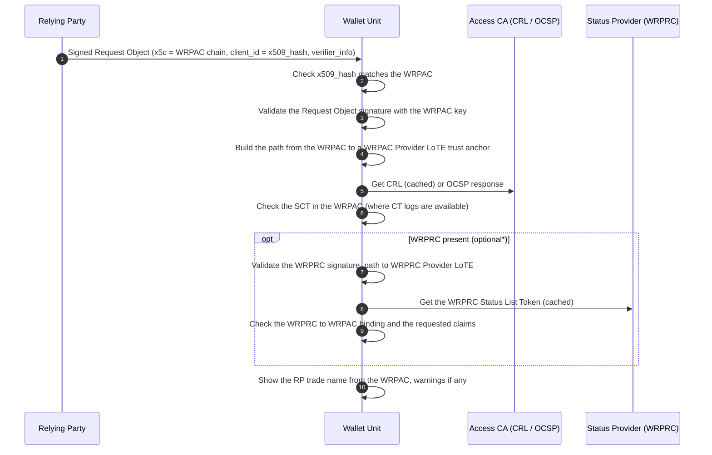

# WE BUILD - Pre-flight Conformance Specification CS-018: Baseline Trust Validation

Version 0.1 / Pre-flight Draft
Date: 26 October 2026

**Authors / Contributors**: WP4 Architecture / Trust Infrastructure Group

* Sarah Amandusson, Digg
* Lal Chandran, iGrant.io
* Nikos Triantafyllou, University of the Aegean
* George J Padayatti, iGrant.io
* Leif Johansson, SIROS
* Giuseppe De Marco, Dipartimento per la trasformazione digitale
* Martin Micuch, IDUnion
* Stefan Kauhaus, Visa
* Thodoris Papadopoulos, GRNET

Table Of Contents

- [1. Introduction](#1-introduction)
- [2. Scope](#2-scope)
- [3. Normative Language and Terminology](#3-normative-language-and-terminology)
- [4. Roles and Components](#4-roles-and-components)
- [5. Trust Model Overview](#5-trust-model-overview)
  - [5.1 Trust Anchor Sources](#51-trust-anchor-sources)
  - [5.2 What Is Validated Against Which List](#52-what-is-validated-against-which-list)
- [6. High-level Flows](#6-high-level-flows)
  - [6.1 Trust List Acquisition and Refresh](#61-trust-list-acquisition-and-refresh)
  - [6.2 Wallet Unit Authenticates the Relying Party](#62-wallet-unit-authenticates-the-relying-party)
  - [6.3 Wallet Unit Authenticates the Credential Issuer](#63-wallet-unit-authenticates-the-credential-issuer)
  - [6.4 Relying Party Validates a Presented Attestation](#64-relying-party-validates-a-presented-attestation)
  - [6.5 Credential Issuer Validates the Wallet Unit](#65-credential-issuer-validates-the-wallet-unit)
- [7. Normative Requirements](#7-normative-requirements)
  - [7.1 Trusted List Processing](#71-trusted-list-processing)
  - [7.2 Certificate Path Validation](#72-certificate-path-validation)
  - [7.3 Wallet Unit Requirements](#73-wallet-unit-requirements)
  - [7.4 Relying Party Requirements](#74-relying-party-requirements)
  - [7.5 Credential Issuer Requirements](#75-credential-issuer-requirements)
  - [7.6 Status List Token Signer Validation](#76-status-list-token-signer-validation)
  - [7.7 Unhappy Paths](#77-unhappy-paths)
- [8. Interface Definitions](#8-interface-definitions)
  - [8.1 WE BUILD List of Trusted Lists](#81-we-build-list-of-trusted-lists)
  - [8.2 List Types and Service Types](#82-list-types-and-service-types)
  - [8.3 Where Certificates Are Carried](#83-where-certificates-are-carried)
  - [8.4 Certificate Content Checks](#84-certificate-content-checks)
  - [8.5 Registration Certificate](#85-registration-certificate)
  - [8.6 Status List Token Header](#86-status-list-token-header)
- [9. Open Topics for Testing Feedback](#9-open-topics-for-testing-feedback)
- [10. Conformance](#10-conformance)
- [References](#references)

# 1. Introduction

This document is a **pre-flight conformance specification** as defined in [7]. It is intended to enable early testing of how WE BUILD participants decide whether to trust the certificates and signed objects they receive. The goal is to gather implementation experience and testing feedback that will inform a future full conformance specification.

Every issuance and every presentation in the WE BUILD ecosystem depends on the same small set of trust decisions:

* the Wallet Unit authenticates the Relying Party through its access certificate (WRPAC) and checks what the Relying Party is registered to request through its registration certificate (WRPRC);
* the Wallet Unit authenticates the Credential Issuer in the same way before it requests a credential;
* the Relying Party validates the signature of the presented PID or attestation against the trust anchor of the right Provider category;
* the Relying Party and the Wallet Unit validate the Status List Token that carries the revocation status;
* the Credential Issuer validates the Wallet Unit Attestation against the Wallet Provider trust anchors.

The existing specifications state that these checks happen, but not how. CS-001 [1] requires the Wallet Unit to validate "signature, Issuer identifier, key binding and any status information". CS-002 [2] requires `x509_hash` and validation of `verifier_info`. CS-010 [6] requires validation of the Status List Token "against the expected Status Issuer". None of them defines the trust anchor, the list that publishes it, or the result when a check cannot be completed. ETSI has not yet published a procedure for consuming Lists of Trusted Entities (ETSI TS 119 605 is a draft), and ETSI TS 119 615 [25] covers only TS 119 612 Trusted Lists.

The WP4 Trust Group has described the trust evaluation points as use cases [9], [10] and has defined the list and certificate profiles [11], [12]. This specification does not restate those documents. It turns them into testable requirements with stable identifiers, fixes the list and service type for each check, defines the trust anchor for Status List Tokens, and gives one table of results for the unhappy paths. Other specifications can then reference a single requirement instead of repeating the check.

# 2. Scope

This specification defines the conformance expectations for trust validation by Wallet Units, Relying Parties and Credential Issuers in the WE BUILD ecosystem.

* **In scope:**
  * Retrieval, authentication, freshness and caching of the WE BUILD List of Trusted Lists (LoTL) and of the Lists of Trusted Entities (LoTE, ETSI TS 119 602 [23]) and Trusted Lists (TL, ETSI TS 119 612 [24]) it points to
  * X.509 certificate path validation to a trust anchor taken from a list, including revocation checking of the certificates in the path
  * Validation of the WRPAC by the Wallet Unit, at presentation (CS-002 [2], CS-007 [5]) and at issuance (CS-001 [1])
  * Validation of the WRPRC by the Wallet Unit where a WRPRC is present (optional\*, see §7.3), including the binding to the WRPAC and the check for overasking
  * Validation of the signing certificate of PID, QEAA and PuB-EAA Providers, and of non-qualified EAA Providers against the trust anchors that the Rulebook defines, by the Relying Party and the Wallet Unit, for SD-JWT VC and ISO/IEC 18013-5 mdoc
  * Validation of the signer of a Status List Token, for attestations, WRPRCs and Wallet Unit Attestations
  * Validation of the Wallet Provider signing certificate of a WIA or KA by the Credential Issuer
  * The result of each failed or incomplete check (reject, warn the User, or proceed)

* **Out of scope:**
  * Issuance and lifecycle of WRPACs and WRPRCs, covered by CS-006 [36]
  * Status List Token format, allocation and retrieval, covered by CS-010 [6]
  * WIA and KA content and lifecycle, covered by CS-004 [3] and CS-005 [4]
  * The intermediary association in the WRPAC and WRPRC, covered by CS-013 [37]; this specification covers only the direct case
  * Operation of the LoTL and of the lists by the Trust Group (onboarding, signing, publication) [11], [13]
  * Distribution of the trust anchors of non-qualified EAA Providers, which the Rulebook of each credential type defines ([14] OIA_15), see §9
  * Trust models other than X.509 with lists, such as OpenID Federation trust marks and the EAA Provider chaining models (see §9)
  * Validation at a past point in time (long-term validation), see §9
  * Validation of qualified electronic signatures and seals created with a Wallet Unit, covered by CS-003

# 3. Normative Language and Terminology

The keywords **MUST**, **MUST NOT**, **REQUIRED**, **SHALL**, **SHOULD**, **SHOULD NOT**, **RECOMMENDED**, **MAY**, and **OPTIONAL** are to be interpreted as described in [RFC 2119](https://datatracker.ietf.org/doc/html/rfc2119).

> **Note:** As a pre-flight specification, the normative requirements herein are preliminary and subject to revision based on testing feedback.

Terms follow the WP4 Trust Group terminology [9] and the ARF [14].

| Term | Meaning in this specification |
|------|-------------------------------|
| **Validator** | Any party that performs a check in this specification: a Wallet Unit, a Relying Party or a Credential Issuer. |
| **LoTL** | The WE BUILD List of Trusted Lists (§8.1). It points to every list in §8.2. |
| **LoTE** | A List of Trusted Entities in the ETSI TS 119 602 [23] data model. |
| **TL** | A Trusted List in the ETSI TS 119 612 [24] data model. |
| **Trusted list** | A LoTE or a TL, when the difference does not matter. |
| **Trust anchor** | A certificate or public key taken from the `ServiceDigitalIdentity` of a service entry in a trusted list. |
| **Service entry** | One service of one trusted entity in a trusted list, identified by its service type URI (§8.2). |
| **WRPAC** | Wallet-Relying Party Access Certificate, an X.509 certificate issued by an Access Certificate Authority under ETSI TS 119 411-8 [26]. |
| **WRPRC** | Wallet-Relying Party Registration Certificate, a signed JWT or CWT issued by a Provider of registration certificates under ETSI TS 119 475 [28]. |
| **Signing certificate** | The end-entity certificate whose key signed a credential, a Status List Token, a WIA or a KA. |
| **Referenced Token** | A token that carries a `status` claim pointing into a Status List Token [18]. |

# 4. Roles and Components

| Role | Description |
|------|-------------|
| **Wallet Unit (WU)** | Validates the WRPAC and WRPRC of the Relying Party and of the Credential Issuer, and validates the credentials it receives and stores. |
| **Relying Party (RP)** | Validates presented PIDs and attestations and their revocation status. In this specification the term includes the Verifier of CS-002 [2]. |
| **Credential Issuer** | The PID Provider, EBWOID Provider or Attestation Provider. It validates the WIA and KA of the Wallet Unit, and it produces the signed objects that the other Validators check. |
| **Wallet Provider** | Signs WIAs and KAs, and the Status List Tokens for them, with keys certified under its entry in the Wallet Provider LoTE. |
| **Access Certificate Authority** | Issues WRPACs. Its trust anchor is in the WRPAC Provider LoTE. |
| **Provider of registration certificates** | Issues and signs WRPRCs and signs their Status List Tokens. Its trust anchor is in the WRPRC Provider LoTE. |
| **Status Issuer** | Signs Status List Tokens for an Issuer, as defined in CS-010 [6]. |
| **Trusted List Provider** | Operates and signs one trusted list. |
| **LoTL operator** | The WP4 Trust Group, which operates and signs the WE BUILD LoTL [13]. |

# 5. Trust Model Overview

## 5.1 Trust Anchor Sources

WE BUILD uses the trust model of the ARF [14] and the European Union list model, as decided in the Trusted Lists ADR [8]. The Validator is configured with one root of trust: the location of the WE BUILD LoTL and the certificate that signs it. From the LoTL, the Validator obtains a pointer to each trusted list, with the certificate that signs that list. From each trusted list, the Validator obtains the trust anchors of the trusted entities of one category.



In the European Union deployment, Member States notify the trusted entities to the Commission [34], and the Commission publishes the LoTE locations and their signing certificates in the Official Journal [14] TLPub_01, TLPub_07. In WE BUILD, the WP4 Trust Group publishes the LoTL in the trust group repository and onboards each Trusted List Provider [11], [13]. A Validator that is configured with the WE BUILD LoTL MUST NOT be configured to accept trust anchors from other sources for the checks in this specification, except the trust anchors of non-qualified EAA Providers (see LST-TV-01).

WE BUILD has no trusted list for non-qualified EAA Providers. This follows the ARF, which uses Trusted Lists for QEAA Providers, and LoTEs for PID Providers, PuB-EAA Providers, Access Certificate Authorities and Providers of registration certificates ([14] OIA_15b, ISSU_10b). The trust anchors of a non-qualified EAA come from the mechanism in the Rulebook of its credential type ([14] OIA_15). A Wallet Unit validates a non-qualified EAA only where it has those trust anchors ([14] ISSU_10).

## 5.2 What Is Validated Against Which List

| Object | Validated by | Trust anchor from | Service type | Revocation of the object |
|--------|--------------|-------------------|--------------|--------------------------|
| WRPAC of a Relying Party | WU | WRPAC Provider LoTE | `WRPAC/Issuance` | CRL or OCSP |
| WRPAC of a Credential Issuer (signed Credential Issuer metadata) | WU | WRPAC Provider LoTE | `WRPAC/Issuance` | CRL or OCSP |
| WRPRC | WU, where present (optional\*) | WRPRC Provider LoTE | `WRPRC/Issuance` | Token Status List |
| PID and EBWOID issued as PID | RP, WU | PID Provider LoTE | `PID/Issuance` | Token Status List |
| QEAA | RP, WU | QEAA Trusted List | `Svctype/EAA/Q` | Token Status List |
| PuB-EAA | RP, WU | PuB-EAA Provider LoTE | `PubEAA/Issuance` | Token Status List |
| Non-qualified EAA | RP; WU where it has the trust anchors | The mechanism in the Rulebook of the credential type ([14] OIA_15) | as defined by the Rulebook | Token Status List, where the Rulebook requires it (CS-010 [6]) |
| WIA, KA | Credential Issuer | Wallet Provider LoTE | `WalletSolution/Issuance` | Token Status List (CS-004 [3]) |
| Status List Token | RP, WU, Credential Issuer | As for the Referenced Token signer (§7.6) | as for the Referenced Token, or the matching `.../Revocation` service | not applicable |

The full service type URIs are in §8.2.

# 6. High-level Flows

## 6.1 Trust List Acquisition and Refresh

Participating actors: Validator, LoTL operator, Trusted List Providers.

1. The Validator is configured with the LoTL location and the LoTL signer certificate (§8.1).
2. The Validator downloads the LoTL and validates its signature with the configured certificate. It checks that `NextUpdate` is in the future.
3. For each pointer in the LoTL, the Validator downloads the trusted list. It validates the signature of the list with a certificate from the `ServiceDigitalIdentities` of that pointer, and it checks the list type and `NextUpdate`.
4. The Validator builds an index of trust anchors by service type. An entity that is no longer in a list, or whose service has a status that is not accepted (LST-TV-08), gives no trust anchor.
5. The Validator caches the result and refreshes it before `NextUpdate`, and at least once every 24 hours.

**Outcome**: every later check uses a local, authenticated and current set of trust anchors; no check depends on a network call to a list at transaction time.

## 6.2 Wallet Unit Authenticates the Relying Party

Participating actors: Relying Party, Wallet Unit, Access Certificate Authority, Provider of registration certificates.



1. The Relying Party sends a signed Request Object as defined in CS-002 [2] or CS-007 [5]. The `x5c` header carries the WRPAC and the intermediate certificates, but not the trust anchor.
2. The Wallet Unit checks that the `client_id` is the `x509_hash` of the WRPAC and validates the Request Object signature with the WRPAC public key.
3. The Wallet Unit validates the WRPAC path to a trust anchor of the WRPAC Provider LoTE, checks its revocation status and, where Certificate Transparency logs are available, its Signed Certificate Timestamp.
4. Where `verifier_info` contains a WRPRC (optional\*), the Wallet Unit validates it: its signature and path to a trust anchor of the WRPRC Provider LoTE, its validity period, its revocation status and its binding to the WRPAC.
5. Where a WRPRC is present, the Wallet Unit compares the requested credentials and claims with it.
6. The Wallet Unit shows the trade name from the WRPAC, and any warning, before it asks the User to approve.

**Outcome**: the User sees an authenticated Relying Party and, where a WRPRC is present, is warned before sharing more than the Relying Party is registered to request.

## 6.3 Wallet Unit Authenticates the Credential Issuer

Participating actors: Credential Issuer, Wallet Unit.

1. The Wallet Unit obtains the Credential Issuer metadata as defined in CS-001 [1].
2. The Wallet Unit validates the signature of the metadata with the key of the Credential Issuer's WRPAC, and validates the WRPAC as in §6.2 step 3 ([14] ISSU_24, ISSU_34). Metadata that is not signed fails this step.
3. Where `issuer_info` in the metadata contains a WRPRC (optional\*), the Wallet Unit validates it as in §6.2 step 4, and checks that the WRPRC entitles the Credential Issuer to issue the offered credential type ([14] ISSU_24a, ISSU_34a, RPRC_22a, RPRC_23; [31] clause 4.2.3). Metadata without a WRPRC does not fail this step.
4. If step 2 or step 3 fails, the Wallet Unit informs the User and does not request issuance (UP-TV-11, UP-TV-17).
5. After issuance, the Wallet Unit validates the received credential as in §6.4 before it stores it. For a non-qualified EAA, it does this only where it has the trust anchors (WU-TV-17).

**Outcome**: the Wallet Unit starts issuance only with a Credential Issuer that it has authenticated and, where a WRPRC is present, that is registered to issue the requested credential type. It stores a credential only after it has validated it in the same way as a Relying Party will, so that the User does not keep a credential that verifiers will reject.

## 6.4 Relying Party Validates a Presented Attestation

Participating actors: Wallet Unit, Relying Party, Status Provider.

1. The Relying Party receives the presentation as defined in CS-002 [2] or CS-007 [5].
2. The Relying Party determines the expected Provider category (PID, QEAA, PuB-EAA or non-qualified EAA) from the credential type and its Rulebook.
3. The Relying Party takes the signing certificate from the `x5c` header (SD-JWT VC) or the `x5chain` header of `issuerAuth` (mdoc), validates the credential signature, and validates the path to a trust anchor for that category (§5.2). For a non-qualified EAA, the trust anchors come from the Rulebook of the credential type.
4. The Relying Party checks the certificate content that identifies the category (§8.4).
5. Where the credential has a `status` claim, the Relying Party obtains the Status List Token (CS-010 [6]) and validates its signer as defined in §7.6 before it reads the status.

**Outcome**: a credential is accepted only when it is signed by a Provider that is listed for that category and its status is valid or has been assessed under the Relying Party's risk policy.

## 6.5 Credential Issuer Validates the Wallet Unit

Participating actors: Wallet Unit, Credential Issuer.

1. The Wallet Unit sends the WIA and, where required, the KA, as defined in CS-001 [1], CS-004 [3] and CS-005 [4].
2. The Credential Issuer validates the WIA and KA signatures with the certificate in their `x5c` header and validates the path to a trust anchor of the Wallet Provider LoTE (`WalletSolution/Issuance`).
3. The Credential Issuer checks the revocation status of the WIA and KA, and validates the signer of their Status List Tokens as defined in §7.6.

**Outcome**: credentials are issued only to Wallet Units of a listed Wallet Solution whose attestations are not revoked.

# 7. Normative Requirements

## 7.1 Trusted List Processing

These requirements apply to every Validator.

| ID | Requirement | Reference |
|----|-------------|-----------|
| LST-TV-01 | The Validator MUST be configured with the location of the WE BUILD LoTL and with the LoTL signer certificate (§8.1), and MUST take every trust anchor for the checks in this specification from the lists that the LoTL points to, and only from those, except the trust anchors of non-qualified EAA Providers (§5.2). | [14] RPA_04, RPRC_02a, ISSU_10b, OIA_15, OIA_15b; [25] GPR-4.0-02 |
| LST-TV-02 | The Validator MUST validate the signature of the LoTL with the configured LoTL signer certificate: compact JAdES Baseline B for the JSON LoTL, enveloped XAdES Baseline B for the XML LoTL. The Validator MUST NOT use a LoTL whose signature does not validate. | [23] clause 6.8, [24] clause 5.7.1, [25] PRO-4.1.4-07 |
| LST-TV-03 | The Validator MUST validate the signature of each trusted list with a certificate taken from the `ServiceDigitalIdentities` of the LoTL pointer to that list, and MUST NOT use a list whose signature does not validate. | [23] clause 6.3.13, [24] clause 5.3.13 |
| LST-TV-04 | The Validator MUST check that the list type of each trusted list (`LoTEType` or `TSLType`) is the type given for that list in §8.2, and MUST use the service entries of a list only for the checks that §5.2 assigns to that list type. | [23] Annexes D to H, [24] clause 5.3.3 |
| LST-TV-05 | The Validator MUST NOT use a LoTL or a trusted list whose `NextUpdate` is in the past. | [23] clause 6.3.15, [24] clause 5.3.15 |
| LST-TV-06 | The Validator MUST NOT use a trusted list that contains a critical extension that the Validator does not process. | [23] clause 6.3.17 |
| LST-TV-07 | The Validator SHOULD cache the LoTL and the trusted lists and MUST refresh them before `NextUpdate`. The Validator SHOULD refresh them at least once every 24 hours, and MUST NOT download a list for each transaction. | [14] ISSU_10a, OIA_15a |
| LST-TV-08 | The Validator MUST derive trust anchors only from service entries that are current: for LoTE types without service status (PID, Wallet Provider, WRPAC Provider, WRPRC Provider), an entry that is present in the current list; for the PuB-EAA Provider LoTE, an entry with status `.../PubEAAProvidersList/SvcStatus/notified`; for a TL, an entry with status `http://uri.etsi.org/TrstSvc/TrustedList/Svcstatus/granted`. | [14] GenNot_05, [23] Annexes D to H, [24] clause 5.5.4 |
| LST-TV-09 | The Validator MUST evaluate trust at the current time. The Validator MUST NOT use historical service information to accept a certificate whose service entry is no longer current. | [23] Annexes D to G, [24] clause 5.5.5 |

## 7.2 Certificate Path Validation

These requirements apply to every Validator, for every certificate path in this specification.

| ID | Requirement | Reference |
|----|-------------|-----------|
| CRT-TV-01 | The Validator MUST build and validate a certification path, as defined in RFC 5280 [21], from the end-entity certificate to a trust anchor that LST-TV-08 gives for the service type in §5.2, or, for a non-qualified EAA, to a trust anchor from the Rulebook of the credential type. The trust anchor is the certificate in the `ServiceDigitalIdentity`, or its public key with its subject name. | [21] clause 6, [25] PRO-4.3.4-03 |
| CRT-TV-02 | The Validator MUST take the end-entity and intermediate certificates only from the `x5c` (JOSE) or `x5chain` (COSE) header of the signed object. Where that header also contains a self-signed certificate, the Validator MUST ignore it and MUST NOT use it as a trust anchor. | [16] clause 5.9.3, [17] clauses 4.1, 5, 6.1.1, [30] OIDFVP-HAIP-REDIRECTS_RO-02 |
| CRT-TV-03 | The Validator MUST check that each certificate in the path is within its validity period at the time of validation. | [21] clause 6.1.3 |
| CRT-TV-04 | The Validator MUST check the revocation status of each certificate in the path, except the trust anchor, by CRL [21] or OCSP [22], using the CRL distribution point or the OCSP location in the certificate. | [14] RPACANot_02, Reg_12, [26] CSS-6.6.2-01, CSS-6.6.3-01 |
| CRT-TV-05 | The Validator SHOULD prefer a cached CRL to an OCSP request when both are available, so that the Access Certificate Authority and the Credential Issuer do not see which certificate is checked and when. A cached CRL MAY be used until its `nextUpdate`. | [15] clause 6.6.3.2 |
| CRT-TV-06 | The Validator MUST check that the end-entity certificate has the `digitalSignature` key usage, and MUST validate the signature of the signed object with the public key of that certificate. | [27] PID-4.4.1-01, [26] |
| CRT-TV-07 | The Validator MUST support ECDSA with P-256 and SHA-256 (ES256) for certificates and for signed objects. | [2], [12], [17] |

## 7.3 Wallet Unit Requirements

> **\* Note on the optional WRPRC:** The Wallet Unit duty to authenticate and validate the WRPRC applies only from 11 August 2028 ([33] Article 3(4) and Article 8). The ARF defers RPRC_17 at presentation, and ISSU_24a, ISSU_34a, RPRC_22a and RPRC_23 at issuance, in the same way [14]. Until that date, where the WRPRC is marked optional\*:
> * Where no WRPRC is present, the absence is not a failure.
> * Where a WRPRC is present, the Wallet Unit MUST validate it as defined in WU-TV-08 to WU-TV-14 at presentation, or in WU-TV-16 at issuance, and MUST apply the results in §7.7.
>
> The WRPAC requirements (WU-TV-01 to WU-TV-07 and WU-TV-15) have no such delay and apply now.

**Relying Party authentication at presentation**

| ID | Requirement | Reference |
|----|-------------|-----------|
| WU-TV-01 | The Wallet Unit MUST authenticate the Relying Party in every presentation, remote and proximity, with the WRPAC, and MUST NOT delegate this to the operating system, a browser or another application. | [14] RPA_01, RPA_01a, RPA_03, [33] Article 3(1) |
| WU-TV-02 | For OpenID4VP, the Wallet Unit MUST check that the `client_id` uses the `x509_hash` prefix and that its value is the base64url-encoded SHA-256 hash of the DER-encoded first certificate in the `x5c` header, and MUST validate the Request Object signature with the public key of that certificate. | [16] clause 5.9.3, [17] clause 5, [2] |
| WU-TV-03 | For ISO/IEC 18013-5 mdoc requests, the Wallet Unit MUST validate `readerAuth` with the public key of the first certificate in its `x5chain` header. | [20], [30] ISO/IEC 18013-REQ-01 to -03 |
| WU-TV-04 | The Wallet Unit MUST validate the WRPAC path as defined in §7.2 to a trust anchor of the WRPAC Provider LoTE, service type `WRPAC/Issuance`. | [14] RPA_04, [26] |
| WU-TV-05 | The Wallet Unit SHOULD check that the WRPAC contains at least one valid Signed Certificate Timestamp (SCT). Until the Certificate Transparency logs for WE BUILD WRPACs and their public keys are published, a missing or unverifiable SCT MUST NOT by itself cause a failure of Relying Party authentication. | [14] CT_05, CT_06, [35] |
| WU-TV-06 | The Wallet Unit SHOULD check that the `certificatePolicies` extension of the WRPAC contains one of the policy identifiers of ETSI TS 119 411-8 (§8.4). | [26] clause 5.3, GEN-6.6.1-03 |
| WU-TV-07 | Where Relying Party authentication succeeds, the Wallet Unit MUST show the User the `commonName` of the WRPAC subject, which is the trade name of the Relying Party or the name of its Service. Where the WRPAC also carries a Service trade name (§8.4), the Wallet Unit MUST show it too. | [14] RPA_06, Reg_34, [26] GEN-6.1.1-04, [33] Article 3(5) |

**Registration certificate at presentation (optional\*)**

| ID | Requirement | Reference |
|----|-------------|-----------|
| WU-TV-08 | Where a WRPRC is present, the Wallet Unit MUST take it from the `verifier_info` element with `format` `registration_cert` (OpenID4VP) or from `euWrprc` in `requestInfo` (mdoc), and MUST validate its signature with the first certificate in its `x5c` (JWT) or `x5chain` (CWT) header. | [16] clause 5.1, [28] clauses 5.2.2, 5.2.3, [30] OIDFVP-HAIP-COMMON-REQ-RO-13 to -16, [33] Annex II |
| WU-TV-09 | The Wallet Unit MUST check that the WRPRC `typ` is `rc-wrp+jwt` or `rc-wrp+cwt`, and MUST validate the path of the WRPRC signing certificate as defined in §7.2 to a trust anchor of the WRPRC Provider LoTE, service type `WRPRC/Issuance`. | [14] RPRC_02, RPRC_02a, [28] GEN-5.2.1-03, -04 |
| WU-TV-10 | The Wallet Unit MUST check that the WRPRC `policy_id` contains `0.4.0.19475.3.1`, that `iat` is not in the future and, where present, that `exp` is not in the past. | [28] OVR-6.1.3-01, GEN-5.2.4-08 |
| WU-TV-11 | The Wallet Unit MUST check the revocation status of the WRPRC from its `status` claim as defined in CS-010 [6], and MUST validate the signer of the Status List Token as defined in §7.6. | [14] RPRC_17, [28] REV-6.2.6.2-05 |
| WU-TV-12 | Where a WRPRC is present, the Wallet Unit MUST check that its `sub` is equal to the `organizationIdentifier` (legal person) or the `serialNumber` (natural person) of the WRPAC subject. Where both the WRPRC and the WRPAC carry a Service identifier (§8.4), the Wallet Unit MUST also check that the two values are equal. Where one or both do not carry it, this is not a failure (§9). | [14] RPRC_07, RPRC_07a, RPRC_17a, Reg_33, [28] GEN-5.1.1-02, GEN-5.1.1-03 |
| WU-TV-13 | Where a WRPRC is present, the Wallet Unit MUST check that each credential and each claim requested in the `dcql_query` (OpenID4VP) or in the `docRequests` (mdoc) is listed in the `credentials` of the WRPRC, with the same format, credential type and claim path. | [14] RPRC_21, [32] Article 8(2)(d), [33] Annex II WRP-OVERASKING-01 to -03 |
| WU-TV-14 | Where a WRPRC is present, the Wallet Unit MUST complete WU-TV-08 to WU-TV-13 before it asks the User to approve the presentation. | [33] Annex II WRP-VALIDATION-01 |

**Credential Issuer authentication at issuance**

| ID | Requirement | Reference |
|----|-------------|-----------|
| WU-TV-15 | Before it requests issuance, the Wallet Unit MUST obtain signed Credential Issuer metadata, MUST validate the signature with the first certificate in its `x5c` header, and MUST validate that certificate as a WRPAC as defined in WU-TV-04 and WU-TV-05. | [14] ISSU_22, ISSU_24, ISSU_32, ISSU_34, [17] clause 4.1, [31] ISS-MDATA-4.2.1-01 |
| WU-TV-16 | Where `issuer_info` in the Credential Issuer metadata contains a WRPRC (optional\*), the Wallet Unit MUST validate it before it requests issuance, as defined in WU-TV-09 to WU-TV-12, and MUST check that it contains `provides_attestations` and that `provides_attestations` contains the credential type that the Wallet Unit is about to request. | [14] ISSU_24a, ISSU_34a, RPRC_22a, RPRC_23, [31] ISS-MDATA-REG_CERT-4.2.3-04, [33] Article 3(4), Article 8 |
| WU-TV-17 | Before it stores a received credential, the Wallet Unit MUST validate its signing certificate as defined in RP-TV-01 to RP-TV-04. For a non-qualified EAA, this applies only where the Wallet Unit has the trust anchors from the Rulebook of the credential type (§5.2). | [14] ISSU_07 to ISSU_10, [1] |

## 7.4 Relying Party Requirements

These requirements also apply to the Wallet Unit for WU-TV-17.

| ID | Requirement | Reference |
|----|-------------|-----------|
| RP-TV-01 | The Relying Party MUST determine the expected Provider category of a credential (PID, QEAA, PuB-EAA or non-qualified EAA) from its credential type (`vct` or `doctype`) and the Rulebook of that type, and MUST NOT determine it only from the certificate or from claims in the credential. | [14] OIA_12 to OIA_15 |
| RP-TV-02 | The Relying Party MUST take the signing certificate from the `x5c` header of the SD-JWT VC Issuer-signed JWT, or from the `x5chain` header of the mdoc `issuerAuth`, and MUST validate the credential signature with it. | [17] clause 6.1.1, [19] clause 2.5, [20] |
| RP-TV-03 | The Relying Party MUST validate the path of the signing certificate as defined in §7.2 to a trust anchor for the expected category in §5.2, and only for that category. For a non-qualified EAA, the trust anchors are those of the mechanism in the Rulebook of the credential type. | [14] OIA_12 to OIA_15, ISSU_07 to ISSU_10 |
| RP-TV-04 | The Relying Party MUST check the certificate content for the expected category in §8.4. A PID signing certificate MUST have the QcType `id-etsi-qct-pid`, and a PuB-EAA signing certificate MUST have the `id-etsi-qcs-QcPSB` statement. | [27] PID-4.5-01, PSB-8.3-01 |
| RP-TV-05 | Where an SD-JWT VC contains an `iss` claim, the Relying Party MUST check that it identifies the subject of the signing certificate, as defined by the Rulebook of the credential type. | [19] clauses 2.2.2.3, 2.5, 7.3 |
| RP-TV-06 | Where a credential has a `status` claim, the Relying Party MUST validate the signer of the Status List Token as defined in §7.6 before it uses the status. | [6] RP-RV-02, [17] clause 6.1 |

## 7.5 Credential Issuer Requirements

**As a Validator of the Wallet Unit**

| ID | Requirement | Reference |
|----|-------------|-----------|
| ISS-TV-01 | The Credential Issuer MUST validate the signing certificate of the WIA and of the KA from their `x5c` header, as defined in §7.2, to a trust anchor of the Wallet Provider LoTE, service type `WalletSolution/Issuance`. | [1], [3], [4], [14] ISSU_19, ISSU_21, ISSU_28, ISSU_30 |
| ISS-TV-02 | The Credential Issuer MUST check that the WIA and KA signing certificate has the QcType `id-etsi-qct-wal`. | [27] WAL-5.2-01 |
| ISS-TV-03 | Where the WIA or KA has a `status` claim, the Credential Issuer MUST validate the signer of the Status List Token as defined in §7.6. | [3], [14] ISSU_30a |

**As the producer of signed objects**

| ID | Requirement | Reference |
|----|-------------|-----------|
| ISS-TV-04 | The Credential Issuer MUST include its signing certificate and the intermediate certificates, but not the trust anchor, in the `x5c` header of each SD-JWT VC and in the `x5chain` header of each mdoc `issuerAuth`. The signing certificate MUST NOT be self-signed. | [17] clause 6.1.1, [27] |
| ISS-TV-05 | The Credential Issuer MUST use a signing certificate that chains to a trust anchor of its own entry in the list for its category (§5.2), and whose content matches §8.4. | [14] PPNot_03, [12], [27] |
| ISS-TV-06 | The Credential Issuer MUST ensure that each Status List Token for its credentials includes an `x5c` header whose first certificate satisfies SL-TV-02. | [14] PPNot_03a, [17] clause 6.1 |
| ISS-TV-07 | The Credential Issuer MUST sign its metadata with the key of its WRPAC, and MUST include the WRPAC chain, without the trust anchor, in the `x5c` header. | [14] ISSU_22, ISSU_32, [17] clause 4.1, [31] ISS-MDATA-ACC_CERT-4.2.2-01 to -03 |
| ISS-TV-08 | Where the Credential Issuer includes a WRPRC in `issuer_info` in its metadata, the WRPRC MUST contain `provides_attestations`, with one entry (`format`, `meta`) for each credential type that the Credential Issuer issues. This makes the RECOMMENDED fields of [28] GEN-5.2.4-05 mandatory in WE BUILD. | [14] RPRC_23, ISSU_24a, ISSU_34a, [28] GEN-5.2.4-05 Table 8, [31] clause 4.2.3 |

## 7.6 Status List Token Signer Validation

The Token Status List [18] does not require the Status List Token to be signed by the issuer of the Referenced Token, and leaves key resolution and trust to the ecosystem ([18] clause 11.3). CS-010 [6] requires validation "against the expected Status Issuer" but does not define it. This section defines it for WE BUILD. It applies to the Status List Tokens of credentials, WRPRCs, WIAs and KAs.

| ID | Requirement | Reference |
|----|-------------|-----------|
| SL-TV-01 | The Validator MUST take the Status List Token signing certificate from the `x5c` header (JWT) or `x5chain` header (CWT) of the Status List Token, MUST validate the token signature with it, and MUST reject a Status List Token that has no such header. | [17] clause 6.1, [18] clause 5.1 |
| SL-TV-02 | (WE BUILD profile) The Validator MUST accept the Status List Token signing certificate only where one of these conditions is true: (a) it is the same certificate as the signing certificate of the Referenced Token; (b) it is issued by the same Certificate Authority as the signing certificate of the Referenced Token, and its subject has the same `organizationIdentifier` (or, for a natural person, `serialNumber`) as that certificate; (c) it chains to a trust anchor of the `.../Revocation` service entry (§8.2) of the same trusted entity, in the same list, as the signing certificate of the Referenced Token. | [18] clause 11.3, [12], [14] PPNot_03a, RPACANot_03b, [23] Annexes D to H |
| SL-TV-03 | The Validator MUST validate the Status List Token signing certificate path as defined in §7.2. | [21] |
| SL-TV-04 | Where SL-TV-01 to SL-TV-03 fail, the Validator MUST treat the status of the Referenced Token as unknown, and MUST NOT treat it as valid. | [6] RP-RV-05, [14] VCR_14 |
| SL-TV-05 | An Issuer that delegates the Status Issuer role (CS-010 [6] §4) MUST ensure that the Status Issuer signs with a certificate that satisfies SL-TV-02 for the Issuer's Referenced Tokens. | [6], [18] clause 13.5 |
| SL-TV-06 | A QEAA Provider or a non-qualified EAA Provider MUST sign its Status List Tokens with the key of the signing certificate of the attestations they reference (condition (a) of SL-TV-02), because the TS 119 612 Trusted List has no revocation service entry for QEAA Providers, and WE BUILD has no trusted list for non-qualified EAA Providers (§5.1). | [12], [27] EAA-6.2-01 |

> **Note on SL-TV-02:** No single source defines this rule. It combines the following:
> * Condition (a) follows the recommendation of the Token Status List for an Issuer that is also the Status Issuer ([18] clause 11.3: "the same key that is embedded into the Referenced Token may be used"), and the WP4 Trust Group rule for EAA and QEAA Providers [12], which SL-TV-06 makes mandatory for them.
> * Condition (b) follows the recommendation of the Token Status List that the certificates of the Issuer and the Status Issuer "should be issued by the same Certificate Authority" ([18] clause 11.3). The match of the subject identifier is a WE BUILD addition, so that a second key of the same organisation is accepted and a key of another organisation under the same Certificate Authority is not. The extended key usage of [18] clause 10 is not required, because its object identifier is not yet assigned.
> * Condition (c) extends to every LoTE type the WP4 Trust Group rule for Wallet Providers, under which a separate status list certificate is the `ServiceDigitalIdentity` of the `WalletSolution/Revocation` service [12]. ETSI TS 119 602 [23] defines the `.../Revocation` service types but not their use. The ARF requires that status and revocation lists can be authenticated with the notified trust anchors ([14] PPNot_03a, RPACANot_03b).

## 7.7 Unhappy Paths

The table defines the result of each failed or incomplete check. **Reject** means that the transaction stops and the object is not used. **Warn** means that the Wallet Unit informs the User before approval, and continues only with explicit approval of the User where the Wallet Provider's risk policy allows it ([14] RPA_06a, RPA_07b, RPRC_17, RPRC_21). **Risk decision** means that the Relying Party applies its documented acceptance policy ([6] RP-RV-05). A missing WRPRC is not a failure (optional\*, §7.3).

| ID | Condition | Wallet Unit | Relying Party | Credential Issuer | Reference |
|----|-----------|-------------|---------------|-------------------|-----------|
| UP-TV-01 | LoTL or list signature does not validate, wrong list type, unknown critical extension | Keep the last valid cached list until its `NextUpdate`; then Reject the checks that depend on it | as Wallet Unit | as Wallet Unit | LST-TV-02 to -06 |
| UP-TV-02 | `NextUpdate` of a cached list has passed and no new list is available | Reject the checks that depend on it | as Wallet Unit | as Wallet Unit | LST-TV-05 |
| UP-TV-03 | No path to a trust anchor of the right list, certificate expired, wrong key usage, signature does not validate | Reject | Reject | Reject | CRT-TV-01 to -06 |
| UP-TV-04 | A certificate in the path is revoked | Reject | Reject | Reject | CRT-TV-04 |
| UP-TV-05 | Revocation status of a certificate cannot be obtained (CRL and OCSP not reachable, no valid cached CRL) | Warn | Risk decision | Risk decision | CRT-TV-04, [15] clause 6.6.3.2 |
| UP-TV-06 | `client_id` does not match the WRPAC, Request Object or `readerAuth` signature does not validate | Reject | not applicable | not applicable | WU-TV-02, WU-TV-03 |
| UP-TV-07 | WRPAC fails WU-TV-04 | Warn ("the identity of the Relying Party could not be verified") | not applicable | not applicable | [14] RPA_05, RPA_06a, CT_06 |
| UP-TV-08 | WRPRC malformed, signature or path invalid, expired, or revoked | Warn | not applicable | not applicable | [14] RPRC_17, [33] Annex II WRP-VALIDATION-02, -03 |
| UP-TV-09 | WRPRC `sub` does not match the WRPAC subject, or both carry a Service identifier and the values are different (WU-TV-12) | Warn, and treat the WRPRC as absent | not applicable | not applicable | [14] RPRC_17a |
| UP-TV-10 | Request asks for credentials or claims that the WRPRC does not list | Warn, and identify the claims that are not registered | not applicable | not applicable | [14] RPRC_21, [33] Annex II WRP-OVERASKING-01 to -03 |
| UP-TV-11 | Credential Issuer metadata is not signed, or fails WU-TV-15 | Inform the User, and do not request issuance | not applicable | not applicable | [14] ISSU_24, ISSU_34 |
| UP-TV-12 | Credential signing certificate does not chain to a trust anchor for the expected category, or fails §8.4 (for a non-qualified EAA without trust anchors, see UP-TV-16) | Reject (do not store) | Reject | not applicable | RP-TV-01 to -04 |
| UP-TV-13 | Status List Token signer fails §7.6 | Treat status as unknown | Risk decision | Risk decision | SL-TV-04 |
| UP-TV-14 | Status is INVALID | Inform the User | Reject | Reject | [6] RP-RV-03 |
| UP-TV-15 | WIA or KA signing certificate fails ISS-TV-01 or ISS-TV-02 | not applicable | not applicable | Reject | [14] ISSU_19, ISSU_28 |
| UP-TV-16 | The credential is a non-qualified EAA, and the Validator has no trust anchors for it from the Rulebook of the credential type | Do not reject for this reason | Reject | not applicable | [14] ISSU_10, OIA_15 |
| UP-TV-17 | The WRPRC in `issuer_info` fails WU-TV-16, including a WRPRC without `provides_attestations` or without the requested credential type | Inform the User, and do not request issuance | not applicable | not applicable | [14] RPRC_22a, RPRC_23 |

# 8. Interface Definitions

## 8.1 WE BUILD List of Trusted Lists

The WP4 Trust Group publishes the LoTL in two forms [13]:

| Form | Location | Data model | Signature |
|------|----------|------------|-----------|
| JSON | `https://webuild-consortium.github.io/wp4-trust-group/list_of_trusted_lists.json` | ETSI TS 119 602 [23], `LoTEType` `http://uri.etsi.org/19602/LoTLType/EUListOfTrustedLists` | Compact JAdES Baseline B; `alg`, `x5c` and `iat` in the protected header |
| XML | `https://webuild-consortium.github.io/wp4-trust-group/list_of_trusted_lists.xml` | ETSI TS 119 612 [24], `TSLType` `http://uri.etsi.org/TrstSvc/TrustedList/TSLType/EUlistofthelists` | Enveloped XAdES Baseline B |

The LoTL signer certificate is published by the WP4 Trust Group with the LoTL [13]. A Validator obtains it out of band and configures it as its root of trust (LST-TV-01). Each pointer in the LoTL gives the list location, the list type, the MIME type (`application/json` or `application/xml` for a LoTE, `application/vnd.etsi.tsl+xml` for a TL) and the certificates that sign the list.

## 8.2 List Types and Service Types

| List | List type | Data model | Service types | Service status |
|------|-----------|------------|---------------|----------------|
| PID Provider LoTE | `http://uri.etsi.org/19602/LoTEType/EUPIDProvidersList` | [23] Annex D | `http://uri.etsi.org/19602/SvcType/PID/Issuance`, `.../PID/Revocation` | none |
| Wallet Provider LoTE | `http://uri.etsi.org/19602/LoTEType/EUWalletProvidersList` | [23] Annex E | `http://uri.etsi.org/19602/SvcType/WalletSolution/Issuance`, `.../WalletSolution/Revocation` | none |
| WRPAC Provider LoTE | `http://uri.etsi.org/19602/LoTEType/EUWRPACProvidersList` | [23] Annex F | `http://uri.etsi.org/19602/SvcType/WRPAC/Issuance`, `.../WRPAC/Revocation` | none |
| WRPRC Provider LoTE | `http://uri.etsi.org/19602/LoTEType/EUWRPRCProvidersList` | [23] Annex G | `http://uri.etsi.org/19602/SvcType/WRPRC/Issuance`, `.../WRPRC/Revocation` | none |
| PuB-EAA Provider LoTE | `http://uri.etsi.org/19602/LoTEType/EUPubEAAProvidersList` | [23] Annex H | `http://uri.etsi.org/19602/SvcType/PubEAA/Issuance`, `.../PubEAA/Revocation` | `notified`, `withdrawn` |
| QEAA Trusted List | `http://uri.etsi.org/TrstSvc/TrustedList/TSLType/EUgeneric` | [24] | `http://uri.etsi.org/TrstSvc/Svctype/EAA/Q` | `granted`, `withdrawn` |

The QEAA Trusted List has the generic list type. The Validator takes QEAA trust anchors only from entries with service type `Svctype/EAA/Q` (CRT-TV-01). WE BUILD has no trusted list for non-qualified EAA Providers (§5.1).

## 8.3 Where Certificates Are Carried

| Object | Format | Header | First certificate | Defined in |
|--------|--------|--------|-------------------|------------|
| Request Object | JWT (`oauth-authz-req+jwt`) | `x5c` | WRPAC | [2], [16] clause 5.9.3 |
| mdoc reader authentication | COSE_Sign1 | `x5chain` | WRPAC | [20], [30] |
| WRPRC | JWT (`rc-wrp+jwt`) or CWT (`rc-wrp+cwt`) | `x5c` or `x5chain` | WRPRC Provider signing certificate | [28] clauses 5.2.2, 5.2.3 |
| Signed Credential Issuer metadata | JWT | `x5c` | WRPAC of the Credential Issuer | [17] clause 4.1, [31] |
| SD-JWT VC | Issuer-signed JWT (`dc+sd-jwt`) | `x5c` | Credential Issuer signing certificate | [17] clause 6.1.1, [19] |
| mdoc | `issuerAuth` COSE_Sign1 | `x5chain` | Document signer certificate | [20] |
| WIA, KA | JWT | `x5c` | Wallet Provider signing certificate | [1], [3] |
| Status List Token | JWT (`statuslist+jwt`) or CWT | `x5c` or `x5chain` | Status List Token signing certificate | [6], [17] clause 6.1, [18] |

In each case the header carries the end-entity certificate first, then the intermediate certificates, and not the trust anchor.

## 8.4 Certificate Content Checks

| Certificate | Check | Values | Reference |
|-------------|-------|--------|-----------|
| WRPAC | `certificatePolicies` (SHOULD, WU-TV-06) | `0.4.0.194118.1.1` (NCP-n-eudiwrp), `.2` (NCP-l-eudiwrp), `.3` (QCP-n-eudiwrp), `.4` (QCP-l-eudiwrp) | [26] clause 5.3 |
| WRPAC | Subject identifier for WU-TV-12 | `organizationIdentifier` (legal person) or `serialNumber` (natural person) | [26] GEN-6.6.1-05, [28] clause 5.1 |
| WRPAC | Name shown to the User (WU-TV-07) | `commonName` of the subject: a trade name or a service name | [26] GEN-6.1.1-04 |
| WRPAC and WRPRC | Service identifier (WU-TV-12) and Service trade name (WU-TV-07) | No encoding is defined yet in [26] or [28], see §9 | [14] Reg_33, Reg_34, RPRC_07a |
| WRPAC | Signed Certificate Timestamp (SHOULD, WU-TV-05) | at least one valid SCT | [14] CT_04, CT_05, [35] |
| PID signing certificate | QcType | `id-etsi-qct-pid` (`0.4.0.194126.1.1`) | [27] PID-4.5-01 |
| Wallet Provider signing certificate | QcType | `id-etsi-qct-wal` (`0.4.0.194126.1.2`) | [27] WAL-5.2-01 |
| QEAA signing certificate | Qualified certificate for electronic seal or signature | `QcCompliance` statement, issued by a QTSP | [27] QEA-7.1-03, QEA-7.3-01 |
| PuB-EAA signing certificate | QcPSB statement | `id-etsi-qcs-QcPSB` (`0.4.0.194126.1.3`) | [27] PSB-8.3-01 to -05 |
| WRPRC | `policy_id` | contains `0.4.0.19475.3.1` | [28] OVR-6.1.3-01 |

## 8.5 Registration Certificate

Example of a WRPRC JWT header and of the payload members of a Relying Party WRPRC that this specification checks (illustrative only; the full payload is defined in [28] clause 5.2.4):

```json
{
  "typ": "rc-wrp+jwt",
  "alg": "ES256",
  "x5c": [
    "MIIC...WRPRC-signing-cert",
    "MIIC...intermediate"
  ]
}
```

```json
{
  "sub": "LEIXG-529900T8BM49AURSDO55",
  "name": "Example Bank",
  "policy_id": [
    "0.4.0.19475.3.1"
  ],
  "entitlements": [
    "https://uri.etsi.org/19475/Entitlement/Service_Provider"
  ],
  "credentials": [
    {
      "format": "dc+sd-jwt",
      "meta": {
        "vct_values": [
          "urn:eudi:pid:1"
        ]
      },
      "claim": [
        {
          "path": [
            "family_name"
          ]
        },
        {
          "path": [
            "given_name"
          ]
        }
      ]
    }
  ],
  "iat": 1783075200,
  "exp": 1814611200,
  "status": {
    "status_list": {
      "idx": 1207,
      "uri": "https://wrprc.example.org/statuslists/3"
    }
  }
}
```

In the example of a Relying Party WRPRC above, WU-TV-12 compares `sub` with the `organizationIdentifier` of the WRPAC subject, and WU-TV-13 compares the `dcql_query` of the request with `credentials`. The example has no Service identifier, because its encoding is not yet defined (§9).

A WRPRC issued to a Credential Issuer has the same header and common members. Instead of `credentials` and `purpose`, it carries an Attestation Provider entitlement and `provides_attestations` ([28] Table 8, ISS-TV-08). Example payload (illustrative only):

```json
{
  "sub": "LEIXG-5299000J2N45DDNE4Y28",
  "name": "Example University",
  "policy_id": [
    "0.4.0.19475.3.1"
  ],
  "entitlements": [
    "https://uri.etsi.org/19475/Entitlement/QEAA_Provider"
  ],
  "provides_attestations": [
    {
      "format": "dc+sd-jwt",
      "meta": {
        "vct_values": [
          "urn:example:diploma:1"
        ]
      }
    }
  ],
  "iat": 1783075200,
  "exp": 1814611200,
  "status": {
    "status_list": {
      "idx": 88,
      "uri": "https://wrprc.example.org/statuslists/3"
    }
  }
}
```

In this example, WU-TV-12 compares `sub` with the `organizationIdentifier` of the Credential Issuer's WRPAC, and WU-TV-16 checks that the offered credential type `urn:example:diploma:1` is in `provides_attestations`.

## 8.6 Status List Token Header

Example of a Status List Token header for condition (a) of SL-TV-02 (illustrative only):

```json
{
  "typ": "statuslist+jwt",
  "alg": "ES256",
  "x5c": [
    "MIIC...same-cert-as-the-credential",
    "MIIC...intermediate"
  ]
}
```

The payload is defined in CS-010 [6] §8.2.

# 9. Open Topics for Testing Feedback

In line with the pre-flight process [7], the following topics are deliberately left open. Implementers are asked to gather experience on them during testing so the full CS can resolve them:

1. **Relation to the Trust Group documents.** Issue #189 proposed a CS for trust evaluation and was closed with the decision that the Trust Group documents would cover it. This specification profiles those documents [9], [10], [11], [12] for testing and does not replace them. Feedback is sought from the Trust Group on the split between its documents and this CS.
2. **LoTE consumption procedure.** ETSI TS 119 605 (procedures for LoTEs) is not published. LST-TV-01 to LST-TV-09 are a minimum WE BUILD profile until it is.
3. **Non-qualified EAA trust anchors.** WE BUILD has no trusted list for non-qualified EAA Providers. The ARF leaves their trust anchors to the Rulebook of the credential type ([14] OIA_15, ISSU_10), so this specification does not define one anchor source for them. Report which mechanism each Rulebook uses, and whether Wallet Units and Relying Parties can obtain the trust anchors.
4. **EBWOID Provider list.** The trust group maps the `ebwoid-provider` category to the `EURegistrarsAndRegistersList` type and the `SvcType/Register` service type. This specification treats an EBWOID as a PID, QEAA or PuB-EAA according to its Provider's category. Report which list an EBWOID signing certificate chains to in practice.
5. **Status List Token signer.** SL-TV-02 is a WE BUILD rule. The Token Status List defines an extended key usage for delegated status signing ([18] clause 10), but its object identifier is not yet assigned. Report whether delegated Status Issuers can meet SL-TV-02, and whether the `.../Revocation` service entries are populated.
6. **Token Status List revision.** CS-010 [6] pins draft-20. Draft-21 (August 2026) is in the RFC Editor queue. HAIP 1.0 [17] references draft-14. Alignment of the pinned revision is left to CS-010.
7. **WRPRC status format.** ETSI TS 119 475 [28] GEN-6.2.6.1-04 defines `idx` as a numeric string, but its Annex C example uses the Token Status List form `status.status_list.idx` (integer). This specification follows the Token Status List form. ETSI TS 119 472-1 [29] defines yet another `status` shape for SD-JWT VC attestations.
8. **Certificate Transparency.** The ARF makes the SCT check a Wallet Unit duty ([14] CT_04 to CT_06), but no operator of Certificate Transparency logs for WE BUILD WRPACs is decided, and no log public keys are published. WU-TV-05 is therefore a recommendation in this pre-flight specification. Report who can operate the logs and monitor them, where their public keys are to be published (for example as a service in a trusted list), and whether WE BUILD Access Certificate Authorities include SCTs today.
9. **`x5u` and `x5t#S256`.** ETSI TS 119 472-1 [29] makes `x5u` and `x5t#S256` mandatory and `x5c` a "should" for QEAA and PuB-EAA in SD-JWT VC; HAIP [17] makes `x5c` mandatory. This specification follows HAIP (ISS-TV-04).
10. **Revocation check privacy.** OCSP requests show the Access Certificate Authority and the Credential Issuer which certificate a Validator checks. CRT-TV-05 prefers cached CRLs. Report on CRL sizes and on the use of OCSP stapling where a transport allows it.
11. **Historical validation.** LST-TV-09 evaluates trust at the current time. Validation at a past point in time (for example for archived evidence) needs time-stamping and historical list data, and is under discussion in the EAA Provider support group.
12. **Service identifier encoding.** The ARF requires the same Service identifier in the WRPAC and in the WRPRC, and a Service trade name in the WRPAC ([14] Reg_33, Reg_34, RPRC_07a, RPRC_17a). ETSI TS 119 411-8 [26] and ETSI TS 119 475 [28] do not define a field for them. The WRPAC `commonName` is a trade name or a service name ([26] GEN-6.1.1-04), and the Organizational Unit separates instances of the same organisation ([26] GEN-6.6.1-08). CS-006 [36] puts the `instanceId` in the Organizational Unit, which identifies a Relying Party Instance and not a Service. Until CS-006 defines the encoding, WU-TV-12 compares the Service identifier only where both certificates carry it, and WU-TV-07 shows the `commonName`. The same gap applies to the intermediary association in CS-013 [37] §8.3. The encoding is open since WP4 Trust Group pull request #135, and is one of the ARF 3.0 points in issue #292. Report which encoding implementers propose, for example a URI in the Subject Alternative Name.

# 10. Conformance

A **Wallet Unit** conforms to this specification if it satisfies the requirements in §7.1, §7.2, §7.3 and §7.6, applies the results for the Wallet Unit in §7.7, and processes the interfaces in §8.

A **Relying Party** conforms to this specification if it satisfies the requirements in §7.1, §7.2, §7.4 and §7.6, applies the results for the Relying Party in §7.7, and processes the interfaces in §8.

A **Credential Issuer** conforms to this specification if it satisfies the requirements in §7.1, §7.2, §7.5 and §7.6, applies the results for the Credential Issuer in §7.7, and produces the interfaces in §8.3 for the objects it signs.

Conformance testing for this pre-flight specification will be defined as part of the feedback process described in [7]. Implementers are encouraged to report their testing experience, in particular on the topics in §9, to inform the development of a full conformance specification.

# References

| # | Reference |
|---|-----------|
| [1] | WE BUILD (2026) Conformance Specification CS-001: Credential Issuance. Available at: [cs-01-credential-issuance.md](cs-01-credential-issuance.md) |
| [2] | WE BUILD (2026) Conformance Specification CS-002: Credential Presentation. Available at: [cs-02-credential-presentation.md](cs-02-credential-presentation.md) |
| [3] | WE BUILD (2026) Conformance Specification CS-004: Individual Wallet Unit Attestation (WUA) Lifecycle. Available at: [cs-04-wua-lifecycle.md](cs-04-wua-lifecycle.md) |
| [4] | WE BUILD (2026) Conformance Specification CS-005: Business Wallet Unit Attestation (BWUA) Lifecycle. Available at: [cs-05-bwua-lifecycle.md](cs-05-bwua-lifecycle.md) |
| [5] | WE BUILD (2026) Conformance Specification CS-007: Credential Presentation and Issuance via the Digital Credentials API. Available at: [cs-07-credential-presentation-dc-api.md](cs-07-credential-presentation-dc-api.md) |
| [6] | WE BUILD (2026) Pre-flight Conformance Specification CS-010: Attestation Revocation Mechanism. Available at: [cs-10-revocation-mechanism.md](cs-10-revocation-mechanism.md) |
| [7] | WE BUILD (2026) ADR: Pre-flight CS. Available at: [pre-flight CS ADR](../adr/pre-flight-CS.md) |
| [8] | WE BUILD (2026) ADR: Trusted Lists. Available at: [../adr/trusted-lists.md](../adr/trusted-lists.md) |
| [9] | WE BUILD WP4 Trust Group (2026) Base: Trust Evaluation in the EUDI Wallet Ecosystem, and the trust evaluation use cases. Available at: https://github.com/webuild-consortium/wp4-trust-group/tree/040e97f363db1645e1379444b08d440bc2cf5db1/task1-use-cases/subtask1-2-trust-registry (Accessed: 16 October 2026). |
| [10] | WE BUILD WP4 Trust Group (2026) EUDI Wallet Trust and Entitlement Discovery. Available at: https://github.com/webuild-consortium/wp4-trust-group/blob/040e97f363db1645e1379444b08d440bc2cf5db1/task2-trust-framework/eudi-wallet-trust-and-entitlement-discovery.md (Accessed: 16 October 2026). |
| [11] | WE BUILD WP4 Trust Group (2026) ETSI Trusted Lists Implementation Profile. Available at: https://github.com/webuild-consortium/wp4-trust-group/blob/040e97f363db1645e1379444b08d440bc2cf5db1/task3-x509-pki-etsi/etsi_trusted_lists_implementation_profile.md (Accessed: 16 October 2026). |
| [12] | WE BUILD WP4 Trust Group (2026) Certificate Profiles for PID, Wallet, EAA, QEAA and PuB-EAA Providers (ETSI TS 119 412-6). Available at: https://github.com/webuild-consortium/wp4-trust-group/blob/040e97f363db1645e1379444b08d440bc2cf5db1/task3-x509-pki-etsi/certificate-profiles-pid-wallet-eaa-qeaa-psbeaa-providers-etsi-ts-119-412-6.md (Accessed: 16 October 2026). |
| [13] | WE BUILD WP4 Trust Group (2026) LoTL Automation and TL Integration, and the published WE BUILD List of Trusted Lists. Available at: https://github.com/webuild-consortium/wp4-trust-group/blob/040e97f363db1645e1379444b08d440bc2cf5db1/task4-trust-infrastructure-api/lotl-automation-and-tl-integration.md (Accessed: 16 October 2026). |
| [14] | European Commission (2026) EUDI Wallet Architecture and Reference Framework v3.0.0, Annex 2: High-Level Requirements (Topics 1, 6, 7, 10, 27, 31, 44, 55). Available at: https://eu-digital-identity-wallet.github.io/eudi-doc-architecture-and-reference-framework/3.0.0/annexes/annex-2/annex-2.02-high-level-requirements-by-topic/ (Accessed: 16 October 2026). Requirements are cited by their legacy identifiers. |
| [15] | European Commission (2026) EUDI Wallet Architecture and Reference Framework v3.0.0, Chapter 6: Trust Model, sections 6.6.2 and 6.6.3. Available at: https://eu-digital-identity-wallet.github.io/eudi-doc-architecture-and-reference-framework/3.0.0/main/06-trust-model/ (Accessed: 16 October 2026). |
| [16] | OpenID Foundation (2025) OpenID for Verifiable Presentations 1.0, 9 July. Available at: https://openid.net/specs/openid-4-verifiable-presentations-1_0-final.html (Accessed: 16 October 2026). |
| [17] | OpenID Foundation (2025) OpenID4VC High Assurance Interoperability Profile (HAIP) 1.0. Available at: https://openid.net/specs/openid4vc-high-assurance-interoperability-profile-1_0-final.html (Accessed: 16 October 2026). |
| [18] | IETF (2026) Token Status List (TSL), draft-ietf-oauth-status-list-20, 20 April 2026 (Internet-Draft, OAuth WG). Available at: https://datatracker.ietf.org/doc/draft-ietf-oauth-status-list/20/ (Accessed: 16 October 2026). Pinned as in CS-010 [6]. |
| [19] | IETF (2026) SD-JWT-based Verifiable Digital Credentials (SD-JWT VC), draft-ietf-oauth-sd-jwt-vc-19 (Internet-Draft, OAuth WG). Available at: https://datatracker.ietf.org/doc/draft-ietf-oauth-sd-jwt-vc/19/ (Accessed: 16 October 2026). |
| [20] | ISO/IEC (2021) ISO/IEC 18013-5:2021 Personal identification - ISO-compliant driving licence - Part 5: Mobile driving licence (mDL) application. |
| [21] | IETF (2008) RFC 5280: Internet X.509 Public Key Infrastructure Certificate and Certificate Revocation List (CRL) Profile. Available at: https://www.rfc-editor.org/rfc/rfc5280 (Accessed: 16 October 2026). |
| [22] | IETF (2013) RFC 6960: X.509 Internet Public Key Infrastructure Online Certificate Status Protocol - OCSP. Available at: https://www.rfc-editor.org/rfc/rfc6960 (Accessed: 16 October 2026). |
| [23] | ETSI (2025) ETSI TS 119 602 V1.1.1: Electronic Signatures and Trust Infrastructures (ESI); Lists of trusted entities; Data model. Available at: https://www.etsi.org/deliver/etsi_ts/119600_119699/119602/01.01.01_60/ts_119602v010101p.pdf (Accessed: 16 October 2026). |
| [24] | ETSI (2025) ETSI TS 119 612 V2.4.1: Electronic Signatures and Trust Infrastructures (ESI); Trusted Lists. Available at: https://www.etsi.org/deliver/etsi_ts/119600_119699/119612/02.04.01_60/ts_119612v020401p.pdf (Accessed: 16 October 2026). |
| [25] | ETSI (2026) ETSI TS 119 615 V1.4.1: Electronic Signatures and Trust Infrastructures (ESI); Trusted lists; Procedures for using and interpreting European Union Member States national trusted lists. Available at: https://www.etsi.org/deliver/etsi_ts/119600_119699/119615/01.04.01_60/ts_119615v010401p.pdf (Accessed: 16 October 2026). |
| [26] | ETSI (2025) ETSI TS 119 411-8 V1.1.1: Electronic Signatures and Trust Infrastructures (ESI); Policy and security requirements for Trust Service Providers issuing certificates; Part 8: Access Certificate Policy for EUDI Wallet Relying Parties. Available at: https://www.etsi.org/deliver/etsi_ts/119400_119499/11941108/01.01.01_60/ts_11941108v010101p.pdf (Accessed: 16 October 2026). |
| [27] | ETSI (2026) ETSI TS 119 412-6 V1.2.1: Electronic Signatures and Trust Infrastructures (ESI); Certificate Profiles; Part 6: Certificate profile requirements for PID, Wallet, EAA, QEAA, and PSBEAA providers. Available at: https://www.etsi.org/deliver/etsi_ts/119400_119499/11941206/01.02.01_60/ts_11941206v010201p.pdf (Accessed: 16 October 2026). |
| [28] | ETSI (2026) ETSI TS 119 475 V1.2.1: Electronic Signatures and Trust Infrastructures (ESI); Relying party attributes supporting EUDI Wallet user's authorization decisions. Available at: https://www.etsi.org/deliver/etsi_ts/119400_119499/119475/01.02.01_60/ts_119475v010201p.pdf (Accessed: 16 October 2026). |
| [29] | ETSI (2026) ETSI TS 119 472-1 V1.2.1: Electronic Signatures and Trust Infrastructures (ESI); Profiles for Electronic Attestation of Attributes; Part 1: General requirements. Available at: https://www.etsi.org/deliver/etsi_ts/119400_119499/11947201/01.02.01_60/ts_11947201v010201p.pdf (Accessed: 16 October 2026). |
| [30] | ETSI (2026) ETSI TS 119 472-2 V1.2.1: Electronic Signatures and Trust Infrastructures (ESI); Profiles for Electronic Attestation of Attributes; Part 2: Profiles for EAA/PID Presentations to Relying Party. Available at: https://www.etsi.org/deliver/etsi_ts/119400_119499/11947202/01.02.01_60/ts_11947202v010201p.pdf (Accessed: 16 October 2026). As amended by [33] Annex II. |
| [31] | ETSI (2026) ETSI TS 119 472-3 V1.1.1: Electronic Signatures and Trust Infrastructures (ESI); Profiles for Electronic Attestation of Attributes; Part 3: Profiles for issuance of EAA or PID. Available at: https://www.etsi.org/deliver/etsi_ts/119400_119499/11947203/01.01.01_60/ts_11947203v010101p.pdf (Accessed: 16 October 2026). As amended by [33] Annex I. |
| [32] | European Commission (2025) Commission Implementing Regulation (EU) 2025/848 of 6 May 2025 as regards the registration of wallet-relying parties, as amended by Commission Implementing Regulation (EU) 2026/1730 of 15 July 2026. Available at: http://data.europa.eu/eli/reg_impl/2025/848/oj and http://data.europa.eu/eli/reg_impl/2026/1730/oj (Accessed: 16 October 2026). |
| [33] | European Commission (2024) Commission Implementing Regulation (EU) 2024/2982 of 28 November 2024 as regards protocols and interfaces to be supported by the European Digital Identity Framework, as amended by Commission Implementing Regulation (EU) 2026/1731 of 15 July 2026. Available at: http://data.europa.eu/eli/reg_impl/2024/2982/oj and http://data.europa.eu/eli/reg_impl/2026/1731/oj (Accessed: 16 October 2026). Annex XII of CIR (EU) 2026/1731 replaces Annex II of CIR (EU) 2024/2982 and inserts clause 4.4 (Wallet-relying party validation and overasking checks, WRP-VALIDATION-01 to -03 and WRP-OVERASKING-01 to -03) into ETSI TS 119 472-2. |
| [34] | European Commission (2024) Commission Implementing Regulation (EU) 2024/2980 of 28 November 2024 as regards notifications to the Commission concerning the European Digital Identity Wallet ecosystem, as amended by Commission Implementing Regulation (EU) 2026/1731. Available at: http://data.europa.eu/eli/reg_impl/2024/2980/oj and http://data.europa.eu/eli/reg_impl/2026/1731/oj (Accessed: 16 October 2026). |
| [35] | IETF (2021) RFC 9162: Certificate Transparency Version 2.0. Available at: https://www.rfc-editor.org/rfc/rfc9162 (Accessed: 16 October 2026). |
| [36] | WE BUILD (2026) Conformance Specification CS-006: Issuance of Relying Party Access and Registration Certificates (draft, pull request #287). Available at: https://github.com/webuild-consortium/wp4-architecture/blob/182842d04584cf7523c126fa7bd16dae0931a169/conformance-specs/cs-06-issuance-of-relying-party-access-and-registration-certificates.md (Accessed: 16 October 2026). Pull request #287 at commit 182842d. |
| [37] | WE BUILD (2026) Pre-flight Conformance Specification CS-013: Relying Party Intermediaries. Available at: [cs-13-intermediary-services-preflight.md](cs-13-intermediary-services-preflight.md) |
