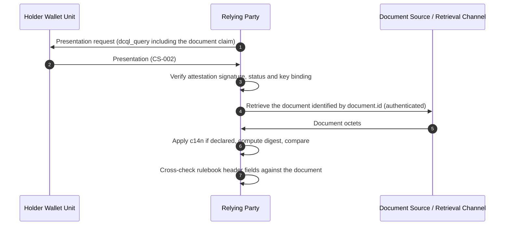

# WE BUILD - Pre-flight Conformance Specification CS-020: Document References, Linked Attestations and Evidence in (Q)EAAs

Version 0.1 / Pre-flight
Date: 26 October 2026

**Revision history**

* Version 0.1 (26 October 2026): First draft, in response to SC5 issue #5 [1].

**Authors / Contributors**: WP4 Architecture

* Niels Klomp, Sphereon

Table Of Contents

- [1. Introduction](#1-introduction)
- [2. Scope](#2-scope)
- [3. Normative Language](#3-normative-language)
- [4. Roles and Components](#4-roles-and-components)
- [5. Protocol Overview](#5-protocol-overview)
  - [5.1 Three Ways an Attestation Points Outside Itself](#51-three-ways-an-attestation-points-outside-itself)
  - [5.2 What Exists and What This Specification Adds](#52-what-exists-and-what-this-specification-adds)
  - [5.3 Placement per Attestation Format](#53-placement-per-attestation-format)
- [6. High-level Flows](#6-high-level-flows)
  - [6.1 Issuance of a Reference Attestation](#61-issuance-of-a-reference-attestation)
  - [6.2 Presentation and Document Retrieval](#62-presentation-and-document-retrieval)
  - [6.3 Linked Attestations](#63-linked-attestations)
- [7. Normative Requirements](#7-normative-requirements)
  - [7.1 Resource Reference](#71-resource-reference)
  - [7.2 Digest Computation](#72-digest-computation)
  - [7.3 SD-JWT VC Encoding](#73-sd-jwt-vc-encoding)
  - [7.4 W3C VCDM 2.0 Encoding](#74-w3c-vcdm-20-encoding)
  - [7.5 Embedded Proofs](#75-embedded-proofs)
  - [7.6 Linked Attestations](#76-linked-attestations)
  - [7.7 Attestation Provider Requirements](#77-attestation-provider-requirements)
  - [7.8 Wallet Unit Requirements](#78-wallet-unit-requirements)
  - [7.9 Relying Party Requirements](#79-relying-party-requirements)
  - [7.10 Unhappy Paths](#710-unhappy-paths)
- [8. Interface Definitions](#8-interface-definitions)
  - [8.1 Resource Reference Object (SD-JWT VC)](#81-resource-reference-object-sd-jwt-vc)
  - [8.2 Document Reference Attestation (SD-JWT VC)](#82-document-reference-attestation-sd-jwt-vc)
  - [8.3 Evidence with an External Attachment (SD-JWT VC)](#83-evidence-with-an-external-attachment-sd-jwt-vc)
  - [8.4 Document Reference Attestation (W3C VCDM 2.0)](#84-document-reference-attestation-w3c-vcdm-20)
  - [8.5 Presentation Request](#85-presentation-request)
- [9. Open Topics for Testing Feedback](#9-open-topics-for-testing-feedback)
- [10. Conformance](#10-conformance)
- [References](#references)

# 1. Introduction

This document is a **pre-flight conformance specification** as defined in [2]. It defines how a (Q)EAA references data outside the attestation, links to another attestation, or embeds a proof, so that use cases can start testing this before a full conformance specification exists.

A reference is an identifier of the external resource plus a digest of it. The attestation never carries the referenced document itself. The Relying Party retrieves the document through its own channel and checks the digest.

This specification profiles the attributes evidence of ETSI TS 119 472-1 [6] (OpenID Identity Assurance [7] and OpenID Attachments [8] for SD-JWT VC, W3C VCDM 2.0 [9] for JSON-LD credentials). It adds a claim for the document the attestation is about, a structure for linked attestations, and the rule for computing the digest.

# 2. Scope

* **In scope:**
  * A Resource Reference structure: identifier, media type, digest, optional canonicalization and retrieval hint
  * The digest computation rule (which bytes, which canonicalization, which algorithms, which encoding)
  * The placement of the subject document reference, of related resources and of evidence in SD-JWT VC and W3C VCDM 2.0 attestations
  * Embedding small signed proofs by value, and the limits on embedding
  * Linking one attestation to another by digest (EBW Recital 27 [10])
  * A minimal Document Reference Attestation type for use cases that do not define their own
  * Verification by the Relying Party after retrieval

* **Out of scope:**
  * The transport of the document itself. This is (Q)ERDS (CS-015 [11], CS-016 [12]), Peppol, an eFTI platform, or another channel chosen by the use case.
  * Issuance and presentation protocols, covered by CS-001 [13] and CS-002 [14]
  * Semantic models of business documents (EN 16931, eCMR D24A). Rulebooks define which document fields they copy into the attestation.
  * ISO mdoc and X.509-AC encodings (see §5.3 and §9)
  * W3C VCDM 1.1 [15], which ETSI TS 119 472-1 does not profile

# 3. Normative Language

The keywords **MUST**, **MUST NOT**, **REQUIRED**, **SHALL**, **SHALL NOT**, **SHOULD**, **SHOULD NOT**, **RECOMMENDED**, **MAY**, and **OPTIONAL** are to be interpreted as described in [RFC 2119](https://datatracker.ietf.org/doc/html/rfc2119).

> **Note:** As a pre-flight specification, the normative requirements herein are preliminary and subject to revision based on testing feedback.

# 4. Roles and Components

| Role | Description |
|------|-------------|
| **Attestation Provider** | Issues the attestation. In SC5 Scenario 4 this is the Supplier's Business Wallet acting as issuer. For a QEAA it is a QTSP. |
| **Holder Wallet Unit** | Stores the attestation and presents it. It does not need to dereference anything in the attestation. |
| **Relying Party (RP)** | Verifies the attestation, retrieves the referenced document through an authenticated channel and checks the digest. |
| **Document Source** | The system where the document stays authoritative: an ERP, a Peppol access point, an eFTI platform, a QERDS provider. |
| **Retrieval Channel** | The channel through which the RP obtains the document: (Q)ERDS, Peppol, the eFTI unique identifying link, or an authenticated HTTPS endpoint. |

# 5. Protocol Overview

## 5.1 Three Ways an Attestation Points Outside Itself

The three cases have different meaning, so this specification keeps them in different places.

1. **Subject document reference.** The attestation is about a document and carries its identifier and digest, never its content. This is the Recital 27 reference attestation and the ADR-11 pattern. Example: the eInvoice attestation and the invoice it refers to.
2. **Related resource.** The attestation points to something else it depends on: another attestation (linked attestation), the original invoice that a credit note corrects, or a QERDS evidence record. The digest freezes what was pointed to at issuance.
3. **Evidence.** Material the Attestation Provider relied on before it issued, in the sense of ETSI TS 119 472-1 clause 4.2.10: "evidence ... that the EAA issuer used for completing the issuance of the EAA". Example: the purchase order a supplier checked before it issued the invoice attestation.

A digest proves that the bytes the RP retrieves are the bytes the Attestation Provider saw. A changed document no longer matches; a correction is a new document with a new attestation (AP-03).

## 5.2 What Exists and What This Specification Adds

| Item | Source | This specification |
|------|--------|--------------------|
| Evidence semantics | ETSI TS 119 472-1 clause 4.2.10 [6] | Used as is |
| Evidence in SD-JWT VC | ETSI TS 119 472-1 clause 5.2.9, OpenID Identity Assurance schema [7] | Profiled (§7.3) |
| Evidence in VCDM 2.0 | ETSI TS 119 472-1 clause 7.2.10, VCDM 2.0 §5.6 [9] | Profiled (§7.4) |
| Attachments by value or by URL plus digest | OpenID Attachments 1.0 [8] | Digest object reused; access tokens forbidden (REF-07) |
| Digest on a referenced object | VCDM 2.0 §5.3 [9] | Used as is for VCDM 2.0 |
| Subject document reference in SD-JWT VC | None | Defined: `document` claim (§7.3) |
| Linked attestations | EBW Recital 27 [10], no format | Defined (§7.6) |
| Which bytes to hash | None | Defined (§7.2) |

## 5.3 Placement per Attestation Format

| Case | SD-JWT VC | W3C VCDM 2.0 | ISO mdoc | X.509-AC |
|------|-----------|--------------|----------|----------|
| Subject document reference | `document` claim (§8.1) | `credentialSubject.document` object with `id`, `type`, `mediaType`, `digestSRI` | Not defined here (§9) | Not defined here |
| Related resource, linked attestation | `related_resources` claim | `relatedResource` property | Not defined here (§9) | Not defined here |
| Evidence | `evidence` claim, OpenID IDA structure | `evidence` property | Excluded by ETSI TS 119 472-1 EAA-6.2.9-01 | Excluded by EAA-8.2.9-01 |

# 6. High-level Flows

## 6.1 Issuance of a Reference Attestation

Participating actors: Document Source, Attestation Provider, Holder Wallet Unit.

1. The Document Source finalises the document, for example an EN 16931 invoice in UBL syntax.
2. The Attestation Provider computes the digest over the document as defined in §7.2.
3. The Attestation Provider issues the attestation using CS-001 [13]. The attestation carries the Resource Reference in the `document` claim, the header fields its rulebook requires, and optionally related resources and evidence.
4. The document itself is sent to the recipient through the Retrieval Channel, or is left at the Document Source for retrieval on demand.

**Outcome**: the Wallet Unit holds an attestation that commits to the exact document without containing it.

## 6.2 Presentation and Document Retrieval

Participating actors: Holder Wallet Unit, Relying Party, Document Source.

This is the two-layer model of the ADR-11 analysis [3]: the attestation can be verified offline, and the document is retrieved online when needed.



1. The RP requests the attestation with CS-002 [14] and includes the `document` claim in the query.
2. The RP verifies the attestation as defined in CS-002 and CS-018.
3. The RP obtains the document through the Retrieval Channel and authenticates to it. The attestation contains no credentials for this (REF-07).
4. The RP computes the digest as defined in §7.2 and compares it with the attested value.
5. The RP cross-checks the header fields defined by the rulebook, such as invoice number, seller and buyer identifiers, against the document (for SC5, IR-EI-06 [5]).

**Outcome**: the RP knows the document is the one the Attestation Provider attested, and that its issuer is who the attestation says.

## 6.3 Linked Attestations

Participating actors: Attestation Provider A, Attestation Provider B, Holder Wallet Unit, Relying Party.

1. Attestation Provider A issues attestation A.
2. Attestation Provider B issues attestation B. B includes in `related_resources` a Resource Reference whose digest is computed over attestation A as defined in LNK-01.
3. The Wallet Unit presents A and B together, or the RP already holds A.
4. The RP verifies A and B separately, including their status, then recomputes the digest of A and compares it with the value in B.

**Outcome**: the RP can verify each attestation and the link between them. B's link to A says nothing about A's current status, so the RP checks both (LNK-04).

# 7. Normative Requirements

## 7.1 Resource Reference

A Resource Reference is the structure used for the subject document reference and for related resources. §8.1 gives the SD-JWT VC encoding; §7.4 gives the VCDM 2.0 mapping.

| ID | Requirement | Reference |
|----|-------------|-----------|
| REF-01 | A Resource Reference MUST contain an identifier of the resource as a URI. The identifier MAY be an HTTPS URL, an eFTI unique identifying link, a Peppol or QERDS message identifier expressed as a URN, or a `data:` URL for an embedded proof (§7.5). | [9] §4.4, §5.3 |
| REF-02 | A Resource Reference MUST contain a digest of the resource computed as defined in §7.2, except where the resource is embedded by value (EMB-03). | [8] §4.2, [9] §5.3 |
| REF-03 | A Resource Reference MUST contain the IANA media type of the octets over which the digest was computed. | [9] §5.3 |
| REF-04 | A Resource Reference MUST state the canonicalization method where one was applied (DIG-03), and MUST NOT state one otherwise. | This specification |
| REF-05 | A Resource Reference SHOULD contain a type of the resource taken from the code list of the rulebook, for example `invoice`, `credit_note`, `ecmr`, `purchase_order`, `attestation`, `qerds_evidence`. | [8] §4.2 `type` |
| REF-06 | A Resource Reference MAY contain a retrieval hint naming the Retrieval Channel (`qerds`, `peppol`, `efti`, `https`). The hint is informative. The RP decides which channels it trusts. | This specification |
| REF-07 | A Resource Reference MUST NOT contain an access token, password, pre-signed URL or any other secret that grants access to the resource. | See note |
| REF-08 | A Resource Reference MUST NOT contain the payload of a business document, either directly or in a `data:` URL. | [3], [4] |
| REF-09 | A Resource Reference MAY describe the resource with its issuer, its document number (for example an invoice number) and its date of issuance. In the subject document reference the issuer is REQUIRED. | [7] §5.4.4.2 `document_details` |
| REF-10 | The issuer MUST be a party object with `name`, `identifier` and `country`, where `identifier` is the WE BUILD legal-entity identifier object: one member per identifier scheme (`euid`, `lei`, `tax`, `gln`, `duns`, `eori`, `bpnl`, `siren`), of which `euid` is REQUIRED. For an issuer without an EUID, `euid` carries the identifier constructed as defined for the EBWOID `id`. | [21] §2, [22] |

> **Note on REF-07.** OpenID Attachments [8] allows an `access_token` next to the URL, because an ID Token or UserInfo response goes to one RP and is short-lived. An attestation is presented to many RPs over a long period, so any token inside it is a bearer secret handed to all of them. Access to the document is controlled by the Retrieval Channel, which authenticates the RP. This also replaces the SC5 rule that evidence URIs "MUST be publicly accessible" [5], which ADR-11 does not allow for commercially sensitive documents.

## 7.2 Digest Computation

| ID | Requirement | Reference |
|----|-------------|-----------|
| DIG-01 | The digest MUST be computed over the octets of the resource as the Document Source delivers it, not over a transfer encoding such as an HTTP content coding, an AS4 compression or a MIME envelope. | [8] §4.2 `digest` |
| DIG-02 | Where the octets reach the RP unchanged, no canonicalization MUST be applied. This is the default and the RECOMMENDED case. It covers PDF and PDF/A-3 documents (including hybrid invoices such as Factur-X or ZUGFeRD), and XML documents that are transported as an opaque payload. | This specification |
| DIG-03 | Where an XML document is re-serialised on its way to the RP, for example when an access point extracts it from a Standard Business Document envelope, the Attestation Provider MUST compute the digest over the Exclusive XML Canonicalization (without comments) of the document element and its descendants, and MUST identify the method as `http://www.w3.org/2001/10/xml-exc-c14n#`. | [16] |
| DIG-04 | For JSON documents that may be re-serialised, the Attestation Provider MUST compute the digest over the JSON Canonicalization Scheme output, and MUST identify the method as `https://www.rfc-editor.org/rfc/rfc8785`. | [17] |
| DIG-05 | The Attestation Provider MUST use SHA-256. | [8] §7 |
| DIG-06 | The Relying Party MUST support SHA-256. | This specification |
| DIG-07 | The digest MUST be calculated over the whole document. A digest over a subset of fields is not a document reference. Rulebooks that need some fields visible copy those fields into the attestation as claims (for SC5: `invoiceNumber`, `amountDueForPayment`). | [3] |
| DIG-08 | Where the referenced document carries its own signature or seal (XAdES, PAdES, JAdES), the digest MUST be computed over the signed document as delivered, signature included. | This specification |

> **Note.** DIG-02 makes the hash a property of the file, not of its meaning. Two semantically equal invoices with different whitespace have different digests. That is correct for a reference to a specific document; detecting semantic duplicates is the rulebook's job (IR-EI-04).

## 7.3 SD-JWT VC Encoding

| ID | Requirement | Reference |
|----|-------------|-----------|
| SDJ-01 | The subject document reference MUST be carried in the `document` claim, whose value is one Resource Reference object as defined in §8.1. | This specification |
| SDJ-02 | Related resources MUST be carried in the `related_resources` claim, whose value is a JSON array of one or more Resource Reference objects. | This specification |
| SDJ-03 | The `digest` member of a Resource Reference MUST be a JSON object with the members `alg` and `value` as defined for external attachments in OpenID Attachments 1.0. `alg` MUST be `sha-256`, the name of SHA-256 in the IANA Named Information Hash Algorithm Registry. `value` MUST be the base64 encoding (RFC 4648 §4) of the digest octets. | [8] §4.2, [18] |
| SDJ-04 | The `document` claim, and the members of each object in it, SHOULD NOT be selectively disclosable when the reference is the purpose of the attestation. Where a rulebook makes `related_resources` entries selectively disclosable, each entry MUST be disclosable as a whole. | [19] |
| SDJ-05 | Evidence MUST be carried in the `evidence` claim. Its value MUST be a JSON array of evidence elements as defined in the OpenID Identity Assurance Schema Definition 1.0 §5.4. | [6] EAA-5.2.9-01, [7] |
| SDJ-06 | Each evidence element MUST include `type`, and MUST identify the entity that checked the evidence in `check_details[].organization`, unless that entity is the Attestation Provider. | [6] EAA-4.2.10-04, [7] |
| SDJ-07 | Evidence elements MAY contain `attachments`. An external attachment MUST follow OpenID Attachments 1.0 §4.2 with the restrictions of REF-07 (no `access_token`). An embedded attachment MUST meet §7.5. | [8] |
| SDJ-08 | The SD-JWT VC Type Metadata of an attestation type that uses `document`, `related_resources` or `evidence` SHOULD describe these claims. | [19] |

> **Note on SDJ-05.** The Identity Assurance schema places `evidence` inside `verified_claims.verification`. ETSI TS 119 472-1 EAA-5.2.9-01 refers to "the evidence claim" without saying where it sits. This specification uses a top-level `evidence` claim (see §9).

## 7.4 W3C VCDM 2.0 Encoding

| ID | Requirement | Reference |
|----|-------------|-----------|
| VCD-01 | The subject document reference MUST be an object in `credentialSubject` with `id` (REF-01), `type`, `mediaType` and `digestSRI` or `digestMultibase`. The REF-09 members are `documentIssuer` (party object per REF-10), `documentNumber` and `dateOfIssuance`; `documentIssuer` is used because `issuer` is a reserved VCDM term for the credential issuer. These property names, `document` and the document types MUST be defined in the `@context` of the rulebook. | [9] §5.3 |
| VCD-02 | Related resources MUST be carried in `relatedResource`. Each object MUST have `id`, MUST have `digestSRI` or `digestMultibase`, and SHOULD have `mediaType`. | [9] §5.3 |
| VCD-03 | Attestation Providers MUST use `digestSRI` with the `sha256` hash algorithm (DIG-05). | [9] §5.3 |
| VCD-04 | A canonicalization method (REF-04) MUST be expressed with a property defined in the rulebook `@context`. | This specification |
| VCD-05 | Evidence MUST be carried in the `evidence` property. Each evidence object MUST have `type`, and MAY have `id`. Where an evidence object refers to an external file by `id`, it SHOULD carry `digestSRI` or `digestMultibase`. | [6] EAA-7.2.10-01 to -05, [9] §5.6, §5.3 |
| VCD-06 | Objects for which selective disclosure is wanted SHOULD NOT be placed in `relatedResource`. | [9] §5.3 |

## 7.5 Embedded Proofs

An embedded proof is a small signed object carried by value: an attestation, a QERDS evidence record, a detached signature, a time-stamp token. The test is that the RP can verify it on its own.

| ID | Requirement | Reference |
|----|-------------|-----------|
| EMB-01 | Only objects that carry their own signature, seal or time-stamp MAY be embedded: an attestation, a (Q)ERDS evidence record as defined in CS-016 §7.3 [12], a JAdES, XAdES or CAdES signature, or an RFC 3161 time-stamp token. | [3], [4], [12] |
| EMB-02 | A business document, or any part of its payload, MUST NOT be embedded. | [3], [4] |
| EMB-03 | In SD-JWT VC, an embedded proof MUST be carried either as an embedded attachment in an evidence element, as defined in OpenID Attachments 1.0 §4.1 (`content_type`, `content`), or as a `related_resources` entry with `media_type` and `content` (§8.1). A digest MAY be omitted because the Attestation Provider's signature covers the content. | [8] §4.1 |
| EMB-04 | In VCDM 2.0, an embedded proof MUST be expressed as an object whose `id` is a `data:` URL carrying the proof, in the way VCDM 2.0 defines for `EnvelopedVerifiableCredential`. | [9] §4.13, [20] |
| EMB-05 | The RP MUST verify an embedded proof as if it had been received on its own, including trust anchor and status. Inclusion in a valid attestation does not make an embedded proof valid. | This specification |

## 7.6 Linked Attestations

| ID | Requirement | Reference |
|----|-------------|-----------|
| LNK-01 | The digest of a linked SD-JWT VC MUST be computed over the US-ASCII octets of its Issuer-signed JWT (header, payload and signature in compact serialisation), without Disclosures and without Key Binding JWT. The digest is then the same for every presentation of that attestation. | [19] |
| LNK-02 | The digest of a linked VCDM 2.0 credential secured with JOSE MUST be computed over the compact JWS. For credentials secured with Data Integrity, the digest MUST be computed over the serialised credential as issued, and the rulebook MUST say which serialisation applies. | [9], [20] |
| LNK-03 | The Resource Reference of a linked attestation MUST have type `attestation`, and its media type MUST be the media type of the linked attestation (`application/dc+sd-jwt` or `application/vc+jwt`). Where the linked attestation has a `jti` (SD-JWT VC) or `id` (VCDM), the Resource Reference identifier MUST be that value. | [6] EAA-5.2.3-01, [19] |
| LNK-04 | The RP MUST check the validity and status of each linked attestation separately. A link records what was linked at issuance; it does not carry status. | [4] |

## 7.7 Attestation Provider Requirements

| ID | Requirement | Reference |
|----|-------------|-----------|
| AP-01 | The Attestation Provider MUST compute the digest from the document it received from the Document Source, not from a copy it rebuilt from its own data. | This specification |
| AP-02 | The Attestation Provider MUST use evidence (§7.3, §7.4) only for material it relied on before issuing. The document the attestation is about MUST be in `document`, not in `evidence`. | [6] EAA-4.2.10-01 |
| AP-03 | Where a business document is corrected or credited, the Attestation Provider MUST issue a new attestation for the new document, and SHOULD include the original document or attestation in `related_resources`. It MUST NOT express the business state of the document through the attestation status list. | [4] |
| AP-04 | The Attestation Provider MUST revoke an attestation through its status mechanism only for attestation-level reasons, such as a wrong digest, a key compromise or an attestation issued in error. | [4], CS-010 |

## 7.8 Wallet Unit Requirements

| ID | Requirement | Reference |
|----|-------------|-----------|
| WU-REF-01 | The Wallet Unit MUST NOT be required to dereference a Resource Reference to store or present the attestation. | This specification |
| WU-REF-02 | The Wallet Unit SHOULD show the User the document type and the description (`desc`) of the subject document before presentation. | This specification |
| WU-REF-03 | The Wallet Unit MUST present the `document`, `related_resources` and `evidence` claims unchanged when requested. | CS-002 |

## 7.9 Relying Party Requirements

| ID | Requirement | Reference |
|----|-------------|-----------|
| RP-REF-01 | The RP MUST verify the attestation (signature, status, key binding, issuer trust) before it acts on any Resource Reference in it. | CS-002, CS-018 |
| RP-REF-02 | The RP MUST retrieve a referenced resource only through a Retrieval Channel it has configured, and MUST NOT fetch an arbitrary URL taken from an attestation. | This specification |
| RP-REF-03 | The RP MUST apply the canonicalization stated in the Resource Reference, if any, compute the digest with the stated algorithm, and compare it with the attested value. | [8] §4.3, [9] §5.3 |
| RP-REF-04 | The RP MUST check that the media type of the retrieved resource equals the stated media type. | [9] §5.3 |
| RP-REF-05 | The RP MUST NOT rely on a resource whose digest does not match. | [8] §4.3, [9] §5.3 |
| RP-REF-06 | The RP MUST apply the cross-checks between attestation claims and document content that the rulebook defines. | [5] IR-EI-06 |

## 7.10 Unhappy Paths

| ID | Condition | Relying Party | Reference |
|----|-----------|---------------|-----------|
| UP-REF-01 | Digest mismatch after retrieval | Reject the document. Do not rely on the attestation for it. | RP-REF-05 |
| UP-REF-02 | Unsupported digest algorithm or canonicalization identifier | Reject the attestation for this purpose. | DIG-05, DIG-06 |
| UP-REF-03 | Resource cannot be retrieved | Attestation remains verified. The document is not. Apply rulebook policy (for SC5: quarantine). | §6.2 |
| UP-REF-04 | Retrieved media type differs from the stated one | Reject the document. | RP-REF-04 |
| UP-REF-05 | Resource Reference contains an access token or other secret | Reject the attestation. | REF-07 |
| UP-REF-06 | Embedded proof fails its own verification | Ignore the embedded proof and apply rulebook policy. | EMB-05 |
| UP-REF-07 | Linked attestation is revoked, suspended or expired | Treat the link as broken. Apply rulebook policy. | LNK-04 |

# 8. Interface Definitions

## 8.1 Resource Reference Object (SD-JWT VC)

| Member | Status | Description | Source |
|--------|--------|-------------|--------|
| `id` | REQUIRED | URI of the resource (REF-01) | VCDM 2.0 `relatedResource.id` [9] |
| `media_type` | REQUIRED | IANA media type of the hashed octets | VCDM 2.0 `mediaType` [9] |
| `digest` | REQUIRED unless `content` is present | Object with `alg` and `value` (SDJ-03) | OpenID Attachments 1.0 [8] |
| `c14n` | OPTIONAL | Canonicalization method identifier (DIG-03, DIG-04) | This specification |
| `type` | RECOMMENDED | Resource type from the rulebook code list | OpenID Attachments 1.0 [8] |
| `issuer` | REQUIRED in `document`, otherwise OPTIONAL | Party that issued the resource: object with `name`, `identifier` (scheme-keyed, `euid` REQUIRED) and `country` (ISO 3166-1 alpha-2) (REF-10). This is the issuer of the document, which can differ from the attestation `iss`. | WE BUILD eInvoice rulebook `seller` [21], IDA `document_details.issuer` [7] |
| `document_number` | OPTIONAL | Business number of the resource, such as an invoice number (REF-09) | IDA `document_details.document_number` [7] |
| `date_of_issuance` | OPTIONAL | Issue date of the resource (RFC 3339 full-date) (REF-09) | IDA `document_details.date_of_issuance` [7] |
| `desc` | OPTIONAL | Human-readable description | OpenID Attachments 1.0 [8] |
| `retrieval` | OPTIONAL | Retrieval Channel hint (REF-06) | This specification |
| `content` | OPTIONAL | Base64 content of an embedded proof (§7.5 only) | OpenID Attachments 1.0 [8] |

## 8.2 Document Reference Attestation (SD-JWT VC)

For use cases that have no attestation type of their own, this specification defines a minimal type `eu.we-build:document-reference:1`. Use-case types, such as `eu.we-build:einvoice:1` [21], SHOULD reuse the `document` claim instead of defining their own hash claim.

| Claim | Status | Description |
|-------|--------|-------------|
| `document` | REQUIRED | Resource Reference of the subject document (§8.1), including `issuer` |
| `related_resources` | OPTIONAL | Array of Resource References (§7.3) |
| `evidence` | OPTIONAL | Evidence elements (§7.3) |

Example Issuer-signed payload (illustrative only; the `urn:peppol:msg:` identifier scheme is a placeholder):

```json
{
  "vct": "eu.we-build:document-reference:1",
  "iss": "https://wallet.greenflowers.example/issuer",
  "iat": 1792972800,
  "exp": 1824508800,
  "jti": "urn:uuid:5f0c1a7e-3c8b-4e8e-9d0e-2b6f5c9a1d44",
  "cnf": { "jwk": { "kty": "EC", "crv": "P-256", "x": "...", "y": "..." } },
  "status": { "status_list": { "idx": 412, "uri": "https://status.greenflowers.example/lists/1" } },
  "document": {
    "id": "urn:peppol:msg:3f0d2a9c-6a1e-4f07-a1b9-0c58e7d4e211",
    "type": "invoice",
    "issuer": {
      "name": "Green Flowers B.V.",
      "identifier": { "euid": "NLNHR.12345678", "lei": "724500VKKSH9QOLTFR81" },
      "country": "NL"
    },
    "document_number": "INV-2026-000123",
    "date_of_issuance": "2026-10-26",
    "media_type": "application/xml",
    "c14n": "http://www.w3.org/2001/10/xml-exc-c14n#",
    "digest": {
      "alg": "sha-256",
      "value": "Utbj3k+g3MKZRmlfk5QMPn8m8w4eOfSxpJrZiDkRJ4Y="
    },
    "desc": "Invoice INV-2026-000123 (EN 16931, UBL 2.1)",
    "retrieval": "peppol"
  }
}
```

A credit note for this invoice would carry its own `document` and point back to the invoice:

```json
{
  "related_resources": [
    {
      "id": "urn:peppol:msg:3f0d2a9c-6a1e-4f07-a1b9-0c58e7d4e211",
      "type": "invoice",
      "issuer": {
        "name": "Green Flowers B.V.",
        "identifier": { "euid": "NLNHR.12345678" },
        "country": "NL"
      },
      "document_number": "INV-2026-000123",
      "date_of_issuance": "2026-10-26",
      "media_type": "application/xml",
      "c14n": "http://www.w3.org/2001/10/xml-exc-c14n#",
      "digest": { "alg": "sha-256", "value": "Utbj3k+g3MKZRmlfk5QMPn8m8w4eOfSxpJrZiDkRJ4Y=" }
    }
  ]
}
```

## 8.3 Evidence with an External Attachment (SD-JWT VC)

The supplier checked a purchase order before issuing. The purchase order is evidence (AP-02), and the RP retrieves it from the buyer's own procurement system (illustrative only):

```json
{
  "evidence": [
    {
      "type": "electronic_record",
      "check_details": [
        { "check_method": "data", "organization": "NL853746281B01", "time": "2026-10-20T09:12Z" }
      ],
      "record": {
        "type": "purchase_order",
        "created_at": "2026-10-14T15:03:00Z",
        "source": { "name": "Fleur SAS procurement", "country_code": "FRA" }
      },
      "attachments": [
        {
          "desc": "Purchase order PO-77812",
          "url": "https://procurement.fleur.example/po/77812",
          "digest": { "alg": "sha-256", "value": "YZmuzyOrp+h7La+4tJFSYNqF489TVoGXt+RRmCOS+44=" }
        }
      ]
    }
  ]
}
```

The attachment has no `access_token` (REF-07). The buyer, as RP, authenticates to its own system.

## 8.4 Document Reference Attestation (W3C VCDM 2.0)

Illustrative only. The `https://w3id.org/we-build/document-reference/v1` context is a placeholder for the rulebook context (VCD-01, VCD-04).

```json
{
  "@context": [
    "https://www.w3.org/ns/credentials/v2",
    "https://w3id.org/we-build/document-reference/v1"
  ],
  "id": "urn:uuid:5f0c1a7e-3c8b-4e8e-9d0e-2b6f5c9a1d44",
  "type": ["VerifiableCredential", "DocumentReferenceCredential"],
  "issuer": "https://wallet.greenflowers.example/issuer",
  "validFrom": "2026-10-26T00:00:00Z",
  "credentialSubject": {
    "id": "urn:euid:NL.KVK.12345678",
    "document": {
      "id": "urn:peppol:msg:3f0d2a9c-6a1e-4f07-a1b9-0c58e7d4e211",
      "type": "Invoice",
      "documentIssuer": {
        "name": "Green Flowers B.V.",
        "identifier": { "euid": "NLNHR.12345678" },
        "country": "NL"
      },
      "documentNumber": "INV-2026-000123",
      "dateOfIssuance": "2026-10-26",
      "mediaType": "application/xml",
      "canonicalization": "http://www.w3.org/2001/10/xml-exc-c14n#",
      "digestSRI": "sha256-Utbj3k+g3MKZRmlfk5QMPn8m8w4eOfSxpJrZiDkRJ4Y="
    }
  },
  "relatedResource": [
    {
      "id": "urn:uuid:0a6d93a2-1f4b-4c7e-8a55-7d2c9b1e6f30",
      "mediaType": "application/vc+jwt",
      "digestSRI": "sha256-90WhUVPE2s8OpLv1cmXnMoOUH4M1k5szxpOXUxXPWRY="
    }
  ],
  "evidence": [
    {
      "id": "https://procurement.fleur.example/po/77812",
      "type": ["PurchaseOrderEvidence"],
      "mediaType": "application/xml",
      "digestSRI": "sha256-YZmuzyOrp+h7La+4tJFSYNqF489TVoGXt+RRmCOS+44="
    }
  ]
}
```

## 8.5 Presentation Request

A Relying Party that will retrieve the document requests the members it needs to retrieve and check it (illustrative only, see CS-002 [14]). Because `document` is not selectively disclosable (SDJ-04), the Wallet Unit returns the whole object; the member paths state what the RP relies on.

```json
{
  "credentials": [
    {
      "id": "invoice_ref",
      "format": "dc+sd-jwt",
      "meta": { "vct_values": ["eu.we-build:document-reference:1"] },
      "claims": [
        { "path": ["document", "id"] },
        { "path": ["document", "media_type"] },
        { "path": ["document", "digest"] },
        { "path": ["document", "issuer", "identifier", "euid"] },
        { "path": ["document", "document_number"] }
      ]
    }
  ]
}
```

# 9. Open Topics for Testing Feedback

In line with the pre-flight process [2], these topics are left open on purpose. Implementers are asked to report on them.

1. **Placement of `evidence` in SD-JWT VC.** ETSI TS 119 472-1 EAA-5.2.9-01 does not say whether `evidence` is top-level or inside `verified_claims.verification`. This specification uses top-level. To be reported to ETSI ESI.
2. **ISO mdoc.** ETSI excludes evidence from mdoc, but the ADR-11 analysis proposes an mdoc-based reference attestation for roadside inspection (SC1.3bis). Report whether a `document` data element in an mdoc namespace is needed, and how its digest should be encoded in CBOR.
3. **eInvoice rulebook alignment.** The eInvoice rulebook v1.1 [21] uses `invoicePayloadHash` and `evidenceHash` in the form `sha256:<hex>`, requires `evidenceUri` to be publicly accessible, and carries `invoiceLifecycleStatus` with `precedingInvoiceReference`. Under this specification these become `document`, `evidence` and `related_resources` with the `digest` object (SDJ-03), retrieval through the Retrieval Channel (REF-07), and a related resource pointing to the preceding invoice (AP-03). SC5 to confirm.

# 10. Conformance

An **Attestation Provider** conforms to this specification if it satisfies §7.1, §7.2, §7.5 and §7.7, and either §7.3 (SD-JWT VC) or §7.4 (VCDM 2.0), plus §7.6 where it issues linked attestations.

A **Wallet Unit** conforms to this specification if it satisfies §7.8.

A **Relying Party** conforms to this specification if it satisfies §7.2 (DIG-06), §7.9, applies §7.10, and processes the interfaces in §8 for the formats it accepts.

ITB+ test cases for this specification are expected to cover at least:

1. **Attestation Provider**: a `document` claim with a correct SHA-256 digest over a UBL invoice (raw octets) and over its Exclusive C14N form; no access token in any Resource Reference; no business document payload embedded.
2. **Relying Party**: acceptance of a matching digest; rejection on a digest mismatch (UP-REF-01), a media type mismatch (UP-REF-04) and an unsupported algorithm (UP-REF-02); a linked attestation whose target is revoked (UP-REF-07).

Conformance testing for this pre-flight specification will be defined as part of the feedback process described in [2]. Implementers are encouraged to report their testing experience, in particular on the topics in §9, to inform the development of a full conformance specification.

# References

| # | Reference |
|---|-----------|
| [1] | WE BUILD SC5 (2026) Issue #5: New CS needed: reference-attestation format (payload canonicalization + hash strategy) per ADR-11. Available at: https://github.com/webuild-consortium/SC5/issues/5 (Accessed: 26 October 2026). |
| [2] | WE BUILD (2026) ADR-21: Pre-flight CS. Available at: https://github.com/webuild-consortium/wp4-architecture/blob/main/adr/pre-flight-CS.md (Accessed: 26 October 2026). |
| [3] | WE BUILD (2026) ADR-11: Separate attestations, documents, and data in EBW, and supporting analysis. Available at: https://github.com/webuild-consortium/wp4-architecture/blob/main/adr/build-document-vs-attestation.md and https://github.com/webuild-consortium/wp4-architecture/blob/main/adr/build-document-vs-attestation-analysis.md (Accessed: 26 October 2026). |
| [4] | WE BUILD (2026) ADR: EAA for verifiable claims (attestations), (Q)ERDS for data transfer (business documents), 11 June 2026. Available at: https://github.com/webuild-consortium/wp4-architecture/blob/main/adr/adr-qeaa-attestations-qerds-documents.md (Accessed: 26 October 2026). |
| [5] | WE BUILD SC5 (2026) eInvoice Attestation Rulebook v0.7. Available at: https://github.com/webuild-consortium/SC5/blob/main/Rulebooks/eInvoiceAttestationRulebook.md (Accessed: 26 October 2026). |
| [6] | ETSI (2026) ETSI TS 119 472-1 V1.2.1: Electronic Signatures and Trust Infrastructures (ESI); Profiles for Electronic Attestation of Attributes; Part 1: General requirements. Clauses 4.2.10, 5.2.3, 5.2.9, 6.2.9, 7.2.10, 8.2.9. Available at: https://www.etsi.org/deliver/etsi_ts/119400_119499/11947201/01.02.01_60/ts_11947201v010201p.pdf (Accessed: 26 October 2026). |
| [7] | OpenID Foundation (2024) OpenID Identity Assurance Schema Definition 1.0, Final, 1 October 2024. Available at: https://openid.net/specs/openid-ida-verified-claims-1_0-final.html (Accessed: 26 October 2026). |
| [8] | OpenID Foundation (2025) OpenID Attachments 1.0, Final, 23 June 2025. Available at: https://openid.net/specs/openid-connect-4-ida-attachments-1_0.html (Accessed: 26 October 2026). |
| [9] | W3C (2025) Verifiable Credentials Data Model v2.0, W3C Recommendation, 15 May 2025. §4.13, §5.3, §5.6. Available at: https://www.w3.org/TR/2025/REC-vc-data-model-2.0-20250515/ (Accessed: 26 October 2026). |
| [10] | European Commission (2025) COM(2025) 838 final: Proposal for a Regulation on the establishment of European Business Wallets, Recital 27. Available at: https://eur-lex.europa.eu/legal-content/EN/TXT/?uri=CELEX:52025PC0838 (Accessed: 26 October 2026). |
| [11] | WE BUILD (2026) Conformance Specification CS-015: QERDS - EBW Interface. Available at: https://github.com/webuild-consortium/wp4-architecture/blob/main/conformance-specs/cs-15-ebw-qtsp-wmp.md (Accessed: 26 October 2026). |
| [12] | WE BUILD (2026) Conformance Specification CS-016: Inter-QTSP Message Relay (QERDS AS4). Available at: https://github.com/webuild-consortium/wp4-architecture/blob/main/conformance-specs/cs-16-qerds-as4.md (Accessed: 26 October 2026). |
| [13] | WE BUILD (2026) Conformance Specification CS-001: Credential Issuance. Available at: https://github.com/webuild-consortium/wp4-architecture/blob/main/conformance-specs/cs-01-credential-issuance.md (Accessed: 26 October 2026). |
| [14] | WE BUILD (2026) Conformance Specification CS-002: Credential Presentation. Available at: https://github.com/webuild-consortium/wp4-architecture/blob/main/conformance-specs/cs-02-credential-presentation.md (Accessed: 26 October 2026). |
| [15] | W3C (2022) Verifiable Credentials Data Model v1.1, W3C Recommendation, 3 March 2022, §5.7 Evidence. Available at: https://www.w3.org/TR/2022/REC-vc-data-model-20220303/ (Accessed: 26 October 2026). |
| [16] | W3C (2002) Exclusive XML Canonicalization Version 1.0, W3C Recommendation, 18 July 2002. Available at: https://www.w3.org/TR/xml-exc-c14n/ (Accessed: 26 October 2026). |
| [17] | IETF (2020) RFC 8785: JSON Canonicalization Scheme (JCS). Available at: https://www.rfc-editor.org/rfc/rfc8785 (Accessed: 26 October 2026). |
| [18] | IANA. Named Information Hash Algorithm Registry. Available at: https://www.iana.org/assignments/named-information/named-information.xhtml (Accessed: 26 October 2026). |
| [19] | IETF (2026) SD-JWT-based Verifiable Digital Credentials (SD-JWT VC), draft-ietf-oauth-sd-jwt-vc-19. Available at: https://www.ietf.org/archive/id/draft-ietf-oauth-sd-jwt-vc-19.html (Accessed: 26 October 2026). |
| [20] | W3C (2025) Securing Verifiable Credentials using JOSE and COSE, W3C Recommendation, 15 May 2025. Available at: https://www.w3.org/TR/vc-jose-cose/ (Accessed: 26 October 2026). |
| [21] | WE BUILD (2026) Attestation Rulebook eInvoice v1.1, §2 (`seller`, `buyer`, `identifier`), and SD-JWT VC schema `eInvoice-sd-jwt.json`. Available at: https://github.com/webuild-consortium/webuild-attestation-rulebooks-catalog/tree/main/rulebooks/rb-eInvoice (Accessed: 26 October 2026). |
| [22] | WE BUILD (2026) Attestation Rulebook EBWOID, §3 (`id`). Available at: https://github.com/webuild-consortium/webuild-attestation-rulebooks-catalog/tree/main/rulebooks/rb-ebwoid (Accessed: 26 October 2026). |
